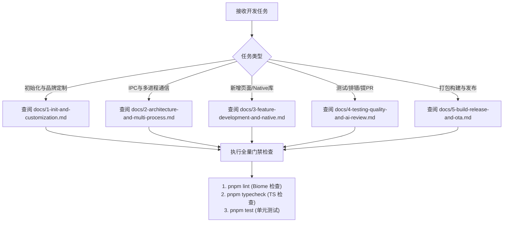

# AI Agent 协同基座与行动守则 (AGENT.md)

> 本文档专供 Cursor, Claude Code, Gemini Antigravity 等 AI 编程助手读取。  
> 编写代码、修改配置或排查问题前，必须遵守本文档定义的**技术栈规范**、**五大红线**与**生命周期指南**。

---

## 1. 架构与技术栈

本项目是一个现代企业级 Electron 桌面应用模板：

- **运行时**: Electron 41 (开启 `contextIsolation: true` 与 `sandbox: true`)
- **UI 框架**: React 19 + TypeScript 5.8
- **构建工具**: Vite 8 + Rolldown
- **代码规范**: Biome (统一代码格式化与代码检查)
- **国际化**: LinguiJS 5 (基于宏提取词条，源码直接写中文)
- **测试框架**: Vitest 3 (单元测试) + Playwright (桌面端 E2E 测试)
- **多包结构**:
  - `packages/main`: 主进程业务核心，负责窗口、原生能力与服务
  - `packages/preload`: 预加载隔离层，通过 `contextBridge` 安全暴露 API
  - `packages/renderer`: 纯前端界面层 (React 19)
  - `packages/shared`: 跨端契约包，包含纯 TypeScript 类型与通道常量
  - `packages/pr-review`: Pull Request 自动化审查工具套件

---

## 2. 编码五大红线 (AI Redlines)

违反以下任何一条规则的代码将被门禁拦截：

1. **禁止在根目录新增业务依赖**：根目录 `package.json` 的 `dependencies` 只能包含 `@app/main`。
2. **禁止使用桶文件聚合导出**：严禁创建 `export * from '...'`。跨包必须引用具名文件。
3. **禁止直接调用原始 IPC 方法**：严禁在渲染端使用非受控的 `ipcRenderer.send`。必须走 `shared` 契约定义。
4. **落盘日志强制全英文**：主进程写入文件的日志必须全部为英文，由系统自动注入 TraceId。
5. **严禁使用 process.cwd() 计算相对路径**：必须使用 `__dirname` 计算相对路径，避免桌面快捷方式启动时工作目录偏移。

---

## 3. 常见任务决策树

---

## 4. 软件工程生命周期文档导航

| 工程阶段 | 阶段文档链接 | 核心解决问题 |
| :--- | :--- | :--- |
| **阶段一** | [项目初始化与品牌定制](docs/1-init-and-customization.md) | 环境安装、应用名/图标一处修改、多环境配置 |
| **阶段二** | [多进程架构与安全通信](docs/2-architecture-and-multi-process.md) | 主进程/渲染进程分工、强类型 IPC、WCO 标题栏 |
| **阶段三** | [业务功能与 Native 原生模块](docs/3-feature-development-and-native.md) | 新增页面 SOP、Lingui 国际化、C++ 原生模块提升打包 |
| **阶段四** | [质量保障、调试与 AI 自动化](docs/4-testing-quality-and-ai-review.md) | 日志排查路径、自动化测试套件、AI 代码审查闭环 |
| **阶段五** | [打包构建、签名与增量热更](docs/5-build-release-and-ota.md) | 跨平台零配置打包、代码签名、OTA 升级流程 |
