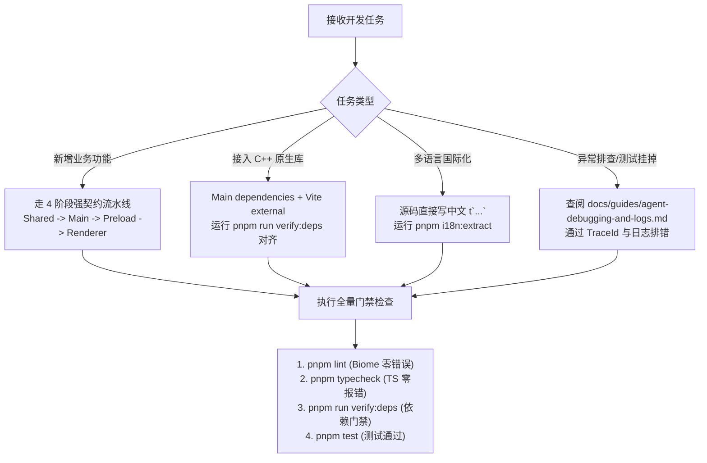

# AI Agent 协同基座与行动守则 (AGENT.md)

> 本文档专供 Cursor, Windsurf, Claude Code, Gemini Antigravity 等 AI 编程智能体在进入本项目时作为核心 System Context 读取。  
> 智能体在执行任何代码分析、修改、重构或调试任务前，必须严格遵守本文档定义的**拓扑架构**、**五大硬性红线**与**决策树流水线**。

---

## 1. 架构拓扑与技术栈快照

本项目是一个专为生产级桌面端应用设计的严苛架构 Monorepo 模板：

- **桌面运行时**: Electron 41 (严格开启 `contextIsolation: true` 与 `sandbox: true`)
- **UI 框架**: React 19 + TypeScript 5.8
- **构建工具链**: Vite 8 + Rolldown (严禁引入 Webpack / Babel / esbuild 作为主构建链)
- **代码规范与格式化**: Biome (无 ESLint / Prettier 冗余层，一键格式化与检查)
- **国际化方案**: LinguiJS 5 (基于 AST 宏提取，中文源码即 Key，秒级热重载)
- **测试框架**: Vitest 3 (单元测试) + Playwright (端到端与黑盒 E2E 测试)
- **工作区包划分**:
  - `packages/main`: 主进程业务核心，涵盖窗口生命周期、安全策略、原生能力、后台服务与 IPC 控制器
  - `packages/preload`: 跨世界安全网关，通过 `contextBridge` 暴露类型安全的 `window.electronApi`
  - `packages/renderer`: 纯 Web 前端层（React 19 MPA 多入口，默认入口为 `home` 与 `updater`）
  - `packages/shared`: 全局跨端契约包，仅包含纯 TypeScript 类型、IPC 频道常量与无 Node/DOM 依赖的通用纯工具函数
  - `packages/pr-review`: 自动化 Pull Request 生命周期与 OpenCodeReview (OCR) 命令行套件

---

## 2. AI 编码五大硬性红线 (AI Redlines)

凡 AI 生成或修改的代码，触碰以下任何一条将被 CI/CD 门禁或 Code Review 直接拒收：

### ❌ 红线 1：禁止私加根目录 dependencies
- 根目录 `package.json` 的 `dependencies` **有且仅允许声明 `@app/main`**！
- 任何业务库、第三方模块严禁写入根目录 `dependencies`。
- 原生 C++ 模块（如 `usb`）必须安装在 `packages/main` 的 `dependencies` 中，并同步配置 `packages/main/vite.config.ts` 的 `rolldownOptions.external`。

### ❌ 红线 2：禁止使用 Barrel 聚合导出（桶文件）
- **严禁**在 `packages/shared/src/index.ts` 或其他业务目录创建聚合 `export * from '...'`。
- 所有跨包引用必须指向具名文件，例如：
  - 正确：`import { IPC_CHANNELS } from '@app/shared/constants/ipc-channels';`
  - 错误：`import { IPC_CHANNELS } from '@app/shared';`
- 目的：杜绝循环引用、保障构建期 Tree-Shaking 极致剪裁、避免 Node 与 DOM 环境类型污染。

### ❌ 红线 3：禁止裸写非安全 IPC 通信
- 严禁在渲染端使用非受控的原始 `ipcRenderer.send` / `ipcRenderer.on`。
- IPC 通信必须遵循严格的 4 阶段流水线：
  1. `shared`: 定义类型契约与 `IPC_CHANNELS`；
  2. `main`: Controller 负责入参 Zod 校验，调用 Service 业务处理，统一返回 `Result<T>`；
  3. `preload`: `contextBridge.exposeInMainWorld` 桥接方法；
  4. `renderer`: UI 层调用强类型 `window.electronApi.*`。

### ❌ 红线 4：落盘日志强制纯英文
- 写入物理磁盘的日志（包括 `mainLogger`、`windowLogger`、`traceLogger`）**必须使用全英文**。
- 日志格式由框架自动注入 `[trace_id:... span_id:...]`，禁止手动拼接或包含非 ASCII 字符。

### ❌ 红线 5：Git 协作与发版权限收敛
- AI 在创建或提交 PR 时，**严禁自行猜测 `gh pr` 或使用原生命令**。
- 必须严格遵循 `packages/pr-review` 工具链（`pnpm pr-review create`）。
- 严禁擅自执行 PR 合并（`merge`）或触发线上发版流水线。

---

## 3. 常见开发任务 AI 决策树

---

## 4. 关键文件与指南快速导航

| 领域 / 诉求 | 权威参考文件 |
| :--- | :--- |
| **日志排错与 Trace 分析** | [`docs/guides/agent-debugging-and-logs.md`](file:///docs/guides/agent-debugging-and-logs.md) |
| **原生 C++ 模块接入与打包** | [`docs/guides/native-modules.md`](file:///docs/guides/native-modules.md) |
| **新增功能 SOP 流水线** | [`docs/guides/new-feature-sop.md`](file:///docs/guides/new-feature-sop.md) |
| **多窗口与 MPA 架构** | [`docs/guides/multi-window.md`](file:///docs/guides/multi-window.md) |
| **依赖与打包规范** | [`docs/dependency-rules.md`](file:///docs/dependency-rules.md) |
| **PR 审查工作流** | [`packages/pr-review/README.md`](file:///packages/pr-review/README.md) |
| **完整架构内幕** | [`docs/architecture-overview.md`](file:///docs/architecture-overview.md) |
