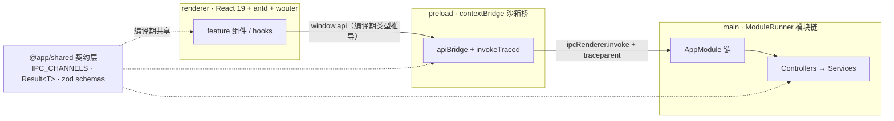

<div align="center">


# Electron React Monorepo Template

面向企业级生产环境与 AI Agent 协同打造的 Electron 桌面端工程底座  
An enterprise-grade Electron desktop template — contract-first, gate-enforced, AI-agent ready

<p>
<a href="https://github.com/BanShan-Alec/electron-react-monorepo-template/actions/workflows/ci.yml"></a>
<a href="LICENSE"></a>
<a href="https://nodejs.org"></a>
<a href="CONTRIBUTING.md"></a>
</p>

<p>
<a href="docs/1-init-and-customization.md">文档</a> ·
<a href="#-特性">特性</a> ·
<a href="#-快速开始">快速开始</a> ·
<a href="CONTRIBUTING.md">贡献指南</a> ·
<a href="AGENT.md">AGENT.md</a>
</p>

<p>


</p>

</div>

---

## ✨ 为什么选本模板？

Clone 下来，你就拥有了一套经过发版验证的 Electron 桌面应用全套解法与规范——不是从零拼装的脚手架演示：

- **完整技术栈开箱即用** —— Electron 41 + React 19 + Vite 8 + TypeScript 6 + antd + Tailwind + Lingui 全部就位，[`pnpm install && pnpm start`](#-快速开始) 直接跑起来，工具链拼装的活儿已经替你做完
- **企业级坑位有现成解法** —— 自动更新、系统托盘、单实例锁、窗口状态保持、分布式追踪、崩溃上报、主题切换、多语言……桌面应用必踩的坑，这里都有经过发版验证的实现，抄作业即可
- **工程规范成文可循** —— 提交规范、组件模板、目录约定、依赖边界全部固化到 husky 与 CI：人类贡献者与 AI Agent 在同一套规则里协作，不会各写各的
- **质量门禁默认开启** —— 类型检查、单元测试、E2E、打包冒烟、asar 体积监控，CI 全绿才放行：劣化进不了主干，reviewer 的眼力不是最后一道防线

## ✨ 特性

### 🏗️ 工程化基座

- **Monorepo 工程治理**：[pnpm workspaces](pnpm-workspace.yaml)——多包物理隔离、依赖版本统一管理，根目录干净、跨包不漂移
- **依赖边界管控**：[`verify-deps` 脚本](scripts/verify-deps.ts#L23-L26) + CI——根目录只允许依赖主进程包，无关代码进不了安装包
- **配置继承体系**：[`@app/tsconfig` 继承包](packages/tsconfig/base.json)——编译配置一处定义、各处继承，新包接入零复制
- **环境变量管理**：[根目录 `.env` 单一事实源](.env.example)——子包不各配各的，`.env.example` 提供完整配置模板；运行时随启动参数注入渲染进程，前端从统一接口读取，改配置不动代码
- **格式化与检查**：[Biome](.config/biome.json)（Rust 编写的单一工具）——格式、检查、import 排序一个工具全包，不用 ESLint + Prettier 两套规则打架
- **提交信息规范**：[commitlint](.config/commitlint.config.ts#L9-L19)——Conventional Commits + 强制中文描述，人和 AI 提交的历史长一个样

### 🔗 类型安全的跨进程契约

- **进程间通信契约**：[`@app/shared` 契约层](packages/shared/src/constants/ipc-channels.ts)——通道与返回结构一处定义，渲染层调用有完整类型提示，不用手拼字符串
- **统一的返回结构**：[`Result<T>`](packages/shared/src/types/result.ts#L5-L7)——成功与失败都是类型的一部分，错误处理不用到处 try/catch
- **参数校验**：[zod schema](packages/shared/src/schemas/counter.ts)——传入数据先过 schema 再进业务逻辑，脏数据挡在边界外
- **崩溃兜底**：统一异常处理——单个接口出错不拖垮整个应用，异常落盘可查
- **安全的渲染层直调**：[contextBridge 显式暴露](packages/preload/src/index.ts#L45)——渲染进程够得着的 API 是列明的，不是整个 ipcRenderer

### ⚡ 开发体验

- **开发即生产**：一条 `pnpm start` 同时拉起 [Vite 开发服务与 Electron](scripts/dev.ts#L142-L174)——渲染进程热更新，主进程改动自动重启
- **端口冲突自治**：[端口预检](scripts/port-guard.ts#L30-L91)——启动前自动探测端口占用，被占用了提示并协助处理
- **远程调试开箱即用**：[CDP 调试端口](scripts/dev.ts#L39)——开发模式自动开放 DevTools 协议端口，断点和性能面板直接连
- **退出无残留**：[进程树清理](scripts/dev.ts#L84-L92)——关闭开发终端会连带清理 Electron 进程，不留躲在托盘里的僵尸实例

### 🧩 架构组织

- **多窗口物理入口**：[MPA 双入口](packages/renderer/vite.config.ts#L73-L77)——更新窗口独立成页，不背主应用的路由和启动壳，轻量快速
- **领域驱动组织**：[`features/` 按功能分目录](packages/renderer/src/features)——组件、Hook、状态放在一起，删功能就是删目录
- **组件编写模板**：[一组件一文件夹 + 固定代码分区](packages/renderer/src/features/counter/components/CounterCard/index.tsx#L8-L12)——新人写的和 AI 写的组件结构长得一样
- **生命周期解耦**：[`ModuleRunner` 微内核](packages/main/src/ModuleRunner.ts#L20-L28)——Electron 原生事件拆成可插拔模块，加功能是加模块，不是改祖传代码
- **分层纪律**：[Controller](packages/main/src/controllers/counter.controller.ts) / [Service](packages/main/src/services/counter.service.ts) 分离——通信与参数校验一层、纯业务一层，业务代码能脱离 Electron 单测

### 🎨 应用基础设施

**界面与交互**

- **UI 组件库**：[antd](packages/renderer/package.json#L21)——企业级组件与交互规范现成，不从零造轮子
- **样式方案**：[tailwindcss](packages/renderer/package.json#L40)——原子化类名写布局，深浅主题共用一套令牌
- **国际化**：[Lingui](packages/renderer/package.json#L17-L18)——源码直书中文，构建期自动提取词条，漏译提前暴露
- **路由**：[wouter](packages/renderer/package.json#L25)——hash 路由适配打包后的 `file://` 场景，概念少、够用
- **全局状态**：[zustand](packages/renderer/package.json#L26)——主题、语言一个 store 管完，无 Provider 嵌套
- **首屏启动优化**：[启动壳信号门禁](packages/renderer/src/startup/coordinator.ts#L19-L83)——动画、首帧、主进程就绪齐备才淡入揭幕，杜绝白屏与卡壳

**可观测性**

- **全链路追踪**：[W3C trace](packages/main/src/telemetry/tracer.ts#L42)——渲染进程发起的操作能在主进程日志里串起来
- **本地日志**：[electron-log](packages/main/src/modules/log.module.ts#L71-L98)——日志落盘、自动轮转，用户机器上的问题打得开看
- **崩溃上报**：[Sentry](packages/main/src/modules/sentry.module.ts#L59-L65)——渲染进程崩溃与未响应自动上报，隐私最小化采集

**桌面原生能力**

- **原生窗口体验**：[Window Controls Overlay](packages/main/src/modules/window/index.module.ts#L93-L100)——自定义标题栏同时保留 Win11 贴靠与双击最大化
- **单实例与托盘**：[单实例锁](packages/main/src/modules/single-instance.module.ts#L6-L10) + [系统托盘](packages/main/src/modules/tray.module.ts#L76-L88)——防多开，关窗转后台继续干活

### 🛡️ 安全与性能防御

- **渲染进程沙箱**：[contextIsolation + sandbox](packages/main/src/modules/window/index.module.ts#L101-L108)——网页代码碰不到 Node 能力，XSS 打不进系统
- **内容与外链管控**：[CSP](packages/main/src/modules/security/csp.ts#L31-L33) + [外链白名单](packages/main/src/modules/security/external-urls.ts#L32-L57)——能加载什么、能跳去哪里都是显式的
- **路径稳健性**：不依赖 `process.cwd()`——相对模块自身定位资源，快捷方式启动也不找错目录
- **体积与加载管控**：[第三方依赖分包](packages/renderer/vite.config.ts#L80-L91) + [asar 体积门禁](scripts/verify-dist.ts#L179-L207)——劣化在 CI 阶段就被拦下

### 🧪 测试矩阵

- **单元测试**：[Vitest](.config/vitest.config.ts)——编解码、链路追踪、日志归档这类纯逻辑有单测兜底
- **端到端测试**：[Playwright](.config/playwright.config.ts)——真实拉起 Electron 窗口做黑盒验证，白屏、脚本注入、窗口交互都覆盖
- **性能基线**：[benchmark 模式](packages/main/tests/benchmark/tracer-perf.test.ts)——关键路径有性能回归探针，劣化看得见

### 📦 交付门禁与 AI 协同

- **动态打包**：[electron-builder](build/electron-builder.ts#L79-L90) + TypeScript 配置——按平台出包，安装包内容精确放行
- **源码防泄露**：[SourceMap 多重处理](packages/renderer/vite.config.ts#L70-L72)——错误堆栈能定位，源码映射不进安装包
- **产物验证**：[打包后真实启动](scripts/verify-dist.ts#L179-L207)——烂包、体积劣化在合入前拦下
- **CI 门禁**：[GitHub Actions](.github/workflows/ci.yml#L19-L56)——类型、规范、单测、E2E 多类检查并行，全绿才放行
- **差分热更新**：[electron-updater](packages/main/src/services/updater.service.ts#L102-L104)——增量更新，用户下载量小、升级快
- **AI 评审闭环**：[pr-review](packages/pr-review/src/cli.ts#L9-L42) + [OpenCodeReview](.github/workflows/open-code-review.yml#L50)——PR 评论触发 AI 审查，本地看板跟踪修复，门禁全绿才合并

## 🏗️ 架构一览

```text
electron-react-monorepo-template/
├── packages/
│   ├── main/          # 主进程：ModuleRunner 模块链 + Controller/Service
│   ├── preload/       # 预加载桥：apiBridge 封闭暴露面 + invokeTraced 链路追踪
│   ├── renderer/      # 渲染进程：React 19 + MPA 双入口 + features 领域架构
│   ├── shared/        # 跨进程契约层：IPC_CHANNELS / Result<T> / zod schemas
│   ├── pr-review/     # PR 生命周期与 AI 审查看板 CLI
│   └── tsconfig/      # base / node / react 编译配置继承包
├── .config/           # Biome / commitlint / changelogen / Playwright / Vitest
├── .github/           # CI / CodeQL / OpenCodeReview / Release 工作流
├── build/             # electron-builder 动态打包 + Sentry 构建配置
├── scripts/           # dev / build / port-guard / verify-deps / verify-dist
├── e2e/               # Playwright 桌面端 E2E
└── docs/              # 软件工程生命周期文档
```



主进程启动顺序由 [`index.ts`](packages/main/src/index.ts#L25-L37) 注册表决定：日志 → Sentry → 配置 → 主题 → IPC → 就绪信号 → 窗口 → 更新 → 托盘 → 单实例 → 安全模块，链式注册、依次就绪。

## 🚀 快速开始

| 依赖 | 版本要求 |
| :--- | :--- |
| Node.js | >= 24.0.0 |
| pnpm | ^10.0.0（仓库锁定 pnpm@10.34.5） |

```bash
pnpm install   # 安装工作区依赖（.npmrc 已内置 npmmirror 镜像加速）
pnpm start     # 开发模式：Vite DevServer + Electron 双进程热重载
```

| 命令 | 用途 |
| :--- | :--- |
| `pnpm build` | 构建全部工作区产物 |
| `pnpm build:win` / `:mac` / `:linux` | 分平台打包安装包 |
| `pnpm test` | Vitest 单元测试 |
| `pnpm test:e2e` | Playwright 桌面端 E2E（自动先构建） |
| `pnpm test:dist` | 打包产物冒烟验证（asar 体积门禁 + 真实启动） |
| `pnpm lint` / `pnpm typecheck` | Biome 检查 / 全仓类型检查 |
| `pnpm verify:deps` | 依赖边界校验（根依赖白名单 + vite external 对齐） |
| `pnpm pr-review pull` | 拉取 AI 评审产物，生成本地审查看板 |

## 📚 文档

按软件工程生命周期组织的深度文档：

1. 🚀 [**阶段一：根目录拓扑与工程规范体系**](docs/1-init-and-customization.md)
2. 🪟 [**阶段二：多进程通信契约与主进程开发调度**](docs/2-architecture-and-multi-process.md)
3. 🔌 [**阶段三：渲染进程架构、组件规范与基础设施选型**](docs/3-feature-development-and-native.md)
4. 🛡️ [**阶段四：质量工程、分布式追踪与 AI 自动化协同**](docs/4-testing-quality-and-ai-review.md)
5. 📦 [**阶段五：性能防御、构建交付与 CI/CD 自动化门禁**](docs/5-build-release-and-ota.md)

## 🤝 贡献

欢迎 PR。动手前请读 [CONTRIBUTING.md](CONTRIBUTING.md)；提交信息遵循 Conventional Commits 且 subject 必须包含简体中文（husky 的 commit-msg 钩子会自动校验）。使用 AI Agent 协作者请先读 [AGENT.md](AGENT.md)。

## 📄 License

本项目以 [The Unlicense](LICENSE) 发布，奉献至公共领域：可自由用于任何商业或非商业用途。
