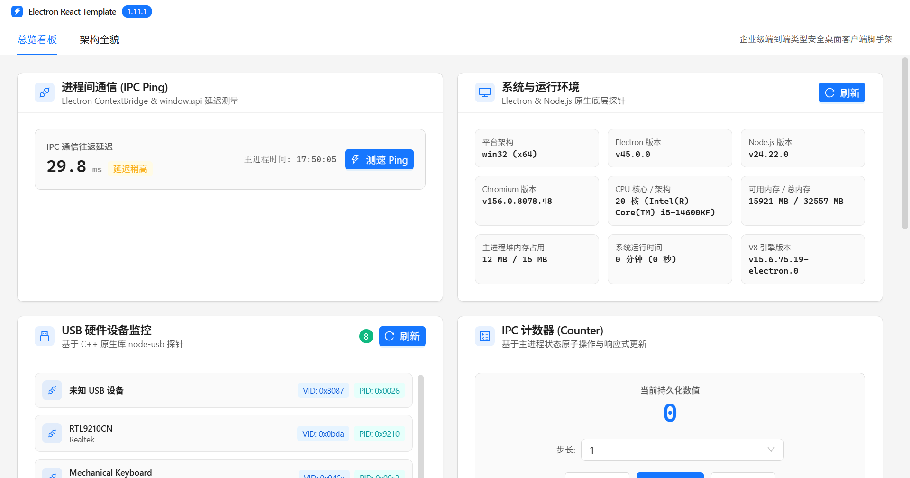
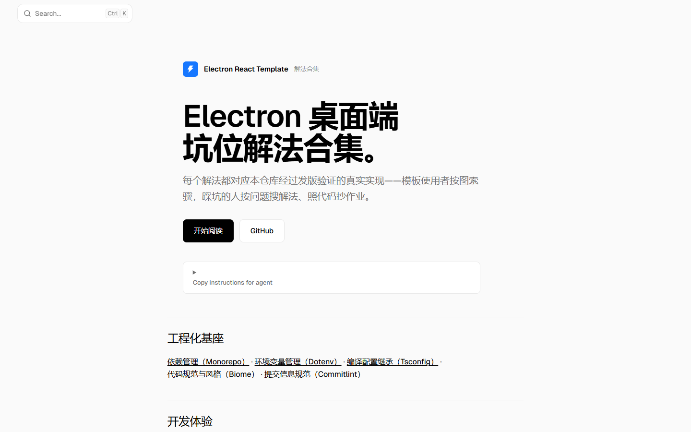

<div align="center">


# Electron React Template

Electron 桌面端坑位解法合集：每个解法都对应本仓库经过发版验证的真实实现<br />
仓库同时是一套可 clone 的 Electron Monorepo 模板——clone 下来，解法就是你的起步代码

<p>
<a href="https://github.com/BanShan-Alec/electron-react-monorepo-template/actions/workflows/ci.yml"></a>
<a href="LICENSE"></a>
<a href="https://nodejs.org"></a>
</p>

<p>
<a href="https://banshan-alec.github.io/electron-react-monorepo-template/">文档站</a> ·
<a href="#-解法地图">解法地图</a> ·
<a href="#-仓库架构">仓库架构</a> ·
<a href="#-快速开始">快速开始</a> ·
<a href="CONTRIBUTING.md">贡献指南</a> ·
<a href="AGENTS.md">AGENTS.md</a>
</p>

<p>
Electron 45 · React 19 · Vite 8 · TypeScript 6 · antd · TailwindCSS · LinguiJS · Biome · Playwright
</p>

</div>

---

> [!TIP]
> **完整文档站**：[banshan-alec.github.io/electron-react-monorepo-template](https://banshan-alec.github.io/electron-react-monorepo-template/)
>
> 按 9 个维度组织的解法页，每页固定「坑 → 解法 → 怎么抄」，源码链接直达仓库真实文件。

## ✨ 为什么是这份合集？

- **发版级，而非片段** —— 每个解法都随本仓库的安装包发出去、被真实更新过若干版本；不是开发态能跑就贴出来的 workaround
- **源码可直接抄** —— 解法页固定三段式「要解决的坑 → 本仓库的解法 → 怎么抄」，每段实现都链到仓库真实文件
- **成体系，不是清单堆叠** —— 9 个维度覆盖从工程基座到交付门禁，坑与坑之间的关联写在同一个体系里
- **模板即载体** —— 整份合集就是一个可 clone 的 Electron Monorepo 模板，照着解法改造即可起步

## 📸 截图

**应用主窗口**



**文档站**



## 🧭 解法地图

完整目录以文档站为准（9 个维度，页面增删只改站点，不在 README 里重复维护）：

**[查看完整解法目录 →](https://banshan-alec.github.io/electron-react-monorepo-template/)**

工程化基座 · 开发体验 · 架构组织 · 界面与交互 · 主进程运行时 · 安全与性能 · 测试矩阵 · 交付门禁 · AI 协同

## 🏗️ 仓库架构

```text
electron-react-monorepo-template/
├── packages/
│   ├── main/          # 主进程：ModuleRunner 模块链 + Controller/Service
│   ├── preload/       # 预加载桥：apiBridge 封闭暴露面 + invokeTraced 链路追踪
│   ├── renderer/      # 渲染进程：React 19 + 双入口 + features 领域架构
│   ├── shared/        # 跨进程契约层：IPC_CHANNELS / Result<T> / zod schemas
│   ├── pr-review/     # PR 生命周期与 AI 审查看板 CLI
│   ├── docs/          # 解法文档站（Vocs，GitHub Pages 部署）
│   └── tsconfig/      # base / node / react 编译配置继承包
├── .config/           # Biome / commitlint / changelogen / Playwright / Vitest
├── .github/           # CI / CodeQL / OpenCodeReview / Docs / Release
├── build/             # electron-builder 动态打包 + Sentry 构建配置
├── scripts/           # dev / build / port-guard / verify-prebuild / verify-postbuild
├── e2e/               # Playwright 桌面端 E2E
└── docs/              # 仓库内深度文档（ADR / 环境 / 依赖 / 打包等）
```

各业务包的职责、README 与规则文件都在 `packages/<name>/` 下，AI 协作者从根 [AGENTS.md](AGENTS.md) 的任务路由进入。

## 🚀 快速开始

| 依赖 | 版本要求 |
| :--- | :--- |
| Node.js | >= 24.0.0 |
| pnpm | ^12.0.0（仓库锁定 pnpm@12.15.0） |

```bash
pnpm install   # 安装工作区依赖（.npmrc 已内置 npmmirror 镜像加速）
pnpm start     # 开发模式：Vite DevServer + Electron 双进程热重载
```

| 命令 | 用途 |
| :--- | :--- |
| `pnpm start` | 开发模式（Vite + Electron 热重载） |
| `pnpm build:win` / `:mac` / `:linux` | 分平台打包安装包 |
| `pnpm test` / `pnpm test:e2e` | Vitest 单元测试 / Playwright 桌面端 E2E |

完整命令清单见 [CONTRIBUTING.md](CONTRIBUTING.md) 与根 `package.json` 的 `scripts`。从模板派生自己的应用，按[配置项归属（Configuration-map）](packages/docs/src/pages/dx/configuration-map.md)替换应用名、App ID、图标与发布源。

## 📚 文档站

完整内容在 **[banshan-alec.github.io/electron-react-monorepo-template](https://banshan-alec.github.io/electron-react-monorepo-template/)**。每页固定「要解决的坑 → 本仓库的解法 → 怎么抄」，源码链接直达仓库真实文件；站点同时输出 `llms.txt` / `llms-full.txt` 与每页 Markdown 路由，AI 协作者可直接检索。

站点源码在 `packages/docs/`（Vocs 构建，GitHub Pages 部署），本地预览 `pnpm docs:dev`。

## 🤝 贡献

欢迎 PR。动手前请读 [CONTRIBUTING.md](CONTRIBUTING.md)；提交信息遵循 Conventional Commits，且 subject 必须包含简体中文（commitlint + husky 自动校验）。使用 AI 协作者请先读 [AGENTS.md](AGENTS.md)。文档与代码不一致时以代码为准，并欢迎提 PR 修正。

## 📄 License

本项目以 [The Unlicense](LICENSE) 发布，奉献至公共领域：可自由用于任何商业或非商业用途。
