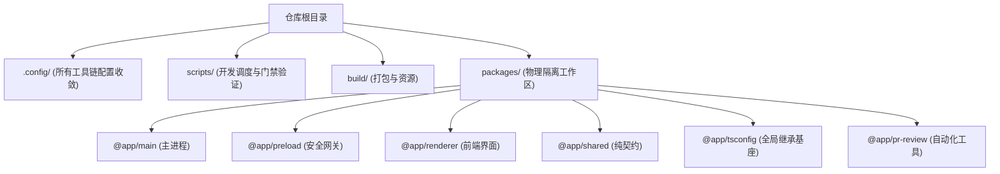
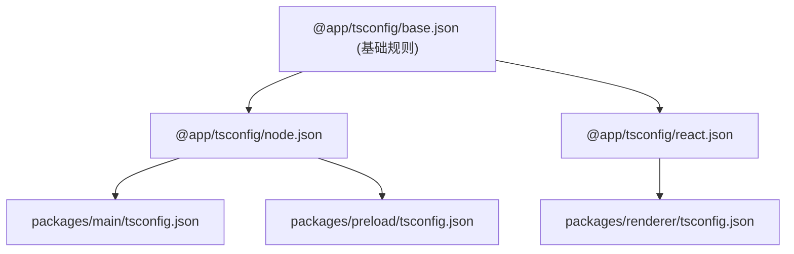

# 阶段一：根目录拓扑与工程规范体系

本文档对比 electron-vite 空白模板，阐述本模板在根目录治理、配置收敛与 TypeScript 继承基座上的设计。

## 1. 根目录拓扑治理 (收敛设计)

### electron-vite 现状
在标准的 electron-vite 脚手架中，所有配置文件随意散落在根目录（如 `eslint.config.js`, `prettier.config.js`, `tsconfig.web.json`, `tsconfig.node.json`）。根目录文件繁杂，容易造成视觉混乱和误删。

### 本模板的设计
本模板实行严格的目录职责收敛：
- **`.config/` 目录**：统一收敛所有工具链配置。包括 `biome.json`、`vitest.config.ts`、`playwright.config.ts`、`commitlint.config.ts`。根目录不再堆叠繁杂的 dot-files。
- **`scripts/` 目录**：统一管理开发调度与自动化验证脚本。包括 `dev.ts`、`port-guard.ts`、`verify-dist.ts`、`verify-deps.ts`。
- **`build/` 目录**：收敛平台图标资源与强类型打包脚本（`electron-builder.ts`、`sentry-config.ts`）。
- **`packages/` 目录**：承载业务多包物理隔离。

> **包管理器选型**：使用 `pnpm Workspaces`。依靠其符号链接内容寻址机制，物理杜绝幽灵依赖，确保子包依赖严格隔离。

---

## 2. 全局 TypeScript 配置继承基座 (`@app/tsconfig`)

### electron-vite 现状
每个子目录重复书写大量相同编译选项（如 `target`, `module`, `strict`, `paths`）。一旦需要升级 TypeScript 规范或调整输出规则，必须逐一修改所有文件，极易产生配置漂移。

### 本模板的设计
本模板建立专属的基础包 `packages/tsconfig`，统一向外导出三套标准化配置：
- **`base.json`**：定义公共严格类型检查规则、装饰器支持与增量构建缓存。
- **`node.json`**：针对主进程和构建脚本，配置 Node.js 运行时模块解析。
- **`react.json`**：针对渲染进程，配置 JSX 运行时与 DOM 类型库。

子包只需通过 `extends: "@app/tsconfig/node.json"` 声明继承。此方案确立了单点事实源，全库编译标准始终保持一致。

---

## 3. 极速代码质量与提交防护 (Rust Biome)

### 为什么选择 Biome 替代 ESLint + Prettier？
- **极速性能**：Biome 基于 Rust 编写。单进程格式化与检查 200 个文件仅需几十毫秒，运行速度比 ESLint + Prettier 快 20 倍以上。
- **单一工具链**：消除 ESLint 与 Prettier 之间的规则冲突与重复 AST 解析开销。
- **自动化卡点**：配合 `lint-staged` 与 `commitlint`，在代码暂存与 Git 提交阶段强制执行 Conventional Commits 汉字规范校验，防止劣质代码混入主干。
