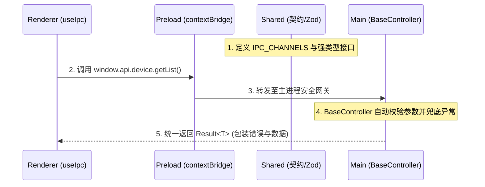
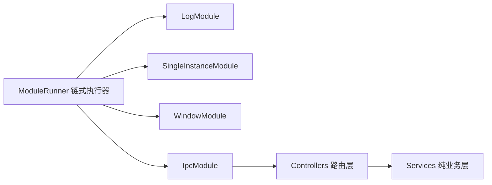

# 阶段二：多进程通信契约与主进程开发调度

本文档对比 electron-vite 空白模板，阐述跨进程 IPC 管道、双进程开发态调度以及主进程自研微内核的设计。

## 1. 契约先行 (Contract-First) 四阶段 IPC 管道

### electron-vite 现状
开发者通常在渲染端直接使用 `ipcRenderer.send('some-channel', payload)` 裸写通道名称。主进程监听函数直接处理入参。这导致通道名称容易拼错、入参缺乏类型校验，一旦主进程抛出异常，会导致整个 Electron 进程闪退。

### 本模板的设计
本模板建立了严格的四阶段 IPC 调用流水线：



1. **`@app/shared`**：统一声明通道常量与类型定义，杜绝手写散装字符串。
2. **`@app/preload`**：通过 `contextBridge` 仅对外暴露白名单业务函数，严禁将原始 `ipcRenderer` 透传给界面。
3. **`packages/main/src/controllers`**：控制器继承 `BaseController`。自动使用 Zod 校验入参，统一将返回值封装为 `Result<T>`，彻底阻断未捕获异常拖垮主进程。
4. **`packages/renderer/src/lib/ipc.ts`**：封装 `useIpc` 与 `callIpc` Hook，提供全链路 TypeScript 自动推导。

---

## 2. 开发态调度器与 CDP 调试基座 (`scripts/dev.ts`)

### electron-vite 现状
通过并发命令同时拉起 Vite 服务器与 Electron。如果 Vite 端口被其他应用占用，两端通信就会断开。此外，默认不暴露调试端口，外部自动化测试工具与远程调试器无法接入。

### 本模板的设计
本模板通过 `scripts/dev.ts` 实现智能有序调度：
- **智能端口守护 (`scripts/port-guard.ts`)**：启动前自动检测预设端口可用性，遇冲突智能清理或提示。
- **有序启动控制**：确保 Vite Dev Server 准备就绪后，再启动 Electron 主进程，避免主进程加载空页面。
- **原生 Chrome DevTools Protocol (CDP) 暴露**：
  主进程启动时自动注入调试参数：
  ```ts
  '--remote-debugging-port=9222'
  ```
  该机制为 Playwright 黑盒测试与外部 Chrome DevTools 提供了标准化的底层控制通道，大幅简化自动化测试编写。

---

## 3. 主进程微内核架构 (`ModuleRunner` + `Controller/Service`)

### electron-vite 现状
所有主进程代码通常堆砌在单一的 `main/index.ts` 中。窗口生命周期、托盘事件、快捷键、自动更新与 IPC 逻辑高度耦合，代码长达上千行，无法针对单个系统能力编写独立的单元测试。

### 本模板的设计
本模板采用自研的微内核模块链式执行器与控制器分层：



- **`ModuleRunner` 微内核**：
  在 `main/src/index.ts` 中通过纯链式调用注册能力模块：
  ```ts
  createModuleRunner()
    .init(new LogModule())
    .init(new SingleInstanceModule())
    .init(new WindowModule())
    .init(new IpcModule());
  ```
  每个 `AppModule` 拥有独立的 `enable(context)` 生命周期，系统能力可自由插拔。
- **Controller 与 Service 职责分立**：
  - **Controller**：仅负责挂载 IPC 路由、入参校验与格式包装。
  - **Service**：承载纯 Node.js 或硬件交互逻辑。Service 完全脱离 Electron 窗口与 IPC 上下文，可在测试中直接实例化验证。
