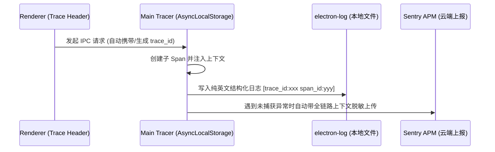
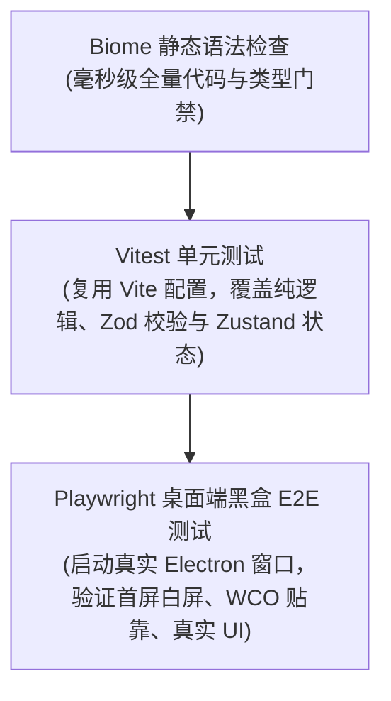

# 阶段四：质量工程、分布式追踪与 AI 自动化协同

本文档对比 electron-vite 空白模板，阐述 W3C 分布式日志追踪、全栈自动化测试以及 Agent-Ready AI 协同体系的设计。

## 1. W3C 分布式日志追踪与链路染色

### electron-vite 现状
开发者习惯使用 `console.log` 打印日志。在打包发布后，由于日志未持久化落盘，一旦客户端发生崩溃或硬件调用失败，运维与研发人员面对黑盒无法定位问题。此外，日志没有请求上下文关联，无法理清跨进程调用链。

### 本模板的设计
本模板在主进程构建了 W3C 标准的分布式追踪与结构化滚动日志系统：

- **链路染色 (`telemetry/tracer.ts`)**：
  基于 Node.js 原生 `AsyncLocalStorage` 实现。每次 IPC 调用均分配 `trace_id` 与 `span_id`，异步调用链自动向下传递，无需显式传参。
- **纯英文滚动落盘**：
  主进程日志使用 `electron-log` 按日期轮转安全落盘。落盘日志强制使用全英文与 ASCII 字符，避免在非中文 Windows 系统上发生编码乱码。

---

## 2. 自动化测试金字塔 (Vitest + Playwright)

### electron-vite 现状
脚手架几乎零测试配置。由于 Electron 兼具 Node.js 运行时与浏览器窗口，开发者常常不知道如何对真实桌面窗口执行自动化测试。

### 本模板的设计
本模板建立了分层测试金字塔：

- **Vitest 单元测试**：直接复用 Vite 模块解析机制，执行快速，测试纯函数与业务模型。
- **Playwright 真实窗口测试**：通过 Playwright 的 `_electron.launch` 直接拉起真实的 Electron 实例，探测虚拟 DOM 无法捕获的严重缺陷（如首屏白屏、预加载脚本注入失败、跨域隔离拦截）。

---

## 3. AI Agent 协同工程化 (`AGENT.md` + `@app/pr-review`)

### electron-vite 现状
面对 Cursor、Claude Code 等 AI 编程助手时没有任何约束体系。AI Agent 常常产生幻觉，滥加无用依赖、生成非安全代码或破坏已有代码风格。

### 本模板的设计
本模板是业界领先的 **Agent-Ready (SE 3.0)** 实践：
- **`AGENT.md` 注入硬性红线**：
  在仓库根目录声明不可逾越的五大红线（如禁止私加根目录依赖、禁止使用桶文件聚合导出、禁止裸写非安全 IPC、严禁使用 `process.cwd()`），将 AI 的探索空间锁死在合规管道内。
- **`@app/pr-review` 自动化闭环**：
  统一封装 `pnpm pr-review` CLI 命令（`create`, `status`, `pull`, `trigger`, `merge`）。与 GitHub Actions 和 OpenCodeReview 深度联动，自动拉取审查缺陷并在本地生成结构化的 Markdown 看板，指导 AI 进行确定性修复。
