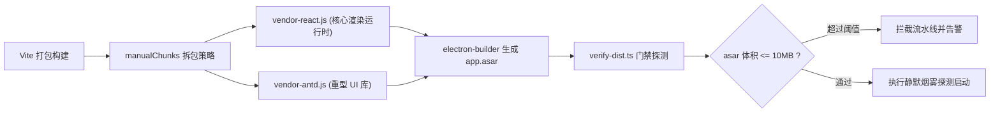
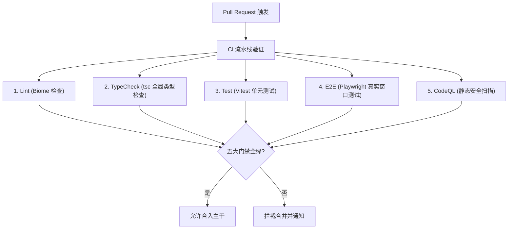

# 阶段五：性能防御、构建交付与 CI/CD 自动化门禁

本文档对比 electron-vite 空白模板，阐述性能分包、asar 体积门禁、TypeScript 动态打包以及 GitHub CI/CD 流水线的设计。

## 1. 性能分包策略与 asar 体积防劣化门禁

### electron-vite 现状
默认打包将所有依赖打入单一大 chunk 中。此外，对最终构建出的 `app.asar` 归档体积缺乏监控，一旦开发者意外引入数十兆的无用依赖，安装包体积暴增却无人感知。

### 本模板的设计
本模板建立了“编译期分包 + 打包后体积探测”双重防线：

- **Vite 智能分包 (`packages/renderer/vite.config.ts`)**：
  配置 `output.manualChunks`，显式拆离最稳定的核心库：
  - `vendor-react`：提取 React 运行时与调度器。
  - `vendor-antd`：提取 Ant Design 及其图标组件。
- **asar 体积防劣化门禁 (`scripts/verify-dist.ts`)**：
  构建完成后自动解包，扫描 `app.asar` 真实体积。系统内置阈值校验（默认 10MB），若体积膨胀超出阈值，立即中断流程，防止安装包体积劣化。

---

## 2. TypeScript 动态打包与产物完整性校验 (`verify-dist`)

### electron-vite 现状
采用静态的 `electron-builder.json` 配置文件。静态 JSON 无法读取多环境变量，也无法动态执行操作系统特性分支判断；打完包后直接结束，不能证明生成的二进制文件在真实机器上能否正常运行。

### 本模板的设计
- **强类型动态构建脚本 (`build/electron-builder.ts`)**：
  采用强类型 TypeScript 编写配置逻辑。自动读取 `package.json` 中的应用名称和版本，动态配置 `asarUnpack: ['**/*.node']` 保证原生 C++ 模块正常加载，并在打包期自动过滤 SourceMap 防止源码泄露。
- **真机二进制烟雾探测 (Smoke Test)**：
  打包完成后，`verify-dist.ts` 会自动在当前操作系统静默拉起刚刚打包生成的原生二进制可执行文件（`.exe` / `.app`），验证窗口根挂载与核心接口，确认可执行文件能够正常启动。

---

## 3. GitHub CI/CD 五大门禁与差分 OTA 闭环

### electron-vite 现状
没有现成的 CI/CD 流水线，合并分支全靠人肉拉取代码和人工打包，容易因为不同环境的差异导致上线后崩溃。

### 本模板的设计
本模板在 `.github/workflows/` 中内置了工业级自动化流水线：

- **全自动化门禁卡点**：
  在代码合入前，CI 流水线强制执行代码规范、TypeScript 全局类型检查、单元测试、Playwright 真实窗口 E2E 测试与 CodeQL 安全漏洞扫描。任何一项失败均禁止合并。
- **差分增量 OTA 升级闭环**：
  结合 `electron-updater`，发布时自动生成差分补丁与 `latest.yml`。客户端在启动时静默检查并下载轻量增量补丁，实现用户无感平滑升级。
