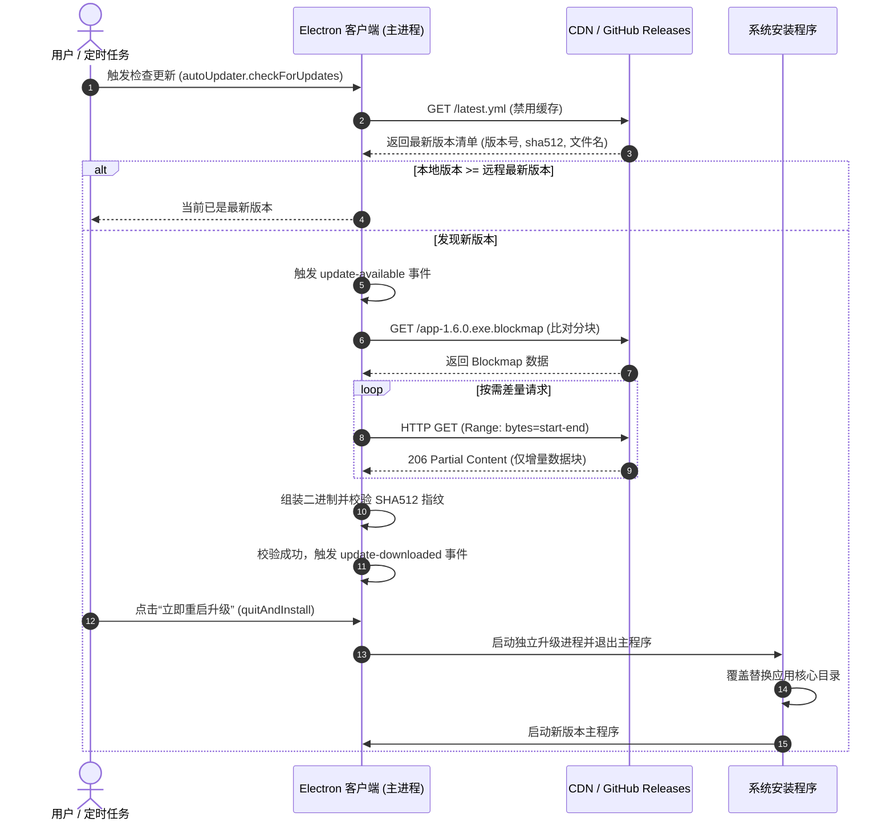

# Electron 跨平台打包与 GitHub OTA 自动更新机制与避坑实践

> Electron 应用完成功能开发后，在打包构建（Packaging）与在线更新（OTA, Over-The-Air Update）阶段容易出现一系列工程问题：静默更新失败、GitHub Releases 资源 404、SHA512 哈希校验不匹配、系统安全软件拦截以及源码泄露等。
> 
> 本文梳理 Electron 跨平台打包产物的构成、增量更新的工作原理，以及在文件名命名、网络 CDN 配置、操作系统安全限制等方面的常见问题与解决方案。

---

## 目录

- [一、 Electron 打包产物与 OTA 更新架构](#一-electron-打包产物与-ota-更新架构)
  - [1. 跨平台安装包格式](#1-跨平台安装包格式)
  - [2. OTA 配套文件与增量更新机制](#2-ota-配套文件与增量更新机制)
  - [3. 自动更新全流程](#3-自动更新全流程)
- [二、 命名规范与 URL 解析问题](#二-命名规范与-url-解析问题)
  - [1. productName 与 name 的职责区分](#1-productname-与-name-的职责区分)
  - [2. 文件名空格导致的 404 与校验失败](#2-文件名空格导致的-404-与校验失败)
  - [3. 特殊字符与编码兼容性](#3-特殊字符与编码兼容性)
- [三、 网络传输与 CDN 缓存配置](#三-网络传输与-cdn-缓存配置)
  - [1. HTTP 206 (Range Requests) 与差量下载](#1-http-206-range-requests-与差量下载)
  - [2. 清单与产物文件的差异化缓存](#2-清单与产物文件的差异化缓存)
- [四、 操作系统安全与运行时问题](#四-操作系统安全与运行时问题)
  - [1. Windows SmartScreen 与代码签名](#1-windows-smartscreen-与代码签名)
  - [2. macOS Gatekeeper、公证与只读卷运行限制](#2-macos-gatekeeper公证与只读卷运行限制)
  - [3. Windows 文件占用与平滑退出安装](#3-windows-文件占用与平滑退出安装)
- [五、 版本规范与源码保护](#五-版本规范与源码保护)
  - [1. SemVer 语义化版本约束](#1-semver-语义化版本约束)
  - [2. 生产环境代码资产保护](#2-生产环境代码资产保护)
- [六、 生产级发布 Checklist](#六-生产级发布-checklist)
- [附录：生产级 electron-builder.ts 配置参考](#附录生产级-electron-builderts-配置参考)

---

## 一、 Electron 打包产物与 OTA 更新架构

运行 `electron-builder` 构建命令后，输出目录（通常为 `dist/`）会生成多个不同后缀的文件。这是由于 Electron 需要适配 Windows、macOS 与 Linux 各自的安装规范，并配合 `electron-updater` 实现自动更新。

### 1. 跨平台安装包格式

| 操作系统 | 常见后缀 | 说明与核心场景 |
| :--- | :--- | :--- |
| **Windows** | `.exe` | 基于 **NSIS (Nullsoft Scriptable Install System)** 的标准单文件安装引导程序，支持自动卸载、静默更新与桌面快捷方式创建。 |
| | `.msi` | 微软 Windows Installer 标准格式，主要面向政企内网或 Active Directory 域环境的集中批量分发。 |
| **macOS** | `.dmg` | Apple 磁盘镜像文件，挂载后用户可将应用拖拽至 `/Applications` 目录安装。 |
| | `.zip` | 包含 `.app` 的归档文件。**macOS 下基于 Squirrel.Mac 的自动更新底层依赖 zip 格式完成包体解压与替换**。 |
| **Linux** | `.deb` | 适用于 Debian / Ubuntu 系列系统的安装包，使用 `dpkg` 或 `apt` 管理。 |
| | `.rpm` | 适用于 RHEL / CentOS / Fedora 系列系统的安装包，使用 `rpm` 或 `dnf` 管理。 |
| | `.AppImage` | 免安装可执行格式，赋予执行权限即可直接运行，依赖隔离在独立运行环境中。 |

---

### 2. OTA 配套文件与增量更新机制

除了主安装包，构建还会生成若干更新元数据文件，用于客户端的差量更新：

#### (1) `latest.yml` / `latest-mac.yml` / `latest-linux.yml`（更新清单）
客户端检查更新时，首先请求轻量的 YAML 清单文件（仅数百字节），而不是直接下载完整安装包：

```yaml
version: 1.6.0
files:
  - url: my-app-1.6.0-win-x64.exe
    sha512: O1k0u8P...==
    size: 92481024
path: my-app-1.6.0-win-x64.exe
sha512: O1k0u8P...==
releaseDate: '2026-10-18T00:00:00.000Z'
```

清单内记录了目标版本号、下载文件名、文件体积及校验用的 **SHA512 哈希值**。

#### (2) `.blockmap`（分块哈希映射文件）
当客户端从 `1.5.0`（100MB）升级到 `1.6.0`（101MB），若实际变更代码只有 2MB，`electron-builder` 提供的分块更新能力可避免全量下载：

1. 构建时，`electron-builder` 将安装包以 64KB 为单位切块并计算各块哈希，输出 `my-app-1.6.0-win-x64.exe.blockmap`；
2. 客户端更新时先读取本地已安装版本的二进制块哈希；
3. 下载新版本的 `.blockmap` 并进行差异比对，找出变更的数据块区间；
4. 通过 HTTP `Range` 头**仅请求变更的 2MB 数据块**，并在本地拼装出完整的新版本安装包。

---

### 3. 自动更新全流程

下图展示了从触发更新检查到完成替换安装的执行时序：



---

## 二、 命名规范与 URL 解析问题

客户端在自动更新时遭遇 **404 Not Found** 或 **SHA512 Checksum Mismatch**，多数情况下源于安装包与元数据文件的命名不规范。

### 1. productName 与 name 的职责区分

`package.json` 中的两个名称字段用途不同：

```json
{
  "name": "super-desktop-client",
  "productName": "Super Desktop Client"
}
```

- **`productName`（UI 展示名称）**：
  用于桌面快捷方式、窗口标题栏以及系统“已安装应用”列表中的名称展示，支持空格、大小写和特殊字符。
- **`name` / `artifactName`（文件系统与网络协议名称）**：
  用于生成本地安装包文件名、下载 URL、GitHub Release 资产名以及 `latest.yml` 索引路径。**应保持纯小写、连字符命名，且不得包含空格**。

在打包配置中，应明确指定：
```ts
// 推荐写法：使用 ${name} 替代 ${productName}
artifactName: '${name}-${version}-${os}-${arch}.${ext}'
```

---

### 2. 文件名空格导致的 404 与校验失败

若产物文件名包含空格（如 `Super Desktop Client Setup 1.6.0.exe`），会在多个环节引发异常：

1. **GitHub Releases 资产命名转义**：
   通过网页端或部分 API 上传时，GitHub Releases 可能会将文件名中的空格替换为点号 `.`（转换为 `Super.Desktop.Client.Setup.1.6.0.exe`）。
2. **`latest.yml` 索引失效**：
   本地构建生成的 `latest.yml` 记录的路径仍为带空格的原文件名。客户端获取该清单后按原名发起请求，因远端文件名已被转义而返回 **HTTP 404**。
3. **哈希校验不匹配**：
   中间代理或网关若将空格自动转义为 `%20`，部分系统的校验逻辑无法正向反解，会抛出 `sha512 mismatch` 并中止更新。
4. **命令行脚本解析异常**：
   在 Linux 环境下执行 `dpkg -i my app.deb` 时，未用引号包裹的带空格文件名会被 Shell 拆解为多个独立参数，导致自动化脚本报错退出。

---

### 3. 特殊字符与编码兼容性

除空格外，文件名还应避免以下字符：

| 字符 | 影响原因 | 建议 |
| :--- | :--- | :--- |
| **`#`** | HTTP 协议中 `#` 后的内容会被当做 URL Fragment（锚点），请求到达 CDN 时会被丢弃，导致路径截断报 404。 | 禁止使用 |
| **`+`** | 部分 Web 服务器和网关会将 URL 中的 `+` 默认解码为空格，引发二次转义问题。 | 禁止使用 |
| **`?`、`&`、`%`** | 均为 URL 查询参数的保留字符，会破坏网络请求路径寻址。 | 禁止使用 |
| **中文字符 / Emoji** | Windows 默认编码（GBK/UTF-16）与 Linux/macOS（UTF-8）不同，跨平台网络传输或解压时容易产生乱码。 | 禁止使用 |

> **命名规范**：安装包文件名建议严格匹配正则 **`^[a-z0-9-_]+$`**。

---

## 三、 网络传输与 CDN 缓存配置

当安装包与清单文件正确上传后，若客户端仍然更新失败或频繁进行全量下载，通常是托管存储（OSS/S3/Nginx/CDN）的响应头配置不当所致。

### 1. HTTP 206 (Range Requests) 与差量下载

增量分块下载依赖服务端的 **HTTP 范围请求（Range Requests）**。客户端下载变动块时会发送类似请求：

```http
GET /my-app-1.6.0-win-x64.exe HTTP/1.1
Host: download.example.com
Range: bytes=1048576-2097151
```

- **正常响应**：服务端返回 **`HTTP/1.1 206 Partial Content`**，并仅传输指定范围的字节数据。
- **配置缺失**：若 CDN、网关或对象存储未开启 Range 支持，或者强制返回 `HTTP 200 OK` 传输整个文件，客户端无法执行分块拼装，**增量更新将退化为全量下载**。

### 2. 清单与产物文件的差异化缓存

不同文件对缓存策略的要求截然不同：

```mermaid
graph LR
    subgraph 清单文件 [元数据清单 (动态更新源)]
        A["latest.yml / latest-mac.yml"]
        A -->|配置要求| B["Cache-Control: no-cache, no-store, must-revalidate<br>（每次实时请求，禁止中间层缓存）"]
    end
    
    subgraph 产物文件 [二进制产物 (版本固定不可变)]
        C["*.exe / *.dmg / *.zip / *.blockmap"]
        C -->|配置要求| D["Cache-Control: max-age=31536000, immutable<br>（哈希不可变，可设置长期强缓存以节约流量）"]
    end
```

- **清单缓存导致的更新滞后**：若 CDN 对 `latest.yml` 设置了缓存，发布新版本或紧急补丁后，旧版本客户端在缓存过期前将无法感知到更新。

---

## 四、 操作系统安全与运行时问题

### 1. Windows SmartScreen 与代码签名

Windows 运行未经签名的 `.exe` 时，系统 SmartScreen 会拦截启动，提示“Windows 已保护你的电脑，未知的发布者”。

- **解决方法**：
  为安装包配置数字签名（Code Signing）。
  - **OV 证书**：包含企业认证信息，初期需积累一定下载与安装量后逐步解除 SmartScreen 拦截；
  - **EV 证书 / Azure Trusted Signing**：具有硬件或云端身份背书，签发后可直接建立信誉，避免拦截提示。

---

### 2. macOS Gatekeeper、公证与只读卷运行限制

#### (1) Apple 公证（Notarization）
面向公网分发的 macOS 应用需要：
1. 使用 Apple Developer 证书签名并开启 **Hardened Runtime（强化运行时）**；
2. 构建后将产物上传至 Apple 公证服务；
3. 将返回的公证票据钉扎（Staple）到应用包中。
> **未公证影响**：系统将阻断运行，并提示“无法打开，因为 Apple 无法检查其是否包含恶意软件”或“应用已损坏”。

#### (2) 只读磁盘镜像（DMG）运行限制
用户下载 `.dmg` 后，若直接在访达挂载的虚拟磁盘中运行应用，而未将其拖入“应用程序”目录：
- DMG 挂载卷在操作系统层面为**只读（Read-Only）**文件系统；
- 自动更新尝试将新文件写入 `.app` 目录时，会直接抛出 **`EPERM / Read-only file system`** 错误并中断更新；
- **防范方式**：在应用主进程启动时调用 `app.isInApplicationsFolder()` 进行校验，若未在应用程序目录中则弹窗提示用户移动。

---

### 3. Windows 文件占用与平滑退出安装

调用 `autoUpdater.quitAndInstall()` 后，若出现更新进程无响应或重启后仍为旧版本的情况，常见原因是**文件锁占用（File Lock）**。

Windows 不允许覆盖或修改正在被进程占用的可执行文件或 DLL。以下情况会导致安装器因权限不足退出：
1. 主进程派生（spawn）的子进程（如后台 Worker、独立服务）未在主程序退出前终止，仍持有端口或文件句柄；
2. 日志流（FileStream）未完成 `flush` 和关闭；
3. 监控上报类 SDK（如 Sentry）在退出钩子中阻塞。

**处理方式**：在调用 `quitAndInstall` 前，主动关闭辅助窗口、断开网络连接并终止所有子进程，确保主程序能正常释放所有句柄并退出。

---

## 五、 版本规范与源码保护

### 1. SemVer 语义化版本约束

自动更新的版本号对比依赖 `semver` 规范：

- **禁止包含 `v` 前缀**：
  `package.json` 中的 `version` 需为纯三段数字（如 `"1.6.0"`），不可写为 `"v1.6.0"`。
- **预发布（Prerelease）版本隔离**：
  形如 `1.6.1-alpha.1` 或 `1.6.1-beta.0` 的版本属于预发布版本。默认情况下，正式版客户端不会接收到预发布版本推送，除非在配置中显式设置 `autoUpdater.allowPrerelease = true`。
- **版本降级保护**：
  `electron-updater` 默认配置 `allowDowngrade: false`，防止客户端被重放清单降级到包含已知漏洞的旧版本。

---

### 2. 生产环境代码资产保护

Electron 构建默认将源码打包进 `app.asar` 归档文件中。`asar` 属于未加密的归档格式，可通过 `npx asar extract app.asar ./src` 直接提取出源代码。

为避免不必要的文件泄露并控制安装包体积，打包配置中建议做好以下控制：

```ts
// electron-builder.ts 配置示例
files: [
  // 1. 排除 SourceMap 映射文件，避免直接暴露未混淆源码
  '!**/*.map',

  // 2. 排除开发依赖、测试用例与类型声明文件
  '!**/node_modules/*/{test,__tests__,tests,docs,examples}/**',
  '!**/node_modules/**/*.d.ts',
],
// 3. 原生 C/C++ 模块 (.node) 需排除在 asar 外，保证系统可正常加载动态链接库
asarUnpack: [
  '**/*.node',
]
```

---

## 六、 生产级发布 Checklist

在执行正式构建和版本发布前，可通过以下清单核验关键项：

### 1. 命名与版本规范
- [ ] `package.json` 中的 `name` 为纯小写连字符格式（匹配 `^[a-z0-9-_]+$`），不含空格和特殊符号。
- [ ] `package.json` 中的 `version` 遵循 SemVer，不带 `v` 前缀（如 `1.6.0`）。
- [ ] `electron-builder` 配置中的 `artifactName` 采用 `${name}` 而非 `${productName}`。

### 2. 资产保护与产物体积
- [ ] 构建配置已通过 `!**/*.map` 排除源码映射文件。
- [ ] 原生模块（`.node`）已加入 `asarUnpack` 配置。
- [ ] 已排除测试文件与冗余开发依赖，`asar` 归档体积在合理范围内。

### 3. 操作系统签名与运行限制
- [ ] Windows 安装包已完成代码签名（避免 SmartScreen 拦截）。
- [ ] macOS 应用已开启 Hardened Runtime 并完成 Apple 公证（Notarization）。
- [ ] macOS 客户端启动时包含 `app.isInApplicationsFolder()` 检测，防范 DMG 只读卷直接运行问题。

### 4. CDN 与网络配置
- [ ] 存储与 CDN 服务已开启 HTTP 206 (Range Requests) 支持，验证增量更新可用。
- [ ] `latest.yml` 清单配置了 `Cache-Control: no-cache, no-store`。
- [ ] 安装包及 `.blockmap` 配置了长期强缓存（`Cache-Control: max-age=31536000`）。

---

## 附录：生产级 electron-builder.ts 配置参考

以下配置模板整合了前文提到的各项避坑要求，直接展示核心配置对象与关键注释：

```ts
const config: Configuration = {
  appId: 'com.example.app',
  productName: 'Super Desktop Client', // 面向系统 UI 和快捷方式显示，允许空格与展示字符

  directories: {
    output: 'dist',
    buildResources: 'build/resources',
  },

  // 确保为所有分发通道生成更新元数据（latest.yml、latest-mac.yml、.blockmap）
  generateUpdatesFilesForAllChannels: true,

  // GitHub Releases OTA 发布提供方配置
  publish: {
    provider: 'github',
    owner: 'your-github-org',
    repo: 'your-app-repo',
    releaseType: 'release',
  },

  /**
   * 【避坑要点 1：命名规范】
   * 采用纯小写的 ${name} 替代包含空格的 ${productName}。
   * 杜绝 GitHub Releases 上传时空格被自动转义为点号 (.) 导致 latest.yml 找不到资产报 404
   */
  artifactName: '${name}-${version}-${os}-${arch}.${ext}',

  // Windows 构建与 NSIS 安装引导器配置
  win: {
    target: [
      {
        target: 'nsis',
        arch: ['x64'],
      },
    ],
    icon: 'build/resources/icon.ico',
    // 生产环境需配置代码签名证书，或通过环境变量传递 CSC_LINK / CSC_KEY_PASSWORD
  },
  nsis: {
    oneClick: false, // 允许用户选择安装路径
    perMachine: true, // 全局安装，规避多用户权限隔离问题
    allowToChangeInstallationDirectory: true,
    createDesktopShortcut: true,
    createStartMenuShortcut: true,
    shortcutName: 'Super Desktop Client',
    deleteAppDataOnUninstall: false,
  },

  // macOS 构建与 Squirrel.Mac 自动更新适配
  mac: {
    // 【避坑要点 2：macOS 自动更新包体】
    // 必须包含 zip 格式，Squirrel.Mac 底层仅支持通过 zip 包完成解压热替换
    target: ['dmg', 'zip'],
    icon: 'build/resources/icon.icns',
    hardenedRuntime: true, // 开启 Hardened Runtime，满足 Apple 公证前置要求
    gatekeeperAssess: false,
    entitlements: 'build/entitlements.mac.plist',
    entitlementsInherit: 'build/entitlements.mac.plist',
  },

  // Linux 构建配置
  linux: {
    target: ['deb', 'AppImage'],
    icon: 'build/resources/icon.png',
  },

  /**
   * 【避坑要点 3：源码保护与体积控制】
   * 1. 严格排除 SourceMap 映射文件，杜绝源码被逆向还原
   * 2. 剔除与运行无关的文档、测试套件与 TypeScript 声明文件
   */
  files: [
    'dist/**',
    'package.json',
    '!**/*.map',
    '!**/node_modules/*/{CHANGELOG.md,README.md,README,readme.md,changelog.md}',
    '!**/node_modules/*/{test,__tests__,tests,docs,example,examples}/**',
    '!**/node_modules/**/*.d.ts',
    '!**/node_modules/**/*.d.cts',
    '!**/node_modules/**/*.d.mts',
  ],

  /**
   * 【避坑要点 4：原生 C/C++ 动态链接库】
   * 原生模块 (.node) 必须排除在 asar 归档外部，否则操作系统无法直接通过 dlopen / LoadLibrary 加载
   */
  asarUnpack: [
    '**/*.node',
  ],
};

export default config;
```
