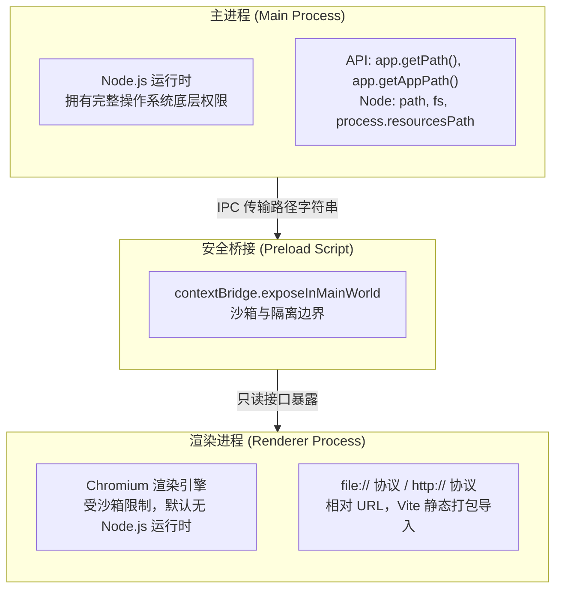
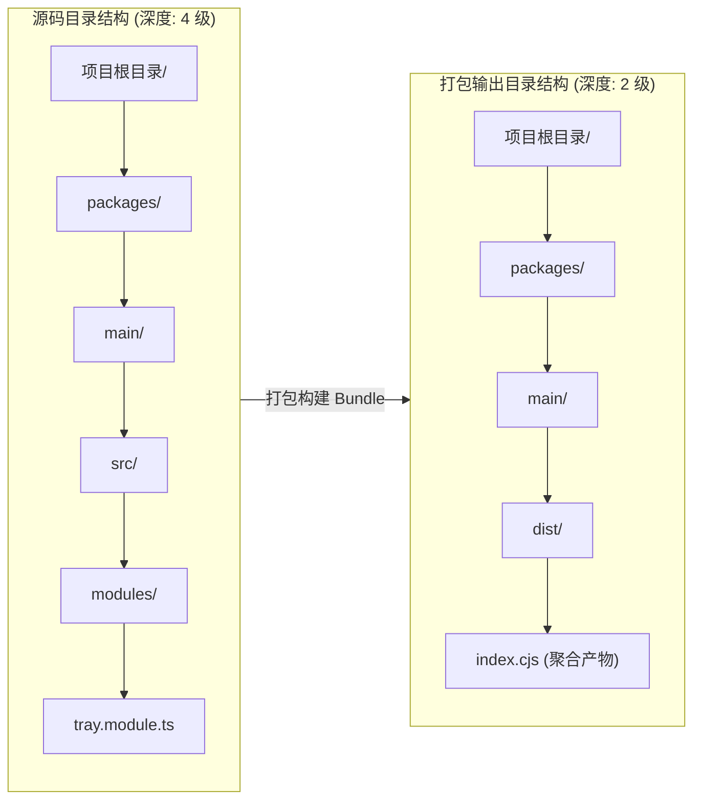
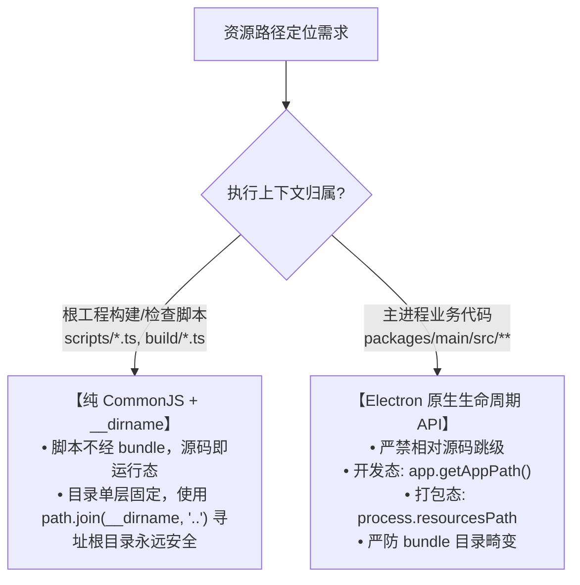
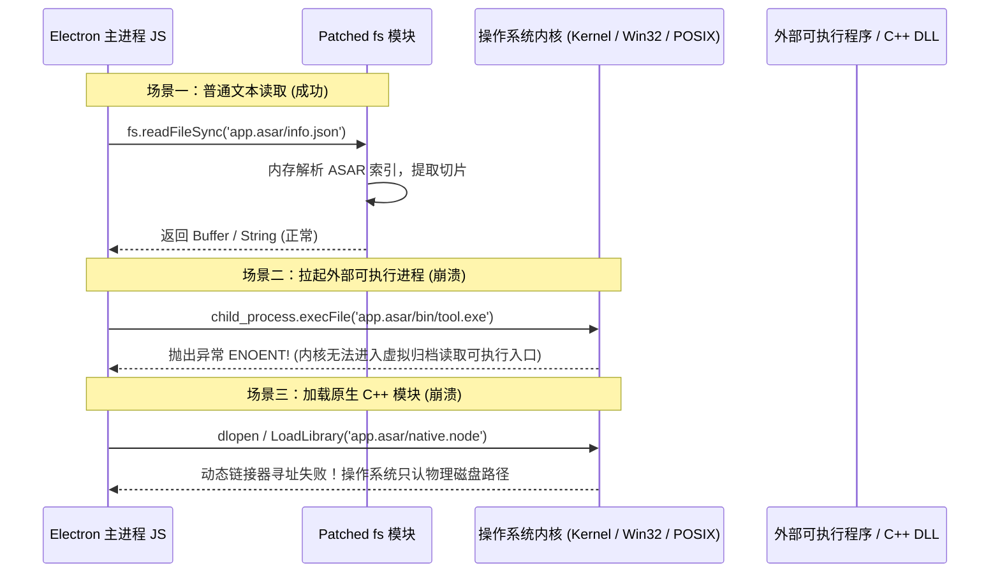

# Electron 跨平台路径管理底层原理与避坑深度实践

> 在纯 Web 前端或纯 Node.js 服务端开发中，通过相对路径或 `process.cwd()` 寻址资源是再自然不过的操作。然而，当这些习惯被带入 Electron 桌面应用时，却常常引发一系列隐蔽而致命的生产事故：本地开发测试完全正常，打包成安装包后却遭遇**首屏白屏**、**托盘图标 404**、**外部二进制启动失败**、**用户配置静默丢失**，乃至**开机自启瞬间崩溃闪退**。
>
> 究其根本，Electron 融合了 Node.js 与 Chromium 两个异构运行时，且在**源码开发态（Source Code）**与**生产打包态（Bundled ASAR）**之间发生了彻底的物理结构突变。若缺乏对底层操作系统行为、打包器打包机制以及 Electron 虚拟文件系统的系统性认知，路径问题将成为团队挥之不去的梦魇。
>
> 本文深入剖析 Electron 路径管理的底层运作机制，复盘最常见的 5 大核心陷阱，并给出生产级的设计决策矩阵与自查清单。

---

## 目录

- [一、 为什么 Electron 的路径管理如此容易翻车？](#一-为什么-electron-的路径管理如此容易翻车)
  - [1. 双运行时环境的物理割裂](#1-双运行时环境的物理割裂)
  - [2. 开发态与生产态的物理形态突变](#2-开发态与生产态的物理形态突变)
  - [3. 跨操作系统在文件系统与用户权限上的根本差异](#3-跨操作系统在文件系统与用户权限上的根本差异)
- [二、 陷阱一：process.cwd() 的“动态漂移”与幽灵故障](#二-陷阱一processcwd-的动态漂移与幽灵故障)
  - [1. 工作目录（Working Directory）由谁决定？](#1-工作目录working-directory由谁决定)
  - [2. 三大典型翻车场景剖析](#2-三大典型翻车场景剖析)
  - [3. 为什么开发阶段永远测不出这个 Bug？](#3-为什么开发阶段永远测不出这个-bug)
  - [4. 规范铁律：生产代码全面禁绝 process.cwd()](#4-规范铁律生产代码全面禁绝-processcwd)
- [三、 陷阱二：__dirname 在现代打包器下的“层级畸变”](#三-陷阱二__dirname-在现代打包器下的层级畸变)
  - [1. 源码目录树 vs 打包产物目录树的“降维打击”](#1-源码目录树-vs-打包产物目录树的降维打击)
  - [2. 真实案例复盘：从 4 层深到 2 层深的越界灾难](#2-真实案例复盘从-4-层深到-2-层深的越界灾难)
  - [3. Vite / Rollup 对 __dirname 的编译替换陷阱](#3-vite--rollup-对-__dirname-的编译替换陷阱)
  - [4. 规范解法：严格区分构建脚本与运行时业务代码](#4-规范解法严格区分构建脚本与运行时业务代码)
- [四、 陷阱三：ASAR 虚拟文件系统与外部二进制断裂](#四-陷阱三asar-虚拟文件系统与外部二进制断裂)
  - [1. ASAR 的底层机制：Node fs 与 Chromium 的 Patch 伪装](#1-asar-的底层机制node-fs-与-chromium-的-patch-伪装)
  - [2. 为什么 execFile 与 C++ Addon 在 ASAR 内必定崩溃？](#2-为什么-execfile-与-c-addon-在-asar-内必定崩溃)
  - [3. asarUnpack 解包机制与 .unpacked 物理寻址](#3-asarunpack-解包机制与-unpacked-物理寻址)
  - [4. process.resourcesPath、extraResources 与 extraFiles 的架构职责](#4-processresourcespathextraresources-与-extrafiles-的架构职责)
- [五、 陷阱四：持久化数据写向安装目录触发的权限浩劫](#五-陷阱四持久化数据写向安装目录触发的权限浩劫)
  - [1. 致命设计：把应用配置保存在“程序旁边”](#1-致命设计把应用配置保存在程序旁边)
  - [2. 操作系统权限防线：Windows UAC 与 macOS App Translocation](#2-操作系统权限防线windows-uac-与-macos-app-translocation)
  - [3. 生产级合规落盘：深入 Electron app.getPath() 体系](#3-生产级合规落盘深入-electron-appgetpath-体系)
  - [4. 跨平台物理路径全景映射表](#4-跨平台物理路径全景映射表)
- [六、 陷阱五：跨平台分隔符与 URL 协议层（file://）的深水区](#六-陷阱五跨平台分隔符与-url-协议层file的深水区)
  - [1. Windows 反斜杠 (\) 与 POSIX 正斜杠 (/) 的字符串陷阱](#1-windows-反斜杠--与-posix-正斜杠--的字符串陷阱)
  - [2. file:// 协议与 Windows 盘符标准（RFC 8089）](#2-file-协议与-windows-盘符标准rfc-8089)
  - [3. 中文路径与特殊字符的 URI encode/decode 转义失控](#3-中文路径与特殊字符的-uri-encodedecode-转义失控)
  - [4. 自定义协议（Privileged Schemes）映射本地路径的安全边界](#4-自定义协议privileged-schemes映射本地路径的安全边界)
- [七、 生产级 Electron 路径选型决策矩阵与自查清单](#七-生产级-electron-路径选型决策矩阵与自查清单)
  - [1. 场景寻址决策矩阵](#1-场景寻址决策矩阵)
  - [2. 生产发布路径排查 Checklist（8 大红线）](#2-生产发布路径排查-checklist8-大红线)

---

## 一、 为什么 Electron 的路径管理如此容易翻车？

桌面应用与纯 Web 开发最大的不同，在于它既有本地操作系统的底层掌控力，又受制于浏览器沙箱的安全边界。Electron 路径问题的复杂性，主要源于以下三个维度的交叉割裂：

### 1. 双运行时环境的物理割裂



- **主进程**：本质是一个 Node.js 进程。它使用操作系统的文件绝对路径（如 Windows 上的 `C:\Users\name\...` 或 macOS 上的 `/Users/name/...`），由底层文件系统 API 操作。
- **渲染进程**：本质是 Chromium 浏览器窗口。在现代安全模式（`contextIsolation: true` 且 `sandbox: true`）下，**渲染进程没有任何 Node.js API**。浏览器内核理解的是 URL（`http://`、`file:///` 或自定义协议 `app://`），任何直接将主进程物理路径当作 Web URL 使用的做法，都会引发跨域拦截、协议格式错误或路径转义问题。

---

### 2. 开发态与生产态的物理形态突变

许多团队在项目发布时遇到路径崩溃，核心在于**开发环境与生产环境的文件组织方式截然不同**：

```text
【开发环境 (Development)】
项目根目录/
├── packages/
│   ├── main/src/modules/tray.ts  <-- 源码直接执行 (TS 转译或内存执行)
│   └── renderer/src/index.tsx    <-- 由 Vite Dev Server (http://localhost:5173) 托管
└── build/resources/icon.png      <-- 处于源码根目录的静态资产

-------------------------------------------------------------------------

【生产打包环境 (Production)】
安装目录 (如 C:\Program Files\MyApp)/
├── MyApp.exe
├── resources/                    <-- process.resourcesPath 指向这里
│   ├── app.asar                  <-- 源码与前端资产被压缩打包为单文件虚拟归档！
│   │   ├── dist/index.cjs        <-- 主进程单一 bundle 产物 (目录深度变浅)
│   │   └── renderer/index.html   <-- 静态前端 HTML (转为 file:// 协议加载)
│   ├── app.asar.unpacked/        <-- 配置了 asarUnpack 的文件被提取到此处
│   └── buildResources/           <-- extraResources 拷贝的外部独立资产
```

在开发态，你的文件物理存在于硬盘的特定源码层级中；而在生产态，主进程被打包工具（Vite/Rollup）抹平成单一文件，存放在由 Electron 虚拟化接管的只读归档（`app.asar`）内。**任何假设“源码目录结构在打包后依然存在”的代码，必定在生产环境中崩塌。**

---

### 3. 跨操作系统在文件系统与用户权限上的根本差异

- **路径分隔符**：Windows 使用反斜杠 `\`，macOS / Linux 使用正斜杠 `/`。硬编码斜杠或混用正则表达式将造成系统兼容性崩盘。
- **大小写敏感性**：Linux 原生 ext4 严格区分大小写（`icon.PNG` 与 `icon.png` 是两个文件）；macOS 默认 APFS 大小写保留但不敏感；Windows NTFS 通常不区分大小写。在 Windows 开发的代码可能在 Linux 或 macOS CI 上直接 404。
- **权限安全边界**：Windows 的 `C:\Program Files` 受到 UAC 强力保护；macOS 的 DMG 运行具备隔离镜像（App Translocation）；Linux 必须严格遵循 XDG Base Directory 规范。

---

## 二、 陷阱一：process.cwd() 的“动态漂移”与幽灵故障

### 1. 工作目录（Working Directory）由谁决定？

在 Node.js 中，`process.cwd()` 返回的是**当前进程启动时操作系统分配的“当前工作目录”（Current Working Directory）**。

> [!CAUTION]
> **极其重要的常识**：
> `process.cwd()` **既不等于** 可执行文件（`.exe` / `.app`）所在的安装目录；
> `process.cwd()` **更不等于** 你的源码所在目录。
> 它纯粹取决于**启动该进程的父进程将“工作目录”设置为了哪里**。

---

### 2. 三大典型翻车场景剖析

#### 场景 A：Windows 桌面快捷方式启动（起始位置丢失）

当用户从桌面快捷方式启动应用时，Windows 快捷方式包含两个关键属性：“目标”（Target）与“起始位置”（Start in）。
- 如果制作安装包的脚本（如 NSIS 配置）或用户手动创建的快捷方式没有严格锁定“起始位置”；
- 操作系统会自动将当前工作目录设置为 `C:\Windows\System32` 或用户的 `Desktop` 目录。
- **后果**：代码中执行 `path.resolve(process.cwd(), 'config.json')`，实际解析出的路径为 `C:\Windows\System32\config.json`，直接抛出 `EACCES: permission denied` 或文件找不到异常，应用当场白屏闪退。

#### 场景 B：操作系统开机自启（Run 注册表 / LaunchAgents）

应用配置为开机自启动时：
- **Windows**：通过注册表 `HKCU\Software\Microsoft\Windows\CurrentVersion\Run` 唤起应用，此时系统的默认工作目录通常是 `C:\Windows\system32`；
- **macOS**：通过 `launchd` 或登录项唤起应用，工作目录默认是根目录 `/`。
- **后果**：平时双击打开应用一切正常，一旦电脑重启开机自动拉起，所有基于相对路径或 `process.cwd()` 读取配置的逻辑全线崩溃。

#### 场景 C：外部协议唤起、命令行跨目录调用或文件拖拽

- 用户通过命令行调用：`cd D:\Projects && "C:\Program Files\MyApp\MyApp.exe"`；
- 此时 `process.cwd()` 是 `D:\Projects`。
- 用户通过浏览器自定义协议 `my-app://open` 唤起应用，工作目录由操作系统或浏览器内核决定。

---

### 3. 为什么开发阶段永远测不出这个 Bug？

在本地开发调试阶段，开发者总是打开终端，`cd` 进入项目根目录并运行：

```bash
cd h:\my-electron-project
pnpm start
```

此时，父进程（你的 VSCode 终端、PowerShell 或 bash）的工作目录**恰好就是项目根目录**。
你的代码中哪怕写了千百个 `path.join(process.cwd(), 'build/resources/icon.png')`，都能精准命中文件！这种“假象”让许多工程师误以为自己的寻址逻辑稳健无误，直到发布给用户后在特定场景批量崩溃。

---

### 4. 规范铁律：生产代码全面禁绝 process.cwd()

在现代 Electron 工程规范中，**必须确立如下铁律**：

> [!IMPORTANT]
> **全局红线**：
> 1. 严禁在主进程业务代码（`packages/main/src/**`）中使用 `process.cwd()`。
> 2. 严禁在 Preload 和 Renderer 进程中依赖或传递 `process.cwd()`。
> 3. 工程构建脚本（`scripts/*.ts`、`build/*.ts`）如需计算路径，必须强制使用 `__dirname` 计算相对跳级，绝不允许从 `process.cwd()` 起跳。

---

## 三、 陷阱二：__dirname 在现代打包器下的“层级畸变”

### 1. 源码目录树 vs 打包产物目录树的“降维打击”

许多开发者知道 `process.cwd()` 会漂移，于是转向 CommonJS 的传统利器 `__dirname`（当前模块文件所在目录）。但在使用 Vite、Rollup、esbuild、Webpack 等现代打包器的现代 Monorepo 工程中，`__dirname` 带来了另一个隐蔽的几何级陷阱：**目录深度的降维打击**。



---

### 2. 真实案例复盘：从 4 层深到 2 层深的越界灾难

思考一个真实的业务场景：在主进程托盘模块 `TrayManager` 中，需要读取项目根目录下的图标 `build/resources/icon.png`。

在源码态，模块文件位于：`packages/main/src/modules/tray.module.ts`。
开发者从该文件出发推算相对路径：
- `..` -> `src/`
- `../..` -> `main/`
- `../../..` -> `packages/`
- `../../../..` -> 项目根目录！

于是写下了看似无懈可击的代码：

```ts
// ❌ 错误示范：基于源码目录深度的跳级寻址
const iconPath = path.resolve(__dirname, '../../../../build/resources/icon.png');
```

**发生了什么灾难？**
1. Vite 在构建 `@app/main` 时，进行了 Tree-shaking 与 Module Bundling，将 `packages/main/src/**` 下的数十个文件打包压缩成了单一的入口文件：`packages/main/dist/index.cjs`。
2. 在打包产物运行时，`index.cjs` 内部的 `__dirname` 代表的是该产物所在的真实物理路径：`packages/main/dist`。
3. 从 `packages/main/dist` 向上跳 4 级：
   - 1 级：`packages/main/`
   - 2 级：`packages/`
   - 3 级：项目根目录
   - 4 级：**项目根目录的上一级（脱离了项目空间！）**
4. 最终路径解析为 `../build/resources/icon.png`，托盘图标直接 404！

---

### 3. Vite / Rollup 对 __dirname 的编译替换陷阱

在构建过程中，打包器针对 `__dirname` 的处理策略也会直接左右运行时行为：

| 打包器配置模式 | 编译后的产物行为 | 带来的典型隐患 |
| :--- | :--- | :--- |
| **纯 CommonJS 构建**<br>(保留运行时变量) | 产物中保留原生的 `__dirname`，其值动态等于产物文件（如 `dist/index.cjs`）所在目录。 | 目录层级变浅导致硬编码的 `../../` 越界逃逸。 |
| **ESM 构建或强制 Inline 宏**<br>(编译期静态字符串替换) | 打包器在编译时将 `__dirname` 替换为**构建机器上的物理绝对路径字符串**（如 `H:\workspace\my-app\packages\main\dist` 或 CI 机器路径 `/home/runner/work/...`）。 | **毁灭性灾难**：打包出的客户端分发给最终用户后，应用运行时读取的居然是打包机上的文件路径，所有用户端立刻因路径不存在而崩溃。 |

---

### 4. 规范解法：严格区分构建脚本与运行时业务代码

为了彻底终结 `__dirname` 的混乱，工程上必须建立清晰的分治规范：



#### ✅ 运行时模块的安全写法范式

在主进程中加载静态资源，应彻底放弃基于 `__dirname` 的多层相对跳跃，转由 Electron 原生运行态统一推导：

```ts
import path from 'node:path';
import { app } from 'electron';

export function resolveAppResource(...subPaths: string[]): string {
  // 打包态 (Production ASAR): 资源通过 extraResources 提取到 resources 根目录
  if (app.isPackaged) {
    return path.join(process.resourcesPath, 'buildResources', ...subPaths);
  }

  // 开发态 (Development): app.getAppPath() 稳定指向工程根目录
  return path.join(app.getAppPath(), 'build', 'resources', ...subPaths);
}
```

---

## 四、 陷阱三：ASAR 虚拟文件系统与外部二进制断裂

### 1. ASAR 的底层机制：Node fs 与 Chromium 的 Patch 伪装

为了防止成千上万个碎小的前端文件在 Windows 硬盘上造成读取性能低下（NTFS 读取海量小文件有性能瓶颈），并提供基础的代码封包，Electron 默认使用 **ASAR (Atom Shell Archive)** 归档格式。

ASAR 的底层原理本质是 **运行时 Monkey Patch**：
- Electron 修改了 Node.js 底层的 `fs` 核心模块；
- 当你调用 `fs.readFileSync('/path/to/app.asar/config.json')` 时，`fs` 模块拦截该调用，读取 ASAR 文件的 Header 索引表，定位偏移量（offset）并从归档包中切片解压对应 Buffer 返回给调用方。
- 对于绝大多数纯 JS 模块和 Web 资源，ASAR 表现得就像一个真正的文件夹。

---

### 2. 为什么 execFile 与 C++ Addon 在 ASAR 内必定崩溃？

尽管 `fs.readFile` 运行良好，但在涉及**操作系统原生调用**时，ASAR 的“障眼法”会立刻被戳穿：



1. **`child_process.execFile` / `spawn`**：
   操作系统的进程调度器（Windows `CreateProcessW` / Linux `execve`）运行在内核态，只认物理文件系统的真实路径。向它传入一个包含了 `.asar` 的虚拟路径，操作系统根本找不到目标，必定报错 `ENOENT`。
2. **C++ 原生模块（`.node` / `.dll` / `.dylib`）**：
   动态链接器需要通过内存映射加载物理二进制文件，不能直接加载存在于 ASAR 归档内的动态库。
3. **写入操作（`fs.writeFileSync` / SQLite 数据库）**：
   ASAR 是只读归档，尝试写入必定触发 `EROFS: read-only file system`。

---

### 3. asarUnpack 解包机制与 .unpacked 物理寻址

当应用必须携带 C++ 原生库（如 `node-usb`、`better-sqlite3`）或第三方 CLI 工具时，必须通过 `electron-builder` 的 `asarUnpack` 将其排除在归档外：

```ts
// build/electron-builder.ts
export default {
  asar: true,
  asarUnpack: [
    '**/node_modules/usb/**',
    '**/node_modules/@serialport/**',
    '**/bin/**'
  ]
};
```

#### 解包产物的物理目录变化
打包后，被解包出来的文件会被自动投递至同级的物理文件夹 `app.asar.unpacked/` 中：

```text
resources/
├── app.asar              <-- 纯代码虚拟归档
└── app.asar.unpacked/    <-- 真实物理文件夹，操作系统可直接加载
    └── node_modules/
        └── usb/
            └── prebuilds/win32-x64/node-usb.node
```

#### ✅ 运行时正确定位 unpacked 物理路径

如果你的业务代码需要将某个 CLI 的物理路径传递给 `child_process.spawn`，正确的寻址方式应当兼容开发态与 `.unpacked` 态：

```ts
import path from 'node:path';
import { app } from 'electron';

export function resolveExecutablePath(binaryName: string): string {
  if (app.isPackaged) {
    // 生产态：将 app.asar 替换为真实物理目录 app.asar.unpacked
    return path.join(
      app.getAppPath().replace('app.asar', 'app.asar.unpacked'),
      'bin',
      binaryName
    );
  }
  // 开发态：直接定位本地源码目录
  return path.join(app.getAppPath(), 'bin', binaryName);
}
```

---

### 4. process.resourcesPath、extraResources 与 extraFiles 的架构职责

在规划外部资源时，许多团队分不清 `extraResources`、`extraFiles` 与 `asarUnpack` 的界限。下表给出了清晰的职责边界划分：

| 机制 | 产物目标物理位置 | 适用场景 | 运行时如何定位 |
| :--- | :--- | :--- | :--- |
| **`asarUnpack`** | `resources/app.asar.unpacked/` | 项目依赖的原生 `.node` C++ Addon；紧密依赖项目模块解析的动态库。 | `app.getAppPath().replace('app.asar', 'app.asar.unpacked')` |
| **`extraResources`** | `resources/<your-dir>/` | 与应用主体逻辑解耦的独立静态资源、外部独立 CLI（如 FFmpeg、Python 离线运行环境、驱动安装程序）。 | `path.join(process.resourcesPath, '<your-dir>')` |
| **`extraFiles`** | 根安装目录（与 `MyApp.exe` 同级） | Windows 外部挂载 DLL、特定启动器配置文件、第三方免安装辅助工具。 | `path.join(path.dirname(app.getPath('exe')), '<your-file>')` |

---

## 五、 陷阱四：持久化数据写向安装目录触发的权限浩劫

### 1. 致命设计：把应用配置保存在“程序旁边”

在传统的轻量 CLI 脚本中，很多开发者习惯在入口旁边直接新建文件：

```ts
// ❌ 极度危险的生产设计：尝试向应用安装目录持久化数据
const dbFile = path.join(process.resourcesPath, 'database.sqlite');
fs.writeFileSync(dbFile, data);
```

这段代码在开发机上调试运行时畅通无阻，但在打包发布后会遭遇**全平台权限绞杀**。

---

### 2. 操作系统权限防线：Windows UAC 与 macOS App Translocation

#### (1) Windows Program Files 与 UAC（用户帐户控制）
- 在 Windows 下，标准安装包会将程序安装至 `C:\Program Files\YourApp` 或 `C:\Program Files (x86)\YourApp`。
- **系统安全限制**：该目录只有操作系统 `SYSTEM` 账户和具备管理员权限的进程才能写入。普通的桌面应用均以标准用户权限（Standard User Privilege）启动。
- **灾难后果**：
  - 触发 `EACCES: permission denied` 直接崩溃；
  - 触发 Windows 遗留的 **UAC Virtualization（UAC 虚拟化重定向）**：系统在不报错的情况下，静默将你的写入文件重定向到了极其隐蔽的 `C:\Users\<User>\AppData\Local\VirtualStore`。这会导致不同用户运行读写错乱，甚至在更新或卸载时造成不可挽回的幽灵数据丢失。

#### (2) macOS DMG 与 App Translocation（只读卷安全隔离）
- 如果用户下载了 `.dmg` 文件，没有拖进 `/Applications` 而是直接在 Finder 挂载盘中双击运行；
- macOS Gatekeeper 会激活 **App Translocation** 安全防御机制，将程序挂载在一个随机命名的只读隔离快照目录下运行；
- 该运行环境的整个安装目录是**物理只读**的，任何向程序旁边写入的指令都会立刻引发 App 闪退。

---

### 3. 生产级合规落盘：深入 Electron app.getPath() 体系

操作系统早已为桌面应用程序设计了规范的数据隔离区域。Electron 通过 `app.getPath(name)` 抹平了跨平台差异。

```mermaid
flowchart TD
    App["Electron 应用进程"] --> DataRouter{"数据存储类型"}
    
    DataRouter -->|核心业务数据 / SQLite / Token| UserData["app.getPath('userData')<br/>跨版本保留、单用户隔离、安全可写"]
    DataRouter -->|日志落盘 (Log Rotation)| Logs["app.getPath('logs')<br/>系统标准日志目录"]
    DataRouter -->|临时缓存 / 大文件下载中转| Temp["app.getPath('temp')<br/>系统自动清理"]
    DataRouter -->|程序自身崩溃堆栈| CrashDumps["app.getPath('crashDumps')<br/>Crashpad / Breakpad 专用"]
```

> [!IMPORTANT]
> **黄金法则**：
> 任何需要由应用动态创建、修改、落盘的数据（配置、数据库、缓存、日志、会话文件），**必须且只能**存放在 `app.getPath('userData')` 或对应的操作系统标准目录中！

---

### 4. 跨平台物理路径全景映射表

下表为 Electron 核心标准路径在各主流操作系统上的底层物理映射，建议在进行多端适配时参考：

| 路径枚举 (`app.getPath(name)`) | Windows 物理真实路径 | macOS 物理真实路径 | Linux 物理真实路径 |
| :--- | :--- | :--- | :--- |
| **`userData`** *(核心推荐)* | `%APPDATA%\<appName>`<br>*(例如: C:\Users\User\AppData\Roaming\MyApp)* | `~/Library/Application Support/<appName>` | `~/.config/<appName>` |
| **`logs`** | `%USERPROFILE%\AppData\Roaming\<appName>\logs` | `~/Library/Logs/<appName>` | `~/.config/<appName>/logs` |
| **`temp`** | `%LOCALAPPDATA%\Temp`<br>*(例如: C:\Users\User\AppData\Local\Temp)* | `/var/folders/.../T/` | `/tmp` |
| **`appData`** | `%APPDATA%` | `~/Library/Application Support` | `~/.config` |
| **`exe`** | 当前正在运行的 `.exe` 物理全路径 | 当前 `.app` 内 `MacOS/` 下的主可执行程序全路径 | 当前 ELF 可执行二进制物理路径 |
| **`desktop`** | `%USERPROFILE%\Desktop` | `~/Desktop` | `~/Desktop` |
| **`documents`** | `%USERPROFILE%\Documents` | `~/Documents` | `~/Documents` |

---

## 六、 陷阱五：跨平台分隔符与 URL 协议层（file://）的深水区

### 1. Windows 反斜杠 (\) 与 POSIX 正斜杠 (/) 的字符串陷阱

在拼接路径时，手写字符串拼接是典型的危险操作：

```ts
// ❌ 灾难写法：在 Windows 上会导致反斜杠与正斜杠混杂
const filePath = baseDir + '/' + subPath;

// ❌ 灾难写法：正则替换误伤转义符
const cleanPath = fullPath.replace(/\\/g, '/');
```

- **正确规范**：始终使用 `node:path` 提供的标准方法：
  - 连接路径：`path.join(a, b, c)`
  - 绝对路径解析：`path.resolve(a, b)`
  - 规范化（去除多余点号与冗余斜杠）：`path.normalize(p)`

---

### 2. file:// 协议与 Windows 盘符标准（RFC 8089）

在 Electron 渲染进程中加载本地页面时，经常遇到 `file://` 协议拼接格式问题。

#### 为什么是三个斜杠 `file:///`？
根据 [RFC 8089 (The "file" URI Scheme)](https://datatracker.ietf.org/doc/html/rfc8089) 国际标准，文件 URL 的语法结构为：

```text
file://<host>/<path>
```

在本地计算机上访问本机文件时，`<host>`（主机名）为空字符串：
- **POSIX 系统（macOS/Linux）**：路径为 `/Users/name/app/index.html`。主机名为空，拼接后为：
  `file://` + 空主机名 + `/Users/name/app/index.html` = `file:///Users/name/app/index.html`（三斜杠）。
- **Windows 系统**：路径为 `C:\app\index.html`。在转换为标准 URI 时，盘符前必须补全正斜杠 `/`：
  `file://` + 空主机名 + `/C:/app/index.html` = `file:///C:/app/index.html`（同样是三斜杠！）。

```ts
import { pathToFileURL, fileURLToPath } from 'node:url';

// ❌ 错误做法：手动拼接协议头，极易在 Windows 盘符前丢掉正斜杠
const badUrl = `file://${path.resolve('dist/index.html')}`; // Windows 产生 file://C:\dist... 破坏 URI 规范

// ✅ 官方标准规范：使用 node:url 原生模块实现物理路径与 File URL 的双向无损互转
const goodUrl = pathToFileURL(path.resolve('dist/index.html')).href;
// 输出: file:///C:/workspace/my-app/dist/index.html (严格符合 RFC 8089)

// ✅ 反向解析：从 file:// URL 无损还原为操作系统的原生物理路径
const nativePath = fileURLToPath(goodUrl);
// Windows 输出: C:\workspace\my-app\dist\index.html
// macOS 输出: /workspace/my-app/dist/index.html
```

---

### 3. 中文路径与特殊字符的 URI encode/decode 转义失控

当用户计算机的用户名或安装路径包含**中文字符**、**空格**、`#`、`%`、`+` 时，URL 与物理文件路径的转换极易发生灾难：

```text
用户计算机物理路径: C:\Users\张三\App Data\MyApp#Demo\index.html
```

- 如果直接传给 Chromium 加载，`#Demo` 会被浏览器直接截断为 URL 的 **Hash 锚点**！
- 如果空格未被转义为 `%20`，某些底层解析器会将其视作 URL 终止符并报 404；
- 如果进行了过度编码，某些不支持 URL 解码的 Node.js 原生 API 读取包含 `%20` 的物理路径又会报 `ENOENT`。

> [!TIP]
> **避坑准则**：
> 凡是交给 Chromium 核心消费的本地路径（如 `BrowserWindow.loadURL()`、`webContents.insertCSS()`、Webview 页面加载），**必须统一通过 `pathToFileURL(localPath).href` 进行标准转换**。`pathToFileURL` 会自动且精准地将中文、空格与特殊字符进行合规转义，杜绝手动拼接带来的转义缺失或二次转义。

---

### 4. 自定义协议（Privileged Schemes）映射本地路径的安全边界

为了规避 `file://` 协议的跨域限制，现代 Electron 架构通常注册自定义协议（如 `app://`、`atom://`）映射本地资源。此时必须高度警惕**路径遍历攻击（Path Traversal Attack）**：

```ts
import { protocol, net } from 'electron';
import path from 'node:path';
import { pathToFileURL } from 'node:url';

// 注册安全协议拦截器
protocol.handle('app', (request) => {
  const url = new URL(request.url);
  
  // 1. 提取相对路径并标准化
  const relativePath = path.normalize(decodeURIComponent(url.pathname));

  // 2. 锚定安全根目录 (例如打包后的前端产物目录)
  const safeRoot = path.join(app.getAppPath(), 'dist/renderer');
  const targetPath = path.resolve(safeRoot, '.' + relativePath);

  // 3. 安全防御拦截：防止恶意通过 ../../ 逃逸出 safeRoot 读取系统敏感文件
  if (!targetPath.startsWith(safeRoot)) {
    return new Response('Forbidden', { status: 403 });
  }

  // 4. 安全映射为 file URL 由 net.fetch 读取响应
  return net.fetch(pathToFileURL(targetPath).href);
});
```

---

## 七、 生产级 Electron 路径选型决策矩阵与自查清单

### 1. 场景寻址决策矩阵

在日常开发遇到路径寻址需求时，查阅下表直接获取官方推荐的架构选型：

| 业务场景 | 推荐采用的 API / 方案 | 严禁采用的写法 (Anti-Pattern) | 核心机制与避坑依据 |
| :--- | :--- | :--- | :--- |
| **主进程加载窗口页面 (HTML)** | `pathToFileURL(path.join(app.getAppPath(), 'dist/renderer/index.html')).href` | `__dirname + '/index.html'`<br>`file://${path.resolve(...)}` | 遵循 RFC 8089 标准，防止 Windows 盘符斜杠缺失与中文路径转义截断。 |
| **主进程加载托盘/窗口原生图标** | 打包态: `process.resourcesPath`<br>开发态: `app.getAppPath()` | `path.resolve(__dirname, '../../../../build/resources')` | 防止 Vite / Rollup 打包后产物深度畸变引发跨层级越界。 |
| **持久化用户配置 / SQLite** | `path.join(app.getPath('userData'), 'data.db')` | `path.join(__dirname, 'config.json')`<br>`path.join(process.resourcesPath, 'db.sqlite')` | 绕开 Windows UAC 写入拦截与 macOS DMG 只读卷崩溃，满足多用户合规隔离。 |
| **落盘应用运行日志** | `path.join(app.getPath('logs'), 'main.log')` | `path.resolve(process.cwd(), 'logs/app.log')` | 杜绝因快捷方式、开机自启导致工作目录漂移向 `System32`。 |
| **调用外部 CLI / FFmpeg** | `extraResources` + `path.join(process.resourcesPath, 'bin/tool.exe')` | 尝试将 `.exe` 打入 `app.asar` 内部并使用 `execFile` 运行 | OS 内核进程调度器无法进入 ASAR 虚拟归档执行原生二进制。 |
| **集成 C++ 原生模块 (.node)** | `asarUnpack` + `app.asar.unpacked/` | 直接放入 `app.asar` 不解包 | OS 动态链接器（dlopen / LoadLibrary）只认物理磁盘二进制。 |
| **工程构建脚本 (scripts/*.ts)** | 纯 CommonJS 模式 + `path.join(__dirname, '..')` | `process.cwd()` | 脚本直接由 Node 运行，层级稳定，绝不随执行命令时的 cwd 漂移。 |

---

### 2. 生产发布路径排查 Checklist（8 大红线）

在发布新版本之前，对照以下 8 条红线进行静态排查与测试验证：

- [ ] **红线 1**：全库搜索 `process.cwd()`，确认**主进程业务代码与 Preload 桥接层中零出现**。
- [ ] **红线 2**：检查主进程中所有引用的静态资源（托盘图标、HTML 模板、默认配置），是否已根据 `app.isPackaged` 分离了开发态与打包态寻址。
- [ ] **红线 3**：检查代码中是否存在通过源码深度推断的硬编码跳级（如 `../../../../`），确认未被 Vite 打包扁平化破坏。
- [ ] **红线 4**：所有原生 C++ 模块（`.node`）和外部可执行文件，均已在 `electron-builder` 中配置 `asarUnpack` 或 `extraResources`，绝无在 `app.asar` 内部拉起外部进程的代码。
- [ ] **红线 5**：应用运行期产生的所有动态数据（SQLite、JSON 配置、Cache、Session），均严格保存在 `app.getPath('userData')` 或 `app.getPath('logs')` 下，严禁向安装目录写入任何数据。
- [ ] **红线 6**：所有交给 Chromium 加载的本地路径，均统一使用 `node:url` 的 `pathToFileURL()` 进行转换，无手动拼接 `file://` 字符串。
- [ ] **红线 7**：在带有**空格和中文字符**的 Windows 测试机路径下（如 `C:\Users\测试用户 李四\Desktop`）执行全流程 Smoke 测试，确保路径转义无异常。
- [ ] **红线 8**：完成打包后，通过**无工作目录的桌面快捷方式**和**开机自启动模拟**拉起真实 `.exe` / `.app`，验证不存在路径崩溃。
