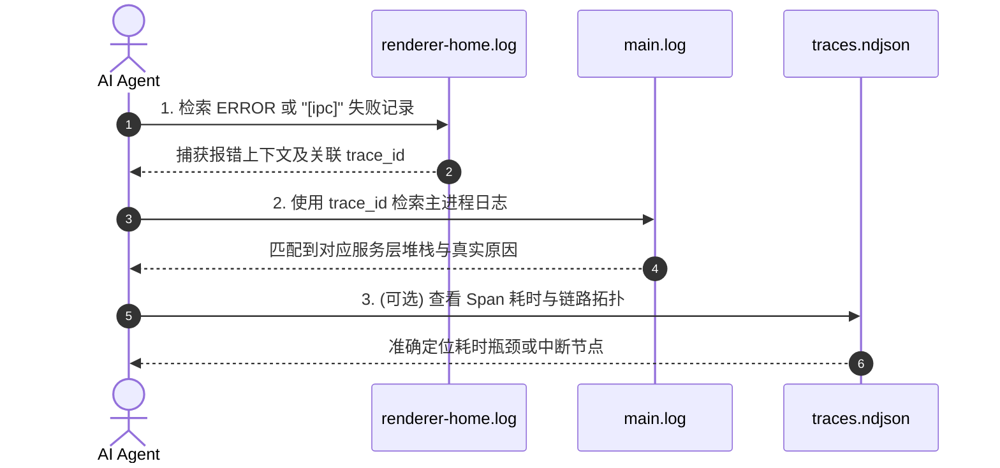

# AI Agent 高效调试与日志分析手册

> 本指南专为 AI 编程智能体（及人类开发者）设计，用于在面对应用启动崩溃、IPC 通信超时、渲染白屏、多窗口状态不同步等异常时，快速定位物理日志、提取链路追踪标识并复现诊断问题。

---

## 1. 物理日志存储拓扑与文件矩阵

本项目内置多进程分层日志体系，主进程与渲染进程（每个窗口）落盘日志物理隔离，且在每次应用启动时执行过期归档清理。

### 1.1 磁盘物理存储路径

| 操作系统 | 默认日志目录物理路径 |
| :--- | :--- |
| **Windows** | `%APPDATA%\<productName>\logs\`（例如 `C:\Users\<User>\AppData\Roaming\electron-template\logs\`） |
| **macOS** | `~/Library/Logs/<productName>/` |
| **Linux** | `~/.config/<productName>/logs/` |

> [!TIP]
> 在开发环境下，若主进程尚未生成桌面注册表配置，日志默认存放在 Electron 用户数据目录下：
> 可以在主进程直接调用 `logManager.getLogDirectory()` 获取实时绝对路径。

### 1.2 核心日志文件矩阵

| 日志文件名 | 归属进程 / 域 | 说明与典型记录内容 |
| :--- | :--- | :--- |
| **`main.log`** | 主进程 (Main) | 生命周期启动、窗口创建、IPC 服务端执行、全局未捕获异常 (`[Uncaught Exception]`) |
| **`renderer-home.log`** | 渲染进程 (Home 窗口) | 主窗口的前端渲染日志、用户操作事件、`window.electronApi` IPC 调用客户端日志 |
| **`renderer-updater.log`** | 渲染进程 (Updater 窗口) | 独立更新窗口的渲染与交互日志 |
| **`traces.ndjson`** | 全局遥测追踪 (Mini-OTel) | 结构化 NDJSON 格式，每行一个 Span 完整拓扑，包含持续时长、状态码与上下文属性 |

---

## 2. Mini-OTel 跨进程分布式追踪机制

项目自研轻量级 OpenTelemetry 追踪实现，彻底打通“渲染进程发起请求 ➔ Preload 桥接 ➔ 主进程处理 ➔ 结果返回”的全链路。

### 2.1 Trace ID 注入规范
每一条日志记录均自动带有 trace 标签，格式如下：
```text
[2026-10-12 21:05:01.123] [info] [trace_id:4bf92f3577b34da6a3ce929d0e0e4736 span_id:00f067aa0ba902b7] [IpcModule] Dispatching channel: usb:get-device-list
```
- `trace_id`: 32 位 Hex 字符串，标识同一个用户操作或业务调用的完整端到端生命周期；
- `span_id`: 16 位 Hex 字符串，标识当前独立执行段（如一个具体的 IPC 请求、一次数据库读取）。

### 2.2 Agent 排查异常的标准操作流程 (SOP)

当前端测试失败、用户反馈白屏或出现 IPC 错误时，Agent 必须遵循以下分析链：



1. **从渲染端日志定位线索**：
   在 `renderer-home.log` 中搜索 `error` 或 `[ipc]`，获取失败通道名与报错摘要；
2. **提取 `trace_id`**：
   提取日志中的 `trace_id:<hex>`；
3. **跨文件精准关联主进程**：
   在 `main.log` 中使用该 `trace_id` 过滤。主进程会在执行该请求的所有日志前自动附加相同的 `trace_id`，从而直接呈现主进程内部抛出的底层 Node 异常或 C++ 模块报错；
4. **分析 `traces.ndjson`**：
   若无直接异常信息，可查看 `traces.ndjson` 中对应 Trace 的 Span 耗时（`duration_ms`）与退出状态（`status.code !== 1`）。

---

## 3. 日志防打爆、轮转与安全脱敏

为了保证应用在长期运行或高频错误下不耗尽用户磁盘，日志子系统具备严格的工业级防护：

1. **体积轮转与归档限制**：
   - 普通日志文件单文件上限为 **5MB**，`traces.ndjson` 上限为 **10MB**；
   - 触发上限后，自动以时间戳重命名归档，格式为 `base-YYYY-MM-DD_HH-mm-ss.log`；
   - 应用每次启动时自动调用 `cleanOldLogs()`：**清理超过 7 天的历史日志，且每类日志最多保留 5 个归档**。
2. **文本硬截断防御**：
   - 避免日志输出巨型 JSON、Base64 或堆栈导致 IO 挂起，单条大文本在进入底层写入时会被自动截断并追加提示。
3. **数据安全与 PII 脱敏**：
   - 涉及网络鉴权、环境凭据时，敏感字段必须由调用方脱敏；
   - 环境变量在多进程间传递使用异或掩码混淆打包，防止明文泄露。

---

## 4. Agent CLI 排查工具箱 (Windows PowerShell)

在无头环境或终端内，AI Agent 可以直接运行以下 PowerShell 命令快速提取诊断信息：

### 4.1 定位日志目录并列出最新日志
```powershell
$LogDir = Join-Path $env:APPDATA "electron-template\logs"
Get-ChildItem -Path $LogDir | Sort-Object LastWriteTime -Descending
```

### 4.2 提取主进程最新 50 条异常日志
```powershell
$LogDir = Join-Path $env:APPDATA "electron-template\logs"
Get-Content -Path (Join-Path $LogDir "main.log") -Tail 200 | Select-String -Pattern "\[error\]|Exception|Error" | Select-Object -Last 50
```

### 4.3 追踪特定 Trace ID 的全链路日志
```powershell
$TraceId = "4bf92f3577b34da6a3ce929d0e0e4736"
$LogDir = Join-Path $env:APPDATA "electron-template\logs"
Get-ChildItem -Path $LogDir -Filter "*.log" | ForEach-Object {
    Select-String -Path $_.FullName -Pattern $TraceId
}
```

### 4.4 检查启动门禁与首屏就绪状态
```powershell
$LogDir = Join-Path $env:APPDATA "electron-template\logs"
Select-String -Path (Join-Path $LogDir "main.log") -Pattern "StartupReadiness|startup:event:main-ready"
```
