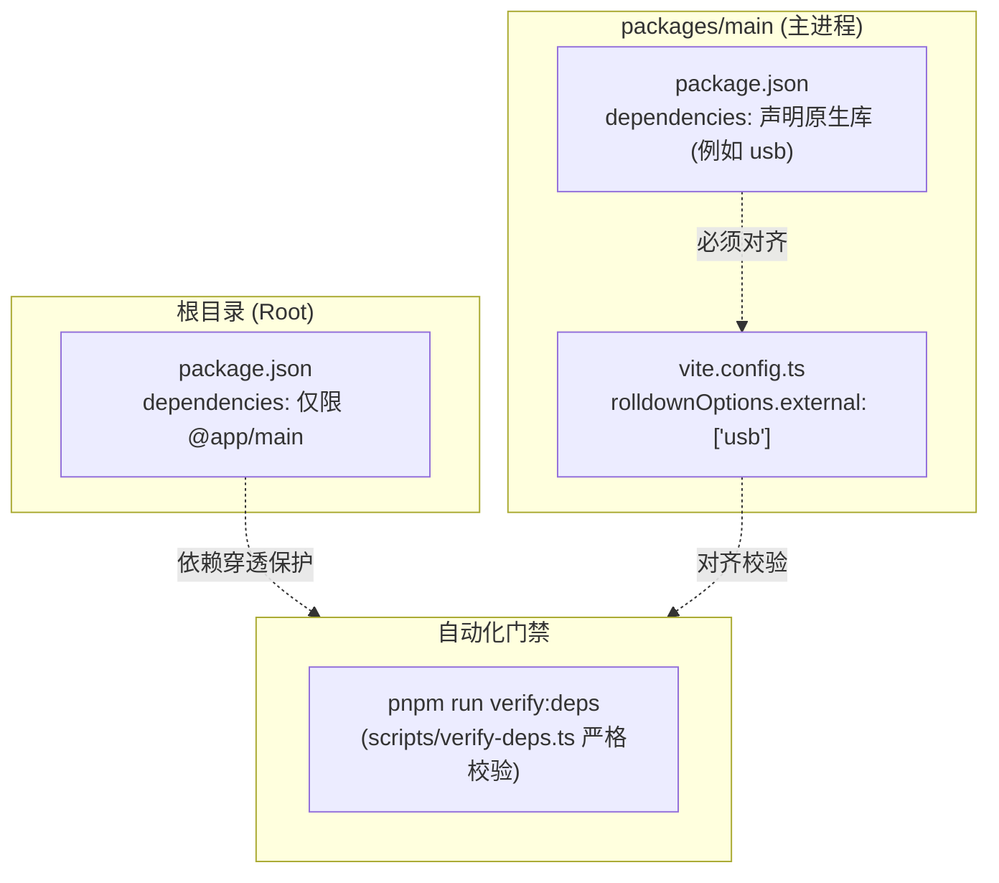

# 原生 C++ 模块接入与打包指南（以 USB 为例）

> 本文系统梳理在本项目中引入、编译、开发与打包原生 Node.js C++ 插件（Native Addons / Prebuilds，例如 `usb`, `serialport`, `better-sqlite3`）的工业级标准流程与陷阱防范。

---

## 1. 原生依赖接入铁律与架构边界

在 Electron 多包 Monorepo 体系中，原生模块的引入受到构建工具与分发架构的双重制约：



### 1.1 核心规则
1. **安装归属**：原生模块必须作为 `packages/main` 的生产依赖（`dependencies`），严禁装在 `devDependencies` 或根目录 `dependencies`。
2. **构建排除**：由于原生模块包含平台相关的动态链接库（`.node` 文件），Rolldown / Vite 打包时无法也不应将其打包进 JS Bundle。必须在 `packages/main/vite.config.ts` 的 `rolldownOptions.external` 中明确列出。
3. **依赖门禁校验**：运行 `pnpm run verify:deps`。此脚本会自动双向比对 `packages/main/package.json` 中的 `dependencies` 与 `vite.config.ts` 中的 `external` 列表，存在任一缺失即判定失败。

---

## 2. 端到端接入全流程（以 `node-usb` 为例）

### 步骤 1：安装原生模块
在项目主进程包中安装：
```bash
pnpm --filter @app/main add usb
```

### 步骤 2：配置 Vite External 排除
编辑 `packages/main/vite.config.ts`：
```ts
export default defineConfig({
  build: {
    rolldownOptions: {
      external: [
        'electron',
        'electron-log',
        'electron-updater',
        '@sentry/electron',
        'usb', // 👈 声明为外部依赖
      ],
    },
  },
});
```

### 步骤 3：验证依赖对齐
在根目录运行门禁检查：
```bash
pnpm run verify:deps
```
若检查通过，输出为：
```text
[verify-deps] dependencies vs external check passed (strict sync)!
```

### 步骤 4：主进程安全封装 (Service & Controller)
原生模块常有底层系统异常，严禁在渲染端直接暴露，必须在服务层进行防腐与序列化处理：

1. **`UsbService`**：
   调用 `usb.getDeviceList()`，捕获系统级错误，提取设备描述符字段（`vendorId`, `productId`, `deviceDescriptor` 等），映射为纯 JS 结构。
2. **`UsbController`**：
   负责入参合法性检验与生命周期捕获，将执行结果包装为 `Result<UsbDeviceItem[]>` 返回。

### 步骤 5：Preload 桥接与渲染层呈现
在 `@app/preload` 通过 `contextBridge` 注入通道，由前端统一经由 `window.electronApi.usb.getDeviceList()` 调用，并在 React 中结合 Hook 进行渲染。

---

---

## 3. pnpm 隔离布局下的原生打包与 asar 解包机制

在打包发布（`pnpm run build`）阶段，`electron-builder` 会将主进程代码打包进 `app.asar` 虚拟文件系统。

> [!WARNING]
> 1. **pnpm 隔离布局陷阱**：在 `node-linker=isolated` 模式下，预编译动态包（如 `@node-usb/usb-win32-x64-msvc`）被深锁在 `.pnpm` 虚拟目录中，`electron-builder` 在按根目录依赖树收集时会**漏打包底层预编译库**！
> 2. **Node.js 无法直接从 asar 加载二进制**：Node.js 底层无法直接 `dlopen` 位于虚拟 `.asar` 内部的二进制 `.node` 文件！

### 3.1 解决方案：`public-hoist-pattern` 精准提升 + `asarUnpack`

我们采用**仅提升原生动态包**的优雅解法，既彻底守住普通业务依赖的 100% 隔离红利，又完美适配 `electron-builder`：

1. **`.npmrc` 精准提升规则**：
   ```ini
   node-linker=isolated
   auto-install-peers=true
   # 仅提升原生二进制包（以 .node 相关的组织或包名），普通业务依赖依然 100% 隔离
   public-hoist-pattern[]=@node-usb/*
   public-hoist-pattern[]=*usb*
   ```
   *如未来引入其他原生库（如 `better-sqlite3`、`serialport`），只需在 `.npmrc` 中追加对应模式，例如 `public-hoist-pattern[]=*sqlite*`。*

2. **`build/electron-builder.ts` 标准外置解包**：
   ```ts
   // 将所有原生 .node 动态链接库统一解压至 app.asar.unpacked
   asarUnpack: ['**/*.node'],
   ```
   打包完成后，动态库将被自动外置至：
   `resources/app.asar.unpacked/node_modules/@node-usb/usb-win32-x64-msvc/usb.win32-x64-msvc.node`。

---

## 4. 跨平台注意事项（Windows / macOS / Linux）

1. **多平台预编译包下载策略**：
   - pnpm 在本地执行 `pnpm install` 时，**仅会按当前宿主 OS 下载对应的预编译依赖**；
   - 包含原生插件的跨平台构建**严禁在单机交叉编译**，必须依赖 GitHub Actions 跨平台矩阵在各宿主系统（`windows-latest`、`macos-latest`、`ubuntu-latest`）上独立运行打包。
2. **macOS 代码签名与沙箱授权**：
   - macOS 要求对外置解包在 `app.asar.unpacked/` 的每个 `.node` 文件进行独立签名与公证；
   - 若开启了 App Sandbox，需在 `build/entitlements.mac.plist` 中声明硬件访问权限（例如 `com.apple.security.device.usb`）。
3. **Linux 权限与动态库兼容性**：
   - Linux 下访问底层 USB 设备需要配置 udev 规则（避免非 root 抛出 `LIBUSB_ERROR_ACCESS`）；
   - 确保使用支持 GNU libc 的标准 Linux 发行版环境构建。

---

## 5. 常见问题排查与速查表

| 症状 / 报错现象 | 根本原因 | 解决方案 |
| :--- | :--- | :--- |
| **`Error: Cannot find module 'usb'`** (开发态) | Vite 误将 `usb` 尝试打包导致 resolve 失败 | 检查 `packages/main/vite.config.ts` 中的 `external` 列表是否添加 `'usb'`。 |
| **`NODE_MODULE_VERSION mismatch`** | 本地 Node.js 的 ABI 版本与 Electron 运行时的 ABI 版本不一致 | 运行 `pnpm rebuild` 或重新安装依赖，触发 Electron 目标版本的头文件重新编译。 |
| **`verify-deps failed`** | `packages/main/package.json` 中的依赖与 `vite.config.ts` 的 `external` 列表不一致 | 补全配置，确保生产依赖与 external 集合完全相同。 |
| **打包后找不到 `@node-usb` 或 `.node` 动态库** | pnpm 隔离模式下未提升预编译包，或缺少 `asarUnpack` | 在 `.npmrc` 中配置 `public-hoist-pattern[]`，并在 `electron-builder.ts` 中配置 `asarUnpack: ['**/*.node']`。 |
| **打包报错 `remove app.asar: file in use`** | 上次运行的 Electron 进程或代码编辑器仍占用着旧的 `app.asar` | 结束占用进程，或通过环境变量配置独立的临时输出目录（如 `$env:DIST_DIR="dist-test"`）。 |

