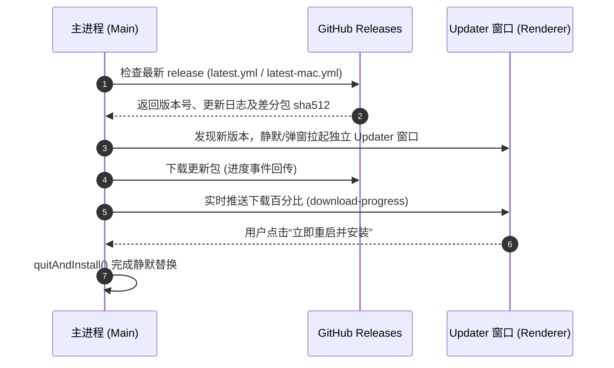

# 打包构建、发版与 OTA 自动更新指南

> 本文详细介绍项目如何通过 `scripts/build.ts` 结合 `electron-builder` 实现跨平台打包，以及如何通过 GitHub Releases 与内置的 `updater` 模块实现生产级增量/全量 OTA 自动更新。

---

## 1. 生产打包工作流 (`scripts/build.ts`)

为了杜绝手工运行 `electron-builder` 造成的依赖遗漏或产物校验跳过，项目使用 [`scripts/build.ts`](file:///scripts/build.ts) 统一接管打包编排。

### 1.1 打包全流水线
当执行打包指令时，流水线按顺序执行以下阶段：
1. **工作区编译 (`pnpm -r run build`)**：
   按依赖拓扑构建 `@app/shared`、`@app/renderer`、`@app/preload`、`@app/main`；
2. **依赖门禁校验 (`verify-deps`)**：
   自动检验原生 C++ 模块与 Vite external 是否严格对齐；
3. **Electron Builder 打包**：
   按 `build/electron-builder.ts` 规则生成可执行文件与安装包；
4. **产物安全性校验 (`verify-dist`)**：
   解包检验 asar 是否泄漏源码与 SourceMap，确认是否生成非法文件。

### 1.2 常用打包指令

```bash
# 仅打包解压目录（用于本地快速验证启动，不生成安装包）
pnpm run build:dir

# 打包 Windows 平台安装包 (.exe / NSIS)
pnpm run build:win

# 打包 macOS 平台安装包 (.dmg / .zip)
pnpm run build:mac

# 打包 Linux 平台安装包 (.AppImage / .deb)
pnpm run build:linux
```

---

## 2. OTA 自动更新体系架构

项目采用 `electron-updater` 配合独立轻量化 `updater` 渲染窗口实现企业级热更新交互。

### 2.1 整体架构流程



### 2.2 环境变量与发布配置
在项目根目录 `.env` 或 CI/CD Secrets 中配置：
- `GH_TOKEN`：GitHub 个人访问令牌（用于在 CI 中将打包产物推送到 Releases）；
- `VITE_APP_UPDATE_URL`：自建更新服务器 URL（如不使用 GitHub Releases，可配置为内部对象存储 S3/OSS）。

---

## 3. GitHub Actions 自动化发版实践

项目在 `.github/workflows/` 中已预置发版流水线：

1. **触发条件**：
   当向 `main` 分支推送带有语义化版本格式的 Git Tag（例如 `v1.0.0`）时，自动触发跨平台矩阵构建（Windows, macOS, Ubuntu）；
2. **多平台并行构建**：
   - Windows 节点生成 `.exe` 安装程序与 `latest.yml`；
   - macOS 节点生成 `.dmg`、`.zip` 与 `latest-mac.yml`（支持签名公证配置）；
   - Linux 节点生成 `.AppImage`；
3. **自动发布 Release Draft**：
   Actions 将所有安装包与校验哈希自动挂载至对应的 GitHub Release，开发者在 GitHub 控制台复核后点击 Publish 即可全网推送。
