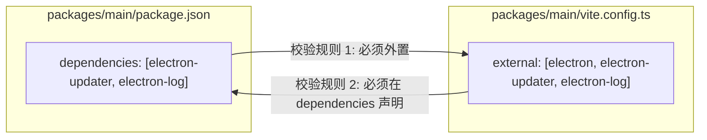

# 📦 Monorepo 打包全生命周期与依赖治理指南 (Packaging & Dependency Management)

> 本文档详细阐述本工程在 **Monorepo（多包工作区）架构** 下的依赖拓扑规范、全生命周期打包流水线，以及 **Pre-build（构建前置门禁）** 与 **Post-build（构建后置验真）** 的防御机制。旨在帮助团队成员理解项目如何从源头根除“安装包体积暴增”、“生产运行时白屏闪退”与“OTA 自动更新失效”等典型工程暗坑。

---

## 目录

- [一、 Monorepo 依赖拓扑设计与防劣化原则](#一-monorepo-依赖拓扑设计与防劣化原则)
  - [1. 依赖分层总览表](#1-依赖分层总览表)
  - [2. 根目录的“极简依赖红线”](#2-根目录的极简依赖红线)
  - [3. 主进程依赖与 Vite External 的“双向对齐”机制](#3-主进程依赖与-vite-external-的双向对齐机制)
- [二、 4 阶段全生命周期打包流水线](#二-4-阶段全生命周期打包流水线)
  - [1. 打包流水线架构图](#1-打包流水线架构图)
  - [2. 阶段详解与防护措施](#2-阶段详解与防护措施)
- [三、 前置与后置双门禁工作原理](#三-前置与后置双门禁工作原理)
  - [1. Pre-build 前置静态门禁 (scripts/verify-prebuild.ts)](#1-pre-build-前置静态门禁-scriptsverify-prebuildts)
  - [2. Post-build 后置物理验真 (scripts/verify-postbuild.ts)](#2-post-build-后置物理验真-scriptsverify-postbuildts)
- [四、 产物命名与 OTA 发布规范](#四-产物命名与-ota-发布规范)
- [五、 常用工程命令速查与排错指引](#五-常用工程命令速查与排错指引)

---

## 一、 Monorepo 依赖拓扑设计与防劣化原则

在多包工作区（pnpm workspace）中，多个子包共享顶层与各自独立的依赖。若缺乏统一的依赖治理策略，极易导致开发库与生产库混杂、体积膨胀失控。

### 1. 依赖分层总览表

| 工作区 / 包名 | 职责定位 | `dependencies`（运行时生产依赖） | `devDependencies`（开发与构建依赖） |
| :--- | :--- | :--- | :--- |
| **根目录 `/`** | Monorepo 编排与统一分发入口 | **严格仅限 `['@app/main']`** | 全局构建工具（`vite`、`typescript`、`electron-builder`、`tsx` 等）及各子包引用 |
| **`packages/main`** | Electron 主进程核心业务与生命周期 | 生产环境 Node.js 运行时依赖（如 `electron-updater`、`electron-log`） | 仅构建期类型声明与编译插件 |
| **`packages/preload`** | 上下文隔离（ContextBridge）安全安全通道 | **严格保持为空 `{}`** | Electron 类型定义 |
| **`packages/renderer`** | React 纯前端界面（Web 技术栈） | 前端运行时组件（`react`、`react-dom`、`lucide-react`、`clsx` 等） | 前端构建工具（Tailwind v4 等） |
| **`packages/shared`** | 跨端契约、类型定义与业务常量 | **严格保持为空 `{}`** | TypeScript 基础工具 |

---

### 2. 根目录的“极简依赖红线”

在许多 Electron 项目中，开发者常常习惯性地把第三方库直接安装到根目录的 `dependencies` 中。**在 Monorepo 架构下，这是极其致命的做法**：

- **打包机制**：`electron-builder` 在收集应用依赖时，会自动扫描根目录 `package.json` 中的 `dependencies`。
- **灾难后果**：若根目录误装了前端依赖（如 React）或开发工具（如 Lodash、Dayjs），`electron-builder` 会将整个包含成百上千小文件的 `node_modules` 树打包进 `app.asar`，导致原本仅几十 MB 的轻量安装包瞬间膨胀至几百 MB。
- **工程红线**：根目录 `package.json` 的 `dependencies` **严格仅允许指向主进程入口包 `['@app/main']`**。所有其他子包及第三方开发依赖必须全部收敛至 `devDependencies`。

---

### 3. 主进程依赖与 Vite External 的“双向对齐”机制

主进程由 Vite / Rolldown 负责编译打包，此时存在一个核心平衡：**哪些库该内联（Bundle）进代码？哪些库该外置（External）在运行时通过 Node 加载？**

本项目通过以下两道铁律保证双向对齐：



- **规则 1：打包外置（防代码重复与体积膨胀）**：
  凡是声明在 `packages/main` 的 `dependencies` 中的第三方模块，必须配置在 `vite.config.ts` 的 `external` 列表中，防止被 Vite 重复打包进单文件 bundle。
- **规则 2：生产依赖声明（防 MODULE_NOT_FOUND 白屏闪退）**：
  凡是在 Vite 中被 `external` 排除的第三方库，必须在 `packages/main` 的 `dependencies` 显式声明。否则代码被打包后，运行期执行 `require('xxx')` 时因物理目录缺失该模块，直接抛出 `MODULE_NOT_FOUND`，应用启动即崩溃白屏！

---

## 二、 4 阶段全生命周期打包流水线

当在终端执行 `pnpm run build:app` 时，工程将经历以下 4 个标准阶段：

### 1. 打包流水线架构图

```mermaid
flowchart TD
    Start["▶ 执行构建命令: pnpm run build:app"] --> Phase1
    
    subgraph Phase1 ["阶段 1: Pre-build 静态合规门禁 (scripts/verify-prebuild.ts)"]
        P1["1. 根目录 package.json name 规范校验 (无空格/小写/无@/)"]
        P2["2. 根目录 dependencies 边界校验 (仅限 @app/main)"]
        P3["3. 主进程 dependencies 与 Vite external 双向对齐检查"]
        P1 --> P2 --> P3
    end
    
    Phase1 -->|校验失败 (耗时 10ms)| Abort1["❌ 0 毫秒拦截退出，不浪费 CPU 编译"]
    Phase1 -->|校验通过| Phase2
    
    subgraph Phase2 ["阶段 2: Workspace 并行编译 (pnpm -r run build)"]
        B1["@app/shared 编译与类型构建"]
        B2["@app/preload 预加载脚本构建"]
        B3["@app/renderer 静态资源编译 (Vite + React)"]
        B4["@app/main 主进程构建 (Vite)"]
        B1 --> B2 & B3 & B4
    end
    
    Phase2 -->|编译报错| Abort2["❌ 构建中断"]
    Phase2 -->|编译成功| Phase3
    
    subgraph Phase3 ["阶段 3: Electron-builder 平台组装 (build/electron-builder.ts)"]
        E1["注入 build/resources 多端图标"]
        E2["排除 !**/*.map 源码映射 (防逆向)"]
        E3["生成 app.asar 与解包目录 (win-unpacked / mac / linux)"]
        E4["计算 .blockmap 差量索引与生成 latest.yml 清单"]
        E1 --> E2 --> E3 --> E4
    end
    
    Phase3 -->|打包异常| Abort3["❌ 打包中断"]
    Phase3 -->|打包成功| Phase4
    
    subgraph Phase4 ["阶段 4: Post-build 物理烟雾验真 (scripts/verify-postbuild.ts)"]
        V1["跨平台自动发现解包目录与二进制"]
        V2["解析 app.asar 头部并执行体积防膨胀门禁 (<10MB)"]
        V3["真实拉起打包程序 (Playwright)，断言 #root 挂载成功"]
        V1 --> V2 --> V3
    end
    
    Phase4 -->|体积超标 / 界面白屏| Abort4["❌ 产物不可用，阻止发布"]
    Phase4 -->|烟雾验收通过| Done["🎉 构建成功！产物已就绪可安全分发"]
```

---

## 三、 前置与后置双门禁工作原理

本工程将验证逻辑按生命周期严密拆分为**前置门禁**与**后置验真**：

### 1. Pre-build 前置静态门禁 (`scripts/verify-prebuild.ts`)
- **执行命令**：`pnpm run verify:prebuild`（在打包开始前自动触发）。
- **执行时机**：打包第 1 毫秒，零 IO 损耗。
- **校验内容**：
  1. **应用名称规范**：断言根目录 `package.json` 的 `name` 严格匹配 `^[a-z0-9-_]+$`，杜绝空格、大写字母与 `@/`，从源头消灭 OTA 发布 404 隐患；
  2. **根依赖隔离**：断言根目录 `dependencies` 严格仅有 `['@app/main']`；
  3. **外置一致性**：双向断言 `packages/main/package.json` 的 `dependencies` 与 `packages/main/vite.config.ts` 的 `external` 列表。

### 2. Post-build 后置物理验真 (`scripts/verify-postbuild.ts`)
- **执行命令**：`pnpm run verify:postbuild`（在打包生成后自动触发）。
- **执行时机**：打包产物生成后、发布上线前。
- **校验内容**：
  1. **跨平台解包发现**：自动兼容扫描 `win-unpacked`、`mac/*.app` 或 `linux-unpacked`；
  2. **asar 深度透视与体积硬门禁**：读取并解码 `resources/app.asar` 二进制头部，计算各顶层模块体积分布，打印 TOP 5 最大产物，并强制断言总体积必须小于预设阈值（默认 10MB，超标直接阻断）；
  3. **Playwright 真实拉起 Smoke 烟雾测试**：
     - 在完全沙箱环境中以原生子进程启动已打包的真实二进制；
     - 等待主窗口建立并验证窗口标题；
     - 等待前端 React 容器 `#root` 成功挂载，证实界面渲染无运行时脚本报错；
     - 测试完成后优雅退出并自动销毁临时用户数据目录。

---

## 四、 产物命名与 OTA 发布规范

在 `build/electron-builder.ts` 中，构建产物命名模板严格遵循：

```ts
artifactName: '${name}-${version}-${os}-${arch}.${ext}'
```

- **`productName` vs `name` 的职责边界**：
  - `productName`（如 `"Electron React Template"`）：专职面向桌面用户视觉体验（窗口标题栏、桌面快捷方式名），**允许包含空格与大写**；
  - `name`（如 `"electron-react-monorepo-template"`）：专职面向网络分发协议与 OTA 自动更新（生成安装文件名、`latest.yml` 索引与 GitHub Release 资产），**强制纯小写中划线零空格**。
- **OTA 增量配套文件**：
  每次打包在输出目标安装包（`.exe` / `.dmg` / `.deb`）的同时，会自动产出对应的 `.blockmap`（64KB 差量比对索引）与 `latest.yml`（版本元数据与 SHA512 哈希校验），分发至 CDN 或 GitHub Releases 即可无缝启用静默增量更新。

---

## 五、 常用工程命令速查与排错指引

### 1. 核心构建命令清单

```bash
# 执行完整打包流水线（Pre-build 门禁 -> 编译 -> 打包 -> Post-build 验真）
pnpm run build:app

# 仅执行打包阶段，跳过工作区子包重新编译
pnpm run build:app --skip-build

# 仅执行打包，跳过打包后的 Post-build 烟雾测试
pnpm run build:app --skip-verify

# 单独针对指定操作系统目标执行打包
pnpm run build:win      # 打包 Windows NSIS (.exe)
pnpm run build:mac      # 打包 macOS (.dmg, .zip)
pnpm run build:linux    # 打包 Linux (.deb)
pnpm run build:dir      # 仅生成解包目录，不制作安装包封装

# 独立执行构建前置静态门禁
pnpm run verify:prebuild

# 独立执行构建后置物理验真（要求 dist 目录已存在解包产物）
pnpm run verify:postbuild
```

---

### 2. 常见门禁阻断与排错手册

#### Q1: 报错 `[根目录 name 违规] 根 package.json 的 "name" 字段不符合规范`
- **原因**：根目录 `package.json` 中的 `name` 包含了空格、大写字母或特殊符号（如 `@my-app/client`）。
- **解法**：修改根 `package.json` 的 `name` 为合法的全小写中划线格式（如 `"my-desktop-client"`）。若需定制用户看到的中文或带空格名称，请修改 `productName` 字段。

#### Q2: 报错 `[根目录依赖违规] 根 package.json 的 dependencies 中检测到非法依赖`
- **原因**：误将某个第三方库安装到了根目录的 `dependencies` 中。
- **解法**：如果是构建工具或全局工具，移至根目录的 `devDependencies`；如果是运行时库，安装至对应的子包目录中（如 `pnpm --filter @app/main add xxx`）。

#### Q3: 报错 `[运行时依赖缺失] 模块在 external 中被排除，但未在 dependencies 中声明`
- **原因**：主进程的 `packages/main/vite.config.ts` 的 `external` 列表排除了某个库，但忘记在 `packages/main/package.json` 的 `dependencies` 显式声明该库。
- **解法**：执行 `pnpm --filter @app/main add <库名>` 将其补齐在生产依赖中，防止打包后报 `MODULE_NOT_FOUND`。

#### Q4: 报错 `[verify-postbuild] asar 体积超过门禁上限 (XX MB > 10.00 MB)`
- **原因**：打包产物异常膨胀，通常是因为打包时误包含了 `.map` 源码映射文件、或者将非必要的大体积静态资源/依赖打进了 asar。
- **解法**：查看控制台输出的 `asar 体积构成分析` 表格与 `TOP 5 最大产物文件`，定位是哪个模块体积超标；必要时在 `build/electron-builder.ts` 的 `files` 中增加排除规则，或者适当调整环境变量 `MAX_ASAR_SIZE_MB` 上限。
