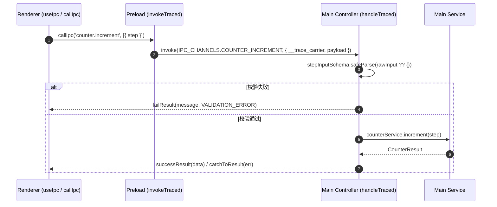

---

title: 全栈端到端功能开发（Fullstack-SOP）
description: 遵循 shared ➔ preload ➔ main ➔ renderer 单向流转闭环，类型安全与链路追踪一气呵成。
---

# 全栈端到端功能开发（Fullstack-SOP）

> **TL;DR**：新增跨进程功能必须按「契约先行、单向穿透」四步推进：在 `shared` 声明 Zod Schema 与通道常量，经 `preload` 透明转发，在 `main` 校验并执行业务返回 `Result<T>`，最后由 `renderer` 的 `useIpc` / `useManualRequest` 消费展示。

**边界声明**：本页负责跨端新功能串联落地的四步顺序与每步验收判据；不负责单层详细规范与豁免细则（见各包 `AGENTS.md`、主进程 [分层架构](/architecture/layering) 与 [类型安全的 IPC 契约](/security/ipc-contract)）及提交前验收清单（见 [AI 产出验收清单](/ai/friendly-conventions)）。

## 1. 选型理由

- **契约单一事实源（Contract-First）**：Electron 主进程（Node.js）与渲染进程（Chromium）分属不同运行时，若双方各自手写类型，字段变更会静默失效。由 `@app/shared` 统一派生入参类型与通道常量，可让 `tsc -b --noEmit` 在编译期拦截跨端漂移。
- **全链路追踪无感注入**：Preload 经 `invokeTraced` 自动注入 `__trace_carrier`，Main 经 `handleTraced` 解包还原 W3C Trace Context，业务代码无需手动传递 `traceId`。
- **单向流转隔离副作用**：所有依赖单向穿透至纯业务 `Service`，避免渲染层或控制层混入原生细节，方便独立单测。

## 2. 核心机制

### 跨端四步调用时序



以仓库内已有的 `counter` 领域为例，新增跨端功能按以下四步依次落地：

### Step 1：契约层（`@app/shared`）

在 `schemas/<domain>.ts` 用 Zod 定义入参并就近导出 `z.infer` 类型，在 `types/<domain>.ts` 定义纯返回结构，在 `constants/ipc-channels.ts` 声明通道常量，最后扩充 `types/api.ts` 的 `ElectronApi` 接口（规则见 [packages/shared/AGENTS.md](https://github.com/BanShan-Alec/electron-react-monorepo-template/blob/main/packages/shared/AGENTS.md)）。

- **完成判据**：未新增任何桶文件（`index.ts`），且消费方全部通过 `@app/shared/<layer>/<file>` 子路径直出导入。

→ 源码：[packages/shared/src/schemas/counter.ts](https://github.com/BanShan-Alec/electron-react-monorepo-template/blob/main/packages/shared/src/schemas/counter.ts) · [types/api.ts](https://github.com/BanShan-Alec/electron-react-monorepo-template/blob/main/packages/shared/src/types/api.ts)
```ts
// schemas/counter.ts：入参契约与类型同源派生
export const stepInputSchema = z.object({
  step: z.number().int().min(1).max(100).default(1),
});
export type StepInput = z.infer<typeof stepInputSchema>;

// constants/ipc-channels.ts：COUNTER_INCREMENT: 'counter:increment'
// types/api.ts（节选）：在 ElectronApi 中声明统一签名 (input?, options?) => Promise<Result<T>>
export interface ElectronApi {
  counter: {
    increment: (input?: StepInput, options?: IpcCallOptions) => Promise<Result<CounterResult>>;
  };
}
```

### Step 2：安全桥接层（`@app/preload`）

在 [packages/preload/src/index.ts](https://github.com/BanShan-Alec/electron-react-monorepo-template/blob/main/packages/preload/src/index.ts) 的 `apiBridge` 中挂载对应方法，统一经 `invokeTraced(IPC_CHANNELS.<KEY>, input, options)` 转发（第 0 位固定为业务载荷，无参传 `undefined`；第 1 位固定为可选 `IpcCallOptions`）。若需主进程主动推送，必须显式区分为粘性通道（`createStickyChannel`）或瞬态通道（返回取消函数）。

- **完成判据**：`apiBridge` 类型与 `ElectronApi` 100% 对齐，执行 `pnpm typecheck` 与 `pnpm --filter @app/preload run build` 无报错。

### Step 3：主进程服务与控制层（`@app/main`）

在 `services/<domain>.service.ts` 编写零 IPC 感知的单例业务类（如 [counter.service.ts](https://github.com/BanShan-Alec/electron-react-monorepo-template/blob/main/packages/main/src/services/counter.service.ts)），在 `controllers/<domain>.controller.ts` 通过 `handleTraced` 校验入参并返回 `Result<T>`，并在 [controllers/index.ts](https://github.com/BanShan-Alec/electron-react-monorepo-template/blob/main/packages/main/src/controllers/index.ts) 的 `registerAllControllers()` 中显式登记（完整新域代码骨架见 [main-domain-sop.md](https://github.com/BanShan-Alec/electron-react-monorepo-template/blob/main/.agents/rules/main-domain-sop.md)）。

- **完成判据**：Controller 内不含业务逻辑，入参已 `.safeParse`，异常经 `catchToResult(err)` 兜底。

→ 源码：[packages/main/src/controllers/counter.controller.ts](https://github.com/BanShan-Alec/electron-react-monorepo-template/blob/main/packages/main/src/controllers/counter.controller.ts)（节选）
```ts
handleTraced(
  IPC_CHANNELS.COUNTER_INCREMENT,
  async (_event, rawInput: unknown): Promise<Result<CounterResult>> => {
    const parseResult = stepInputSchema.safeParse(rawInput ?? {});
    if (!parseResult.success) {
      return failResult(parseResult.error.issues[0].message, ErrorCode.VALIDATION_ERROR);
    }
    try {
      return successResult(counterService.increment(parseResult.data.step));
    } catch (err) {
      return catchToResult(err);
    }
  },
);
```

### Step 4：渲染展示层（`@app/renderer`）

在 `features/<domain>/hooks/` 下封装业务 Hook（单一通道优先用 `useIpc('domain.method')`，多通道编排使用 `useManualRequest` + `callIpc`），在 `features/<domain>/components/<Xxx>/index.tsx` 按七段式纯展示渲染，并仅通过 `features/<domain>/index.tsx` 向外导出入口组件（规则见 [packages/renderer/AGENTS.md](https://github.com/BanShan-Alec/electron-react-monorepo-template/blob/main/packages/renderer/AGENTS.md)）。

- **完成判据**：组件内不碰 `window.api`，请求均为 `manual: true` 显式触发，全仓执行 `pnpm typecheck && pnpm lint && pnpm test` 全绿。

→ 源码：[packages/renderer/src/features/counter/hooks/useCounter.ts](https://github.com/BanShan-Alec/electron-react-monorepo-template/blob/main/packages/renderer/src/features/counter/hooks/useCounter.ts)（节选）
```ts
// 单通道场景可用 useIpc('counter.get')；多动作编排在 useManualRequest 内统一路由 callIpc
async function runCounterAction(action: CounterAction, step: number): Promise<CounterResult> {
  if (action === 'increment') {
    return callIpc('counter.increment', [{ step }]);
  }
  if (action === 'decrement') {
    return callIpc('counter.decrement', [{ step }]);
  }
  return callIpc('counter.reset');
}
```

## 3. 桌面端避坑注意事项

| 避坑要点                       | 事故表现与原因                                                                                 | 本仓库对齐方案                                                            |
| :----------------------------- | :--------------------------------------------------------------------------------------------- | :------------------------------------------------------------------------ |
| **Controller 遗漏集中登记**    | 主进程写了 Controller 却未在 `controllers/index.ts` 中注册，调用抛出 `No handler registered`。 | 必须在 `registerAllControllers()` 中显式挂载，严禁裸写分散监听。          |
| **IPC 返回裸 Error 对象**      | 未捕获 Promise rejection 跨进程传递，渲染端收到空对象 `{}` 导致调试困难与白屏崩溃。            | 必须使用 `catchToResult(err)` 统一包装为带 `ErrorCode` 的 `Result<T>`。   |
| **渲染层异步未走 manual-only** | 使用第三方库默认轮询或自动防抖，桌面端后台常驻时疯狂空转消耗 CPU 与电量。                      | 统一采用 `useManualRequest` 或 `useIpc`，显式由用户交互或特定 Hook 触发。 |
