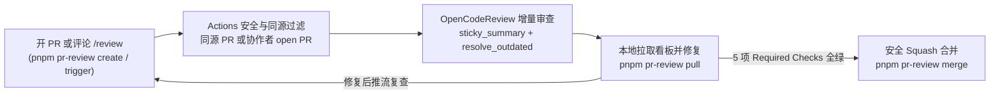

---

title: AI 评审闭环（Open-code-review）
description: 解释 PR 自动审查的评论治理与安全触发边界，配合本地 pr-review CLI 实现拉取修复与安全合入闭环。
---

# AI 评审闭环（Open-code-review）

> **TL;DR**：通过 GitHub Actions 集成 `open-code-review` 实现「单看板原地更新 + 旧线程自动关闭 + 仅增量审查」，本地统一经 `pnpm pr-review <cmd>` 拉取看板、触发复查与校验合并。

**边界声明**：本页负责解释自动化评审工作流的触发安全边界、评论治理参数设计原因与常见故障排查；`pnpm pr-review` 各子命令的详细参数与 Agent 操作 SOP 以 [.agents/skills/pr-review/SKILL.md](https://github.com/BanShan-Alec/electron-react-monorepo-template/blob/main/.agents/skills/pr-review/SKILL.md) 为唯一真源。

## 1. 选型理由

- **治理论坛式评论刷屏**：传统评审机器人每推一次提交就在行内重新发表全量评论，多轮迭代后重要人工讨论被淹没。通过置顶单一 Summary 看板并启用 `sticky_summary` 原地更新，保持 PR 页面可读性。
- **自动清理已修复线程**：开发按建议修复并推送后，开启 `resolve_outdated` 由 CI 自动将对应旧 review threads 标为 Resolved，无需手工逐条点关闭。
- **控制外网暴露面与费用**：公开仓库中 `issue_comment` 在默认分支上下文下可读 Secrets，必须过滤仓库成员身份与 PR 状态，避免路人评论触发恶意消耗。

## 2. 核心机制

### 评审与本地修复闭环



### 工作流安全边界与核心治理参数

工作流定义在 [.github/workflows/open-code-review.yml](https://github.com/BanShan-Alec/electron-react-monorepo-template/blob/main/.github/workflows/open-code-review.yml)，仅在 PR 创建 / 重开 / Ready 时自动触发，后续 push 不自动消耗额度，需显式评论 `/review` 或 `/ocr` 触发复查。关于 `pull_request` / `issue_comment` 触发事件在权限与 Secrets 上的安全边界，可查阅 [GitHub Actions 事件触发文档](https://docs.github.com/en/actions/writing-workflows/choosing-when-your-workflow-runs/events-that-trigger-workflows#pull_request)（读它能确认为何 Fork PR 无法访问仓库密钥以及 `permissions` 最小授权原则）。

→ 源码：[.github/workflows/open-code-review.yml](https://github.com/BanShan-Alec/electron-react-monorepo-template/blob/main/.github/workflows/open-code-review.yml)（节选）
```yaml
concurrency:
  group: ${{ github.workflow }}-${{ github.event.pull_request.number || github.event.issue.number }}
  cancel-in-progress: true

permissions:
  contents: write # 支持 resolve_outdated 自动关闭已修复的 review threads
  pull-requests: write # 发表行内 review 与 summary 看板
  issues: write

jobs:
  review:
    if: >
      (github.event_name == 'pull_request' &&
       github.event.pull_request.head.repo.full_name == github.repository) ||
      (github.event.issue.pull_request && github.event.issue.state == 'open' &&
       contains(fromJson('["OWNER","MEMBER","COLLABORATOR"]'), github.event.comment.author_association) &&
       (startsWith(github.event.comment.body, '/review') || startsWith(github.event.comment.body, '/ocr')))
```

在 `alibaba/open-code-review@main` 步骤中，关键治理策略围绕减噪、权限收敛与防限流设置：

- **增量审查与去重**：`checkpoint_range: "true"` 与 `incremental: "true"` 仅对最新推送的提交范围增量扫描，避免重复覆盖历史行内位置。
- **单看板与线程自净**：`sticky_summary: "true"` 原地更新置顶看板，`resolve_outdated: "true"` 在代码修复后自动关闭对应旧线程，`route_severity_below: ""` 禁止低优建议灌入看板。
- **限流与产物保留期**：`review_concurrency: "4"` 为上游 LLM 供应商留出并发余量；`upload_artifacts: "false"` 交由后续步骤统一将审查产物（`/tmp/ocr-result.json` 与 `/tmp/ocr-stderr.log`）保留 1 天。

### 本地闭环入口指针

日常本地协同严禁手写散装 `gh` 命令拼凑逻辑，统一通过 `@app/pr-review` CLI 驱动：

- **发起与查看**：`pnpm pr-review create` 自动推流并按 PR 模板建单，`pnpm pr-review status` 汇总门禁与冲突状态。
- **拉取与复查**：`pnpm pr-review pull` 将审查产物与 CI 状态落盘为 `packages/pr-review/reviews/pr-<PR>-round-<N>.md` 本地看板，修复推流后以 `pnpm pr-review trigger` 发送 `/review` 触发复查。
- **安全合并**：`pnpm pr-review merge` 校验分支同步与 5 项 Required Checks 全绿后执行 squash 合并；完整子命令参数、人工批注格式及 AI 红线见 [SKILL.md](https://github.com/BanShan-Alec/electron-react-monorepo-template/blob/main/.agents/skills/pr-review/SKILL.md) 与 [CICD.md](https://github.com/BanShan-Alec/electron-react-monorepo-template/blob/main/.github/CICD.md)。

## 3. 桌面端避坑注意事项与失败排查

| 故障症状 / 避坑要点            | 原因分析                                                                              | 仓库对齐方案与排查手段                                                                            |
| :----------------------------- | :------------------------------------------------------------------------------------ | :------------------------------------------------------------------------------------------------ |
| **工作流报 HTTP 403 权限不足** | 未声明写权限时，`resolve_outdated` 或发表行内评论会被 `GITHUB_TOKEN` 拒绝。           | 在工作流顶部显式授予 `permissions: contents: write` 与 `pull-requests: write`。                   |
| **Actions 跑出红叉或缺少密钥** | 仓库未配置 `OCR_LLM_URL` / `OCR_LLM_TOKEN` / `OCR_LLM_MODEL`，或外部 Fork PR 无密钥。 | 通过 `if` 跳过 Fork PR；未启用 AI 评审时删该 workflow 文件，且 `AI Code Review` 保持非 required。 |
| **评论 `/review` 无任何反应**  | PR 非 `open` 状态、评论未以 `/review` 或 `/ocr` 开头，或评论者无协作者权限。          | 对照 `if` 条件确认 PR 状态与账号权限（`OWNER / MEMBER / COLLABORATOR`）。                         |
| **LLM 429 限流导致部分失败**   | PR 变动文件较多时并发请求突破供应商每 Key 并发上限。                                  | 工作流显式设置 `review_concurrency: "4"` 削峰，必要时可再次评论 `/review` 补跑。                  |
| **`pr-review merge` 被拒绝**   | 仓库启用 `strict: true` 分支保护，分支落后于 `main` 或 5 项必选门禁未全绿。           | 先执行 `git merge origin/main` 同步主干并推送，等 CI 全绿后再合并。                               |
