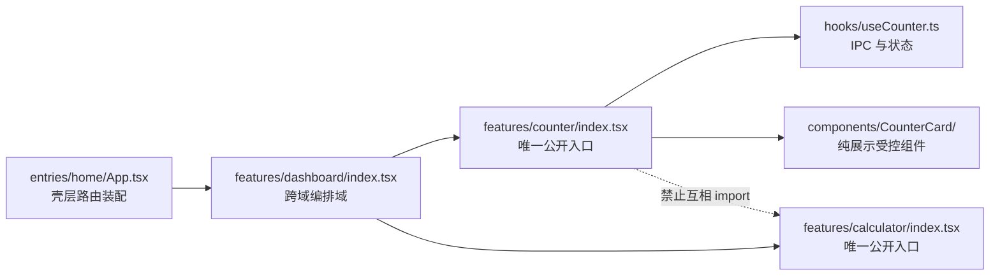

---

title: 功能域组织（Features）
description: 渲染层采用自包含领域目录（Features），域间禁止跨层引用，删功能即删目录。
---

# 功能域组织（Features）

> **TL;DR**：渲染层按功能域垂直划分（`features/<domain>/`），每个域通过唯一公开入口 `index.tsx` 粘合私有 Hook 与展示组件；域间禁止互相 `import`，废弃功能只需物理删除对应目录。

**本页负责**：`features/<domain>/` 垂直功能域的目录边界、单向入口暴露（`index.tsx`）与域间禁止互相引用约定。
**本页不负责**：壳层 Wouter 路由装配与 Hash 导航（见 [路由（Wouter）](/ui/wouter)）、单组件内部七段式分区与文件夹规范（见 [React 组件编写规范（Code-partition + Hooks）](/architecture/react-conventions)）、全局共享状态（见 [全局状态（Zustand）](/ui/zustand)）。

## 1. 选型理由

传统前端按文件技术类型建立全局大池子（所有组件进全局 `components/`、所有 Hook 进全局 `hooks/`），在桌面端多业务面板演进中会导致两类问题：
1. **调用关系碎片化**：单个业务面板的 UI、状态与 IPC 逻辑散落在多个目录，排查或修改时必须跨目录跳转追踪。
2. **废弃清理困难**：业务下线时，散落在全局池中的 Hook 与子组件极易成为无人敢删的孤儿文件。

项目据此确立领域自包含原则：一个业务域对应一个独立目录，目录边界即架构边界；完整包级规则见 [packages/renderer/AGENTS.md](https://github.com/BanShan-Alec/electron-react-monorepo-template/blob/main/packages/renderer/AGENTS.md) §1–§2。

## 2. 核心机制



### 标准功能域拓扑结构

每个功能域严格维持三层内聚结构，私有组件与私有 Hook 默认不出域：

→ 源码：[packages/renderer/src/features/counter/index.tsx](https://github.com/BanShan-Alec/electron-react-monorepo-template/blob/main/packages/renderer/src/features/counter/index.tsx)

```text
features/counter/
├── index.tsx                    # 唯一对外公开入口（仅做胶水：调用 Hook + 渲染卡片）
├── components/CounterCard/      # 私有展示组件（Props 进、回调出，不直接调 IPC）
└── hooks/useCounter.ts          # 私有业务 Hook（封装状态、计算与跨进程 IPC 调用）
```

### 极简胶水入口（`index.tsx`）

功能域入口只负责实例化本域 Hook 并将 ViewModel 透传给展示卡片，壳层或其他编排域只能导入 `@/features/<domain>`，禁止深层路径引用（如 `@/features/counter/hooks/useCounter`）。复杂父域确有分层需要时，允许下设最多两层自包含 `sections/`，同级 section 间同样禁止互相引用：

→ 源码：[packages/renderer/src/features/counter/index.tsx](https://github.com/BanShan-Alec/electron-react-monorepo-template/blob/main/packages/renderer/src/features/counter/index.tsx)

```tsx
// 节选：入口仅做 Hook 实例化与卡片Props 透传（不包裹 memo）
function CounterFeature() {
  const { count, step, setStep, isUpdating, handleIncrement, handleDecrement, handleReset } =
    useCounter();

  return (
    <CounterCard
      count={count}
      step={step}
      onStepChange={setStep}
      isUpdating={isUpdating}
      onIncrement={handleIncrement}
      onDecrement={handleDecrement}
      onReset={handleReset}
    />
  );
}

export { CounterFeature };
```

壳层 `App.tsx` 通过 Wouter 的 `<Switch>` / `<Route>` 装配各页面级入口，具体路由协议、兜底重定向与多窗口路由隔离见 [路由（Wouter）](/ui/wouter)。

## 3. 桌面端避坑注意事项

- **功能域之间禁止互相直接 `import`**：严禁在 `features/counter` 中导入 `features/calculator` 的组件或 Hook；若需跨域组合（如首页工作台），一律收敛到上层 `features/dashboard` 编排，或通过主进程统一状态同步。
- **不要过早抽取全局共享层**：仅被单一功能域消费的组件或工具必须留在域内；只有当第二个独立功能域出现真实复用诉求时，才上提到全局 `src/components/`、`src/hooks/` 或 `src/lib/`。
- **展示组件与 IPC Hook 严格分离**：`features/<domain>/components/` 内的卡片保持纯受控展示，不直接调用 `useIpc` 或 `window.api`，由 `hooks/` 统一持有异步通信与错误提示，确保 UI 渲染可独立测验。
- **Hook 严禁上提至顶层壳实例化**：Hook 必须在各自的 `Feature` 入口内部实例化，避免顶层 `App` 持有全部业务状态导致主界面无关重渲染。
