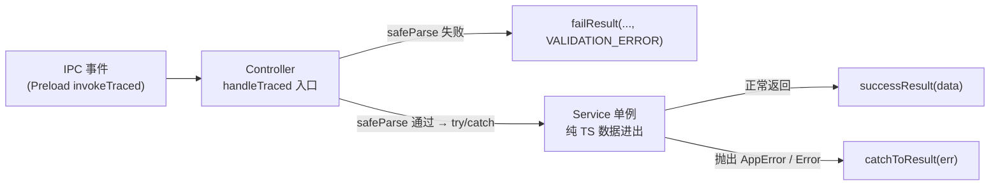

---

title: 分层架构（Controller / Service）
description: IPC 事件收敛于 Controller，核心业务封装在 Service，脱离 Electron 依赖实现纯 Node 单测。
---

# 分层架构（Controller / Service）

> **TL;DR**：主进程通信遵循 `IPC 事件 → Controller → Service` 单向链路。Controller 在 `try` 外先用 Zod 校验入参、在 `try/catch` 内委托 Service 并统一返回 `Result<T>`；Service 保持无 IPC 感知与无状态单例，支持纯 Node 单测。

**本页负责**：主进程 Controller 与 Service 的职责切分、校验与异常收敛边界及单向依赖设计。
**本页不负责**：主进程包级四条铁律全文（见 [packages/main/AGENTS.md](https://github.com/BanShan-Alec/electron-react-monorepo-template/blob/main/packages/main/AGENTS.md) §2）、横向系统模块装配（见 [模块生命周期（ModuleRunner）](/architecture/module-lifecycle)）、跨端 Schema 契约与 Preload 桥接（见 [类型安全的 IPC 契约（Zod + ContextBridge）](/security/ipc-contract)）、主进程构造注入单测实践（见 [主进程单元测试（EventEmitter）](/testing/main-process-tests)）。

## 1. 选型理由

桌面端主进程若把 `ipcMain.handle` 与业务逻辑混写在同一回调里，会迅速引发两类工程痛点：
1. **单测被迫依赖完整 Electron 运行时**：测试一段简单计算或配置逻辑也要拉起原生窗口与 IPC 通道，无法在无 GUI 的 Node 环境中秒级运行。
2. **业务无法跨触发源复用**：同一能力若同时需要响应 IPC 调用、启动期后台检查（如 `initApp` 启动后静默校验自启或检查更新）或托盘菜单触发，耦合 `IpcMainInvokeEvent` 的处理函数将无法直接复用。

因此主进程将「通信协议适配」与「领域逻辑执行」严格拆分到 `controllers/` 与 `services/` 两层。

## 2. 核心机制



### Controller 层：校验在 `try` 外，异常收敛在 `try/catch`

Controller 通过 `handleTraced` 挂载通道并接入 W3C 链路追踪。入参先在 `try` 块外部经 `@app/shared/schemas` 的 `.safeParse()` 校验，非法请求在进入业务逻辑前直接通过 `failResult` 返回语义化 `ErrorCode.VALIDATION_ERROR`；通过后再进入 `try/catch` 调用 Service，将 `AppError` 或未知异常统一收敛为 `Result<T>`：

→ 源码：[packages/main/src/controllers/counter.controller.ts](https://github.com/BanShan-Alec/electron-react-monorepo-template/blob/main/packages/main/src/controllers/counter.controller.ts)

```ts
// 节选：Zod 校验置于 try 外快速失败，Service 执行包裹在 try/catch 内
handleTraced(
  IPC_CHANNELS.COUNTER_INCREMENT,
  async (_event, rawInput: unknown): Promise<Result<CounterResult>> => {
    const parseResult = stepInputSchema.safeParse(rawInput ?? {});
    if (!parseResult.success) {
      return failResult(parseResult.error.issues[0].message, ErrorCode.VALIDATION_ERROR);
    }
    try {
      return successResult(counterService.increment(parseResult.data.step));
    } catch (err) {
      return catchToResult(err);
    }
  },
);
```

### Service 层：无 IPC 感知与延迟读取配置

Service 类只接收纯 TypeScript 数据结构并返回纯结果对象（异常通过抛出 `AppError` 表达业务错误码），不引入 `ipcMain` 或 `IpcMainInvokeEvent`；依赖持久化配置时在方法体内延迟调用 `getAppConfigStore()`，避免模块加载期提前求值：

→ 源码：[packages/main/src/services/counter.service.ts](https://github.com/BanShan-Alec/electron-react-monorepo-template/blob/main/packages/main/src/services/counter.service.ts)

```ts
// 节选：纯业务 Service 类与单例导出，方法内延迟读取配置 store
export class CounterService {
  getCounter(): CounterResult {
    const store = getAppConfigStore();
    return { count: store.get('serverCounter') };
  }

  increment(step = 1): CounterResult {
    const store = getAppConfigStore();
    const newCount = store.get('serverCounter') + step;
    store.set({ serverCounter: newCount });
    return { count: newCount, step };
  }
}

export const counterService = new CounterService();
```

### 单一入口集中注册

所有域控制器的 `register<Domain>Controllers()` 均在 `registerAllControllers()` 中显式装配，防止通信入口散落在业务文件各处：

→ 源码：[packages/main/src/controllers/index.ts](https://github.com/BanShan-Alec/electron-react-monorepo-template/blob/main/packages/main/src/controllers/index.ts)

```ts
// 节选：主进程 IPC 控制器的集中注册入口
export function registerAllControllers(): void {
  registerSystemControllers();
  registerUsbControllers();
  registerCounterControllers();
  registerCalculatorControllers();
  // ... 其余业务域控制器
}
```

## 3. 桌面端避坑注意事项

主进程四条架构铁律（单向调用、Zod 校验、`Result<T>` 包装、`handleTraced` 挂载及 `DIAGNOSTICS_LOG` 唯一豁免）的规范原文见 [packages/main/AGENTS.md](https://github.com/BanShan-Alec/electron-react-monorepo-template/blob/main/packages/main/AGENTS.md) §2；下述为桌面端分层落地的边界说明：

- **`modules/` 与 `services/` 的职责分界**：系统横切能力（窗口、托盘、CSP、单实例锁）属于 `modules/`，由 `ModuleRunner` 在启动流水线管理；垂直业务状态与计算属于 `services/`。二者不可混写，但如 `config.controller` 可在 Service 更新配置后调用窗口注册表 `broadcast()` 同步多窗口。
- **配置 Store 必须方法内延迟读取**：`initApp` 启动前全局单例尚未初始化，若在 `new XxxService()` 构造函数里立即调用 `getAppConfigStore()`，会破坏模块装配时序并在启动阶段报错；必须在业务方法执行时再读取。
- **以构造函数注入替代拆分微型文件**：需要隔离 Electron 原生依赖（如 `autoUpdater`）进行单元测试时，应在 Service 构造函数保留可选依赖注入接缝（见 [主进程单元测试（EventEmitter）](/testing/main-process-tests)），而非把私有映射函数生硬拆成零散文件。
- **跨进程链路追踪豁免边界**：除 `DIAGNOSTICS_LOG`（见 [全链路追踪（W3C-trace）](/main/tracing)）外，新增 Controller 必须使用 `handleTraced` 包装，否则主进程无法继承渲染端发起的 W3C Trace 上下文。
