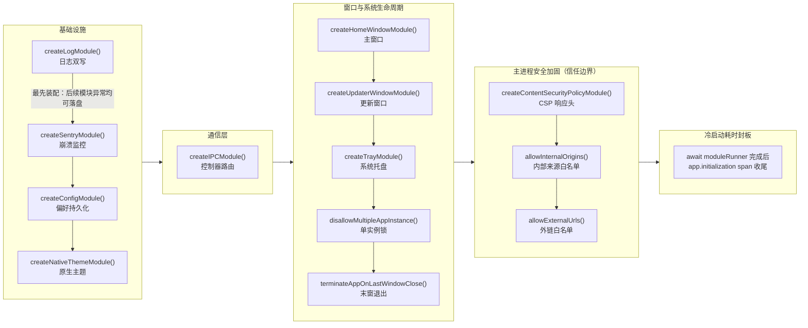

---

title: 模块生命周期（ModuleRunner）
description: 采用 ModuleRunner 微内核将系统能力解耦为可插拔模块，链式装配并在入口删一行即可整体退场。
---

# 模块生命周期（ModuleRunner）

> **TL;DR**：主进程横向系统能力一律实现 `AppModule` 接口（仅包含 `enable()` 方法），由微内核 `ModuleRunner` 串成顺序 Promise 链执行；系统能力可插拔，入口删一行即可整体卸载。

**本页负责**：`AppModule` 协议、`ModuleRunner` 链式驱动机制与 `initApp` 主进程装配时序。
**本页不负责**：业务域 Controller / Service 分层（见 [分层架构（Controller / Service）](/architecture/layering)）、托盘与单实例内部实现（见 [托盘常驻与单实例（Tray + Single-instance）](/main/tray-single-instance)）、CSP 与来源白名单策略（见 [内容安全策略（CSP）](/security/csp)）、首屏启动壳门禁（见 [首屏体验（Startup-orchestration）](/ui/first-screen)）。

## 1. 选型理由

传统 Electron 项目极易演化为数千行的“巨石 `main.js`”：窗口创建、系统托盘、自动更新、CSP 设置、单实例锁等逻辑全部混杂在 `app.whenReady()` 的嵌套回调中，初始化时序无从厘清，删除或重构某项能力往往牵一发而动全身。

项目采用微内核架构将原生生命周期事件垂直切片：每个能力是一个模块，装配顺序显式写在入口，关注点与依赖关系同时可见。

## 2. 核心机制

`initApp` 里的 `.init()` 链就是真实初始化时序：`init()` 对每个模块立即调用 `enable()`，同步完成的部分当场执行；返回的 Promise 从调用点就开始跑，只是被接到链尾，`await moduleRunner` 会等链上所有 Promise 落定。下图按代码顺序分阶段排列全部模块：



### 极简模块协议（`AppModule`）

每个横向系统模块只关注自己的就绪逻辑，接口只有单一方法：

→ 源码：[packages/main/src/AppModule.ts](https://github.com/BanShan-Alec/electron-react-monorepo-template/blob/main/packages/main/src/AppModule.ts)

```ts
export interface AppModule {
  enable(context: ModuleContext): Promise<void> | void;
}
```

### 微内核链式驱动（`ModuleRunner`）

`ModuleRunner` 维护一条顺序 Promise 执行链：`init()` 立即调用 `enable()`，返回 Promise 时把它接到链尾；自身实现 `PromiseLike<void>`，入口一句 `await moduleRunner` 即可收敛整条链。对外只导出 `createModuleRunner()` 工厂，不直接暴露类定义：

→ 源码：[packages/main/src/ModuleRunner.ts](https://github.com/BanShan-Alec/electron-react-monorepo-template/blob/main/packages/main/src/ModuleRunner.ts)

```ts
// 节选：ModuleRunner 类（省略 import 与私有 createModuleContext）
class ModuleRunner implements PromiseLike<void> {
  private promise: Promise<void>;

  constructor() {
    this.promise = Promise.resolve();
  }

  then<TResult1 = void, TResult2 = never>(
    onfulfilled?: ((value: void) => TResult1 | PromiseLike<TResult1>) | null | undefined,
    onrejected?: ((reason: unknown) => TResult2 | PromiseLike<TResult2>) | null | undefined,
  ): PromiseLike<TResult1 | TResult2> {
    // biome-ignore lint/suspicious/noExplicitAny: Delegate error handler to Promise#then
    return this.promise.then(onfulfilled, onrejected as any);
  }

  init(module: AppModule) {
    const p = module.enable(this.createModuleContext());
    if (p instanceof Promise) {
      this.promise = this.promise.then(() => p);
    }
    return this;
  }
}

export function createModuleRunner() {
  return new ModuleRunner();
}
```

### 主进程入口的流水线装配

系统能力的启动声明式收拢在 `initApp` 中：加一个能力即新建 module 并在链上加一行；删掉 `createTrayModule()` 那一行，托盘连同原生事件订阅整体退场：

→ 源码：[packages/main/src/index.ts](https://github.com/BanShan-Alec/electron-react-monorepo-template/blob/main/packages/main/src/index.ts)

```ts
// 节选：initApp() 装配链与冷启动 span 收尾（省略完整 origin 集合构建）
const startupSpan = getTracer().startManualSpan('app.initialization');

const moduleRunner = createModuleRunner()
  .init(createLogModule())
  .init(createSentryModule())
  .init(createConfigModule())
  .init(createNativeThemeModule())
  .init(createIPCModule())
  .init(createHomeWindowModule({ initConfig }))
  .init(createUpdaterWindowModule({ initConfig }))
  .init(createTrayModule())
  .init(disallowMultipleAppInstance())
  .init(terminateAppOnLastWindowClose())
  .init(createContentSecurityPolicyModule())
  .init(allowInternalOrigins(/* devServer origin 或 file:// + 'null' */))
  .init(allowExternalUrls(new Set(ALLOWED_EXTERNAL_URLS)));

await moduleRunner;
startupSpan.addEvent('app.modules_ready');
startupSpan.setAttributes({ initMs: Math.round(performance.now()) });
startupSpan.end('OK');
```

## 3. 桌面端避坑注意事项

- **模块装配顺序具有强因果依赖**：日志模块（`createLogModule`）必须最先装配，确保后续所有模块初始化异常均可捕获落盘；启动壳只等「动画 + React 首帧」两道门禁，主进程装配耗时由 `app.initialization` span 记录（`initMs` 以进程启动为锚）供排障。
- **职责边界隔离（`modules/` vs `services/`）**：`modules/` 仅承载横向基础设施与原生系统生命周期切片（如窗口、托盘、原生主题）；垂直业务逻辑一律归属于 `services/`，避免在 `modules/` 中混入业务分支。
- **初始化异常阻断与 `app.exit(1)` 防僵尸驻留**：若前置模块在 `enable()` 中抛出 Rejected Promise，`initApp().catch()` 必须在记入日志后显式调用 `app.exit(1)`。切勿只打日志而不退出，否则会留下无窗口却占着单实例锁的后台僵尸进程。
- **模块注销与资源清理**：若模块持有长时间监听（如 `process.on` 或原生句柄），应在模块内部配合主进程退出信号主动注销，避免造成进程退出挂死。
