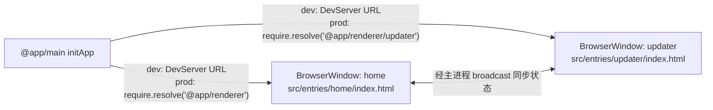

---

title: 多窗口入口（MPA）
description: 采用 MPA 架构隔离主窗口与更新弹窗，Vite 双物理入口与 exports 精确路径解析。
---

# 多窗口入口（MPA）

> **TL;DR**：拒绝将 SPA 单页思维硬套在 Electron 多窗口上；主应用（`home`）与更新弹窗（`updater`）各自拥有独立的 HTML 入口与编译产物，更新小窗无需背负主应用的路由与业务组件包袱。

**本页负责**：Vite 双物理入口（MPA）划分、`@app/renderer` `exports` 映射与主进程多窗口路径解析。
**本页不负责**：`manualChunks` 路径正则分包与 ASAR 体积门禁（见 [分包与体积门禁（Chunk + Asar）](/security/bundle-budget)）、窗口初始传参时序分层（见 [窗口初始传参（Window-params）](/architecture/window-params)）、窗口几何持久化与单实例唤醒（见 [窗口位置与尺寸（Window-state）](/ui/window-state) 与 [托盘常驻、单实例与开机自启（Tray + Single-instance + Auto-launch）](/main/tray-single-instance)）。

## 1. 选型理由

许多桌面应用习惯把 Web 的 SPA 单入口直接搬进 Electron：
1. **轻量辅助窗背负冗余体积**：一个只负责展示进度条的更新弹窗，若共享同一 SPA 入口，不得不加载主应用完整的路由树、文档能力与业务卡片。
2. **故障隔离能力弱**：主应用入口异常容易连带影响更新弹窗独立拉起，削弱用户修复或升级路径。

项目采用多页面应用（MPA）架构，在构建期与进程运行时实现物理级隔离。

→ 官方文档：[构建多页面应用（vite.dev）](https://vite.dev/guide/build.html#multi-page-app)，读它可了解 Vite 多 HTML 入口的构建输入解析与产物输出机制。

## 2. 核心机制



### Vite 多页面物理入口

在 `packages/renderer/vite.config.ts` 中分别声明 `home` 与 `updater` 两个 HTML 入口，使 Vite 按独立入口树打包；配套的 `manualChunks` 精细分包策略与 ASAR 体积门禁见 [分包与体积门禁（Chunk + Asar）](/security/bundle-budget)：

→ 源码：[packages/renderer/vite.config.ts](https://github.com/BanShan-Alec/electron-react-monorepo-template/blob/main/packages/renderer/vite.config.ts)

```ts
// 节选：多页面物理入口定义（output.manualChunks 分包细则见 /security/bundle-budget）
rollupOptions: {
  input: {
    home: path.resolve(currentDir, 'src/entries/home/index.html'),
    updater: path.resolve(currentDir, 'src/entries/updater/index.html'),
  },
}
```

### 主进程按需加载与物理路径解析

主进程在启动入口区分开发态与生产态，开发态传入 Dev Server 对应路径的 `URL`，生产态通过 `require.resolve` 解析包导出路径：

→ 源码：[packages/main/src/index.ts](https://github.com/BanShan-Alec/electron-react-monorepo-template/blob/main/packages/main/src/index.ts)

```ts
// 节选：主进程传入双窗口入口配置
initApp({
  windows: {
    home: devServer
      ? new URL('src/entries/home/index.html', devServer)
      : { path: require.resolve('@app/renderer') },
    updater: devServer
      ? new URL('src/entries/updater/index.html', devServer)
      : { path: require.resolve('@app/renderer/updater') },
  },
  preload: { path: require.resolve('@app/preload') },
});
```

`@app/renderer` 的 `package.json` 通过 `exports` 对外暴露构建后的 HTML 物理位置，主进程无需硬编码 `dist/` 目录层级：

→ 源码：[packages/renderer/package.json](https://github.com/BanShan-Alec/electron-react-monorepo-template/blob/main/packages/renderer/package.json)

```json
"exports": {
  ".": { "default": "./dist/src/entries/home/index.html" },
  "./updater": { "default": "./dist/src/entries/updater/index.html" },
  "./updater.html": { "default": "./dist/src/entries/updater/index.html" },
  "./package.json": "./package.json"
}
```

## 3. 桌面端避坑注意事项

- **MPA 跨物理窗口状态同步单一真源**：每个物理入口拥有独立的 Chromium 渲染进程、独立 JS 堆内存与独立 Zustand 实例。跨窗口严禁通过 `localStorage`、`BroadcastChannel` 或 `window.opener` 互传状态，变更一律提交主进程，由主进程经 `broadcast()` 向已注册窗口派发。
- **辅助小窗口的按需销毁与模块自治**：更新弹窗等辅助性小窗应在关闭时释放渲染进程内存，不在后台空转；各窗口模块（`HomeWindowModule`、`UpdaterWindowModule`）仅管理自身生命周期，严禁跨模块越权销毁其他窗口。
- **分包规则集中收敛**：`manualChunks` 路径正则过滤（隔离 `vendor-react` 与 `vendor-antd`）与体积门禁配置均以 [分包与体积门禁（Chunk + Asar）](/security/bundle-budget) 为准，避免多处改写导致匹配退化。
- **开发态与生产态路径差异**：开发态主进程通过 `new URL(..., devServer)` 拼接相对路径走 HTTP 加载；生产态通过 `loadFile` 加载本地 `file://` 产物，辅助小窗内部不得引入依赖 History 路由的路径跳转（见 [路由（Wouter）](/ui/wouter)）。
