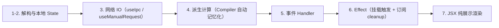

---

title: React 组件编写规范（Code-partition + Hooks）
description: 说明 React Compiler 下的组件目录、七段式分区、manual-only 请求与 IPC 订阅清理约定。
---

# React 组件编写规范（Code-partition + Hooks）

> **TL;DR**：React Compiler 在编译期接管常规依赖记忆化；组件按「一组件一文件夹（`Xxx/index.tsx`）」组织，内部遵循七段式线性骨架，异步请求强制 `manual-only`（单通道用 `useIpc`，多通道编排用 `useManualRequest`），IPC 订阅必须在 `useEffect` cleanup 中成对释放。

**本页负责**：React Compiler 工程配置约束、一组件一文件夹目录形态、七段式组件骨架、`manual-only` 请求与 IPC 订阅清理。
**本页不负责**：全局 Biome 门禁与桶文件规则明细（见 [代码规范与风格（Biome）](/engineering/code-style)）、功能域纵向划分（见 [功能域组织（Features）](/architecture/feature-domains)）、主进程推送事件分类契约（见 [窗口初始传参（Window-params）](/architecture/window-params)）。

## 1. 选型理由

桌面客户端常驻运行且跨进程事件密集，手动在每个计算与回调上包裹 `useMemo` / `useCallback` 既增加样板代码，也容易因漏写依赖引发闭包陈旧；同时若允许组件或 Hook 自动轮询，后台常驻时会导致 IPC 频发。

工程采用三项互锁约束：
1. **编译期自动记忆化**：在 [Vite 配置](https://github.com/BanShan-Alec/electron-react-monorepo-template/blob/main/packages/renderer/vite.config.ts) 中通过 `@vitejs/plugin-react` 开启 `react({ compiler: true })`（底层走基于 Rust 的 `oxc-transform-react`，不引入 Babel）；在 [Biome 配置](https://github.com/BanShan-Alec/electron-react-monorepo-template/blob/main/.config/biome.json) 中启用 `nursery.useReactCompiler: "error"`，在 lint 阶段拦截违反 React 纯度规则的写法（如 render 期间读写 `ref.current`）。
2. **一组件一文件夹与七段式骨架**：目录即组件实体，组件内部职责自上而下单向排列，降低人机阅读与审查成本。
3. **显式触发异步请求**：禁用隐式轮询与自动重取，所有 IPC 均需用户操作或挂载 `useEffect` 显式触发。

→ 官方文档：[React Compiler（react.dev）](https://react.dev/learn/react-compiler)，读它可了解编译器自动记忆化的工作边界及 Rules of React 纯度校验要求。

## 2. 核心机制



组件结构、Props 导出与七段式规则唯一真源见 [packages/renderer/AGENTS.md](https://github.com/BanShan-Alec/electron-react-monorepo-template/blob/main/packages/renderer/AGENTS.md) §6。

### 一组件一文件夹目录形态

所有 React 组件采用独立文件夹 `Xxx/index.tsx`（PascalCase 目录），将私有样式、私有 Hook 与纯逻辑辅助模块收敛在同级目录下，不对外暴露内部实现。以复杂组件 `CodeHighlight` 为例：

→ 源码：[packages/renderer/src/components/ui/CodeHighlight/index.tsx](https://github.com/BanShan-Alec/electron-react-monorepo-template/blob/main/packages/renderer/src/components/ui/CodeHighlight/index.tsx)

```text
src/components/ui/CodeHighlight/
├── index.tsx                # 组件本体实现（JSX 渲染与 Props 接口定义）
├── highlight.css            # 组件专属局部样式
├── hooks/
│   └── useCodeHighlight.ts  # 组件专属私有 Hook
└── lib/
    └── codeHighlight.ts     # 组件专属纯逻辑辅助模块
```

`Xxx/index.tsx` 本身包含组件实现逻辑，并非只做 `export *` 重导出的桶文件；Biome `noBarrelFile` 规则说明与禁止双导出（Dual Export）约束见 [代码规范与风格（Biome）](/engineering/code-style)。

### 七段式固定分区骨架

组件函数体严格按「解构 → State → IO → 派生 → Handlers → Effect → JSX」自上而下排列，静态常量与纯函数置于组件外部：

→ 源码：[packages/renderer/src/features/counter/components/CounterCard/index.tsx](https://github.com/BanShan-Alec/electron-react-monorepo-template/blob/main/packages/renderer/src/features/counter/components/CounterCard/index.tsx)

```tsx
// 节选：七段式组件骨架（完整 JSX 与 Props 字段见源码）
const _CounterCard = (props: CounterCardProps) => {
  useLingui();
  // 变量声明、解构
  const { count, step, onStepChange, isUpdating, onIncrement, onDecrement, onReset } = props;
  // 组件状态 / 网络IO（无内容可保留注释或自然跳过）
  // 数据转换（React Compiler 自动记忆化，无需手动 useMemo）
  const selectOptions = toSelectOptions(STEP_OPTIONS);
  // 逻辑处理函数 / 组件Effect
  // 组件渲染
  return <AppCard title={/* ... */}>{/* ... */}</AppCard>;
};

interface CounterCardProps {
  /* ... */
}
export const CounterCard = memo(_CounterCard);
```

### manual-only 请求与订阅清理闭环

- **请求收口**：[Biome 配置](https://github.com/BanShan-Alec/electron-react-monorepo-template/blob/main/.config/biome.json) 通过 `style.noRestrictedImports` 禁止业务直接导入 `ahooks` 的 `useRequest`（仅豁免底层封装本身）。单通道调用一律使用 [useIpc](https://github.com/BanShan-Alec/electron-react-monorepo-template/blob/main/packages/renderer/src/hooks/useIpc.ts)，多通道编排使用 [useManualRequest](https://github.com/BanShan-Alec/electron-react-monorepo-template/blob/main/packages/renderer/src/hooks/useManualRequest.ts)（内部写死 `manual: true` 与 `150ms` `loadingDelay`）。
- **订阅清理**：Preload 暴露的 `onXxx` 订阅均返回取消函数，Hook 必须在 `useEffect` 的清理函数中成对注销，防止窗口常驻期间重复累加监听器：

→ 源码：[packages/renderer/src/features/updater/hooks/useUpdater.ts](https://github.com/BanShan-Alec/electron-react-monorepo-template/blob/main/packages/renderer/src/features/updater/hooks/useUpdater.ts)

```ts
// 节选：useEffect 订阅主进程状态与进度推送，并在 cleanup 成对取消
useEffect(() => {
  void bootstrap();

  // 状态流转订阅
  const unsubState = window.api?.updater?.onStateChanged?.(applyEvent);

  // 下载进度流式订阅：进度不是完整快照，仅前迸 revision 并叠加在前一状态上
  const unsubProgress = window.api?.updater?.onProgressChanged?.((progress) => {
    revisionRef.current += 1;
    // 只有正在下载时才叠加进度：取消/失败后迟到的进度事件不得把状态拨回 downloading
    setSnapshot((prev) => (prev.state === 'downloading' ? { ...prev, progress } : prev));
  });

  return () => {
    unsubState?.();
    unsubProgress?.();
  };
}, []);
```

## 3. 桌面端避坑注意事项

- **不要为了“清零”而盲删必要的 `useCallback`**：避免样板式 `useMemo` / `useCallback`；但如 DOM 测量观察者或稳定性敏感的 Effect 依赖仍可按实际引用需求保留显式 `useCallback`。
- **IPC 订阅防陈旧闭包**：`useEffect` 监听回调读取最新状态时，应优先使用函数式更新 `setSnapshot((prev) => ...)` 或 `useRef` 镜像（如 `latestEventRef`），避免捕获挂载期旧值。
- **Props 命名与导出一致性**：新写组件统一声明具名 `export interface <ComponentName>Props`（禁止 `I` 前缀与行内类型），展示组件统一采用 `export const Xxx = memo(_Xxx)` 具名导出。
- **禁止在组件中裸写 `console.log`**：生产构建不会将 renderer `console` 落盘，业务与异常叙事应统一走全局 `logger`。
