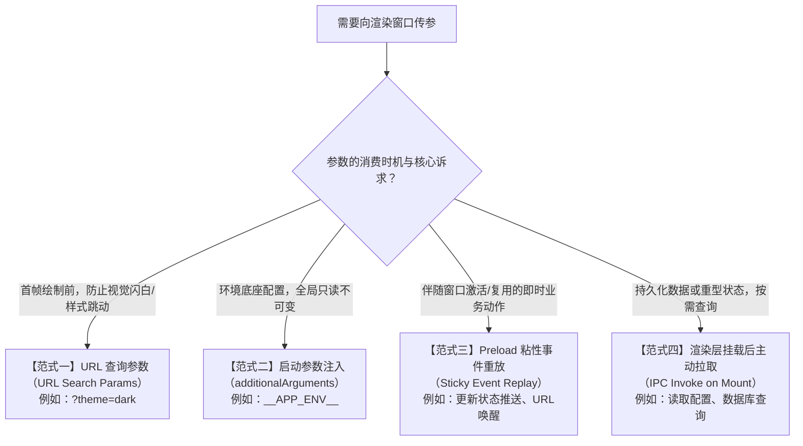

---

title: 窗口初始传参（Window-params）
description: 梳理 Electron 窗口初始传参的四种范式（URL Query、additionalArguments、粘性事件重放、主动拉取），彻底消灭首屏闪烁与时序竞态。
---

# 窗口初始传参（Window-params）

> **TL;DR**：拒绝「所有参数一律挂载后 IPC 异步拉取」的偷懒模式；根据参数生命周期将传参严格划分为四大分层范式：首帧防闪烁走 **URL Query**，静态基座走 **additionalArguments**，瞬态业务指令走 **Preload 粘性事件重放**，持久化重型数据走 **IPC 主动拉取**。

## 1. 选型理由

桌面客户端相比传统 Web 存在复杂的原生宿主与 Chromium 渲染管线分层，若采用传统的 Web 单页思维或单一通信通道，极易触发以下三大痛点：

1. **首屏闪白与样式跳动（FOUC, Flash of Unstyled Content）**：若将主题（Dark/Light）等视觉控制项放在 React 挂载后通过 IPC 异步拉取，窗口弹出的瞬间原生背景色与 HTML 默认白底会产生肉眼可见的“白闪”，随后又因 CSS 变量注入跳变，视觉极为粗糙。
2. **生命周期时序竞态（Race Condition）**：主进程创建窗口或在窗口复用时立即向渲染层发送 IPC（`webContents.send('event-action')`）。此时渲染层的 React 组件尚处于加载代码或构建 Fiber 树阶段，监听器未及注册便导致初始业务事件彻底丢失；若为此引入“挂载后反向 Pull + 监听 Push”的双通道机制，又会引发事实源分裂与去重防重难题。
3. **窗口复用时的状态僵化与残留**：常驻型辅助小窗口（如更新弹窗、托盘快捷面板）在桌面端普遍采用 `show/hide` 复用机制以节省内存与冷启动开销。若传参模式无法兼容“初次冷启动”与“二次热唤起”，将导致状态无法动态刷新或上一次状态残留。

## 2. 核心机制

针对不同阶段的消费需求，窗口传参严格按时序生命周期分流决策：



### 范式一：URL 查询参数（URL Search Params）—— 首帧防闪烁极速通道

在调用 `loadURL` 或 `loadFile` 时将轻量标量参数直接编码进 URL 查询字符串中。在 HTML `<head>` 中通过原生内嵌脚本在解析 CSS / DOM 之前**同步读取**并打上标记，彻底消除首屏主题闪白。

→ 源码：[packages/main/src/modules/window/home-window.module.ts](https://github.com/BanShan-Alec/electron-react-monorepo-template/blob/main/packages/main/src/modules/window/home-window.module.ts) 与 [packages/renderer/src/entries/home/index.html](https://github.com/BanShan-Alec/electron-react-monorepo-template/blob/main/packages/renderer/src/entries/home/index.html)

```html
<!-- 主进程注入 query: url.searchParams.set('theme', resolvedTheme) -->
<!-- 渲染层 HTML <head> 极速同步拦截消费 -->
<script>
  const startupTheme = new URLSearchParams(window.location.search).get('theme');
  if (startupTheme === 'dark' || startupTheme === 'light') {
    document.documentElement.dataset.theme = startupTheme;
  }
</script>
```

### 范式二：启动参数注入（`additionalArguments`）—— 静态环境基座

利用 Chromium 原生启动参数通道，在主进程创建 `BrowserWindow` 时通过 `webPreferences.additionalArguments` 注入序列化快照（`--app-meta=...`）。Preload 在执行时同步从 `process.argv` 中解包，并通过 `contextBridge` 进行深度冻结（`Object.freeze`）暴露，早于渲染层任何业务 JS bundle 执行。

→ 源码：[packages/preload/src/index.ts](https://github.com/BanShan-Alec/electron-react-monorepo-template/blob/main/packages/preload/src/index.ts)

```ts
// Preload 桥接层解析、深度冻结并安全暴露只读底座
const metaArg = process.argv.find((arg) => arg.startsWith(APP_ENV_ARG_PREFIX));
let runtimeEnv: AppRuntimeEnv | null = null;
if (metaArg) {
  runtimeEnv = unpackRuntimeEnv(metaArg.slice(APP_ENV_ARG_PREFIX.length));
}
contextBridge.exposeInMainWorld('__APP_ENV__', Object.freeze(runtimeEnv ?? {}));
```

### 范式三：Preload 粘性事件重放（Sticky Event Replay）—— 动态激活与复用单向流

针对具有“随时可能被唤起，且窗口可能冷启动、也可能常驻复用”的业务弹窗，采用单向推（Push）+ 粘性事件缓存重放机制。Preload 常驻捕获目标 IPC 通道数据；React 挂载并注册监听时，若已有到达的事件，利用微任务（`queueMicrotask`）立即重放，消灭拉取往返与时序竞态。

→ 源码：[packages/preload/src/sticky.ts](https://github.com/BanShan-Alec/electron-react-monorepo-template/blob/main/packages/preload/src/sticky.ts)

```ts
// 节选：通用粘性事件通道实现（常驻捕获 + 监听注册微任务重放）
export function createStickyChannel<T>(channel: string) {
  let latestData: T | null = null;
  const listeners = new Set<(data: T) => void>();
  ipcRenderer.on(channel, (_event, data: T) => {
    latestData = data;
    for (const listener of listeners) listener(data);
  });
  return (callback: (data: T) => void) => {
    listeners.add(callback);
    if (latestData !== null) {
      const cached = latestData;
      queueMicrotask(() => {
        if (listeners.has(callback)) callback(cached);
      });
    }
    return () => {
      listeners.delete(callback);
    };
  };
}
```

### 范式四：渲染层挂载后主动拉取（IPC Invoke on Mount）—— 持久化数据按需加载

经典的 Request-Response 模式，由渲染层组件在挂载时按需调用 `await window.api.config.get()`。仅适用于存储在 SQLite/Drizzle 或 `electron-store` 中的持久化重型数据，以及用户切换到特定 Tab 时的按需装配；严禁用于窗口弹出瞬间的即时指令传递。

→ 源码：[packages/renderer/src/features/settings/hooks/useAppConfig.ts](https://github.com/BanShan-Alec/electron-react-monorepo-template/blob/main/packages/renderer/src/features/settings/hooks/useAppConfig.ts)

## 3. 桌面端避坑注意事项

| 维度                | 范式一：URL Query  | 范式二：启动参数注入   | 范式三：粘性事件重放           | 范式四：挂载主动拉取            |
| :------------------ | :----------------- | :--------------------- | :----------------------------- | :------------------------------ |
| **生效层级**        | HTML `<head>` 最早 | Preload 注入全局       | React `useEffect`              | React `useEffect`               |
| **通信机制**        | URL 协议原生携带   | Chromium 启动命令行    | IPC Push (`webContents.send`)  | IPC Pull (`ipcRenderer.invoke`) |
| **跨进程往返**      | 0 次（无 IPC）     | 0 次（无 IPC）         | 0.5 次（单向推）               | 1 次（往返 Request/Response）   |
| **支持数据类型**    | 简短字符串         | 序列化字符串/对象      | 任意结构化数据                 | 任意结构化数据                  |
| **支持热更新/复用** | ❌（需重新导航）   | ❌（进程生命周期绑定） | ✅（支持连续推送与微任务重放） | ✅（随调随取）                  |
| **防首屏闪白能力**  | 极强（首帧生效）   | 良好（JS 执行前注入）  | 依赖 React 首帧渲染            | 差（需加载占位骨架屏）          |

- **绝对禁止为了传参破坏 `contextIsolation`**：严禁为了传参方便关闭 `contextIsolation` 或通过 `nodeIntegration` 直接读写主进程内存；所有参数传递必须经由隔离桥接通道（URL、标准启动参数或安全包装的 `ipcRenderer`）。
- **警惕「主动拉取（Pull）」与「被动推送（Push）」混用的双重事实源陷阱**：在需要唤起窗口处理动作的场景中，切勿同时设立 `get-state`（拉）与 `on-state`（推）两个通道。双通道必然导致去重逻辑膨胀与状态竞态，应当坚决采用**范式三（粘性重放）**实现单向数据流归一。
- **`additionalArguments` 的前缀命名与碰撞防御**：Chromium 本身自带大量的命令行启动参数（如 `--disable-features`、`--lang`）。自定义参数必须包含显式唯一前缀（如 `--app-meta=`），并在 Preload 解包时做好 `try-catch` 容错防崩。
- **常驻复用窗口的数据清理与幂等消费**：采用粘性重放范式时，若某次业务动作属于“阅后即焚”型（如完成一次通知弹窗交互），渲染层在消费后需视业务需要重置内部状态，或在窗口 `hide` 时由主进程向 Preload 下发清理信号，避免下一次意外重放陈旧数据。
