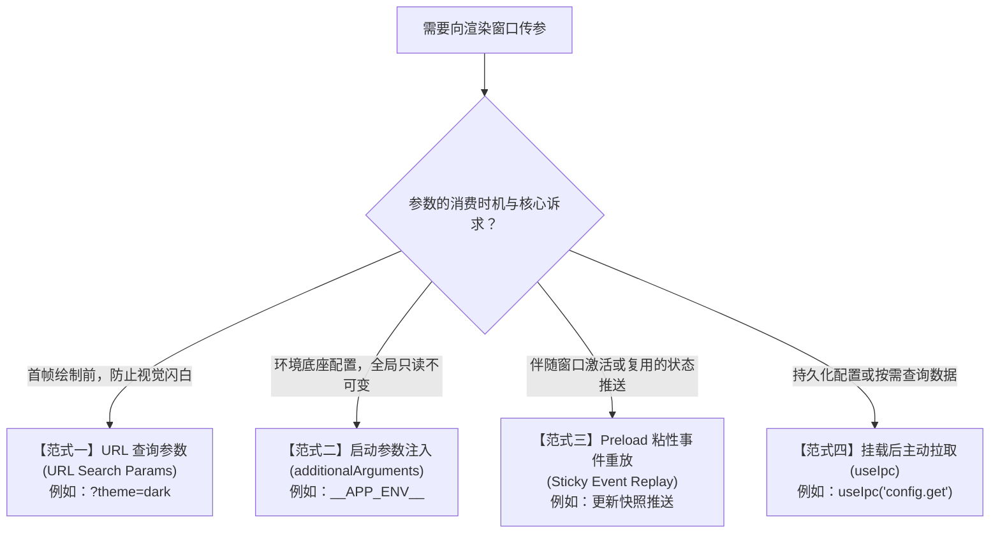

---

title: 窗口初始传参（Window-params）
description: 梳理 Electron 窗口初始传参的四种范式（URL Query、additionalArguments、粘性事件重放、useIpc 主动拉取），消灭首屏闪烁与时序竞态。
---

# 窗口初始传参（Window-params）

> **TL;DR**：拒绝「所有参数一律挂载后 IPC 异步拉取」；按消费时机将窗口传参分为四层：首帧防闪烁走 **URL Query**，静态基座走 **`additionalArguments`**，动态激活与复用走 **Preload 粘性事件重放**，持久化配置（`electron-store`）走 **`useIpc` 主动拉取**。

**本页负责**：主进程向 `BrowserWindow` 传递初始参数的四种时序分层与消费范式。
**本页不负责**：多窗口物理入口拆分（见 [多窗口入口（MPA）](/architecture/multi-window)）、`electron-store` 持久化与 schema 重置（见 [配置持久化（Electron-store）](/main/config-persistence)）、IPC Schema 校验与 `contextBridge` 契约（见 [类型安全的 IPC 契约（Zod + ContextBridge）](/security/ipc-contract)）、首屏启动门禁协调（见 [首屏体验（Startup-orchestration）](/ui/first-screen)）。

## 1. 选型理由

桌面客户端存在原生宿主与 Chromium 渲染管线分层，单一传参方式会触发三类典型问题：
1. **首屏闪白与样式跳动（FOUC）**：若主题等首帧视觉变量等 React 挂载后再通过 IPC 异步拉取，窗口打开瞬间会出现背景底色与 CSS 变量切换的明显闪烁。
2. **挂载时序竞态（Race Condition）**：主进程创建窗口后立即 `webContents.send()` 推事件，而渲染层 React 尚未完成首轮渲染与监听器注册，导致初始状态丢失。
3. **常驻或复用窗口的状态陈旧**：窗口在冷启动与后续唤起时需保持一致的数据接收路径，若同时混用「挂载拉取 + 事件推送」双通道，极易产生去重复杂与状态倒退。

→ 官方文档：[BrowserWindow 实例与 webPreferences（electronjs.org）](https://www.electronjs.org/docs/latest/api/browser-window)，读它可查阅 `webPreferences.additionalArguments` 与 `loadURL` / `loadFile` 查询参数传递约束。

## 2. 核心机制

针对不同消费时机的参数，窗口传参按以下决策树分流：



### 范式一：URL 查询参数（URL Search Params）

主进程在调用 `loadURL` 或 `loadFile` 时将首帧主题（`STARTUP_THEME_QUERY_KEY`）写入 URL query；HTML `<head>` 在解析样式前同步读取并写入 `dataset.theme`，消除首屏白闪：

→ 源码：[packages/main/src/modules/window/home-window.module.ts](https://github.com/BanShan-Alec/electron-react-monorepo-template/blob/main/packages/main/src/modules/window/home-window.module.ts) 与 [packages/renderer/src/entries/home/index.html](https://github.com/BanShan-Alec/electron-react-monorepo-template/blob/main/packages/renderer/src/entries/home/index.html)

```html
<!-- 节选：渲染层 HTML <head> 在首帧前同步读取主题 query -->
<script>
  const startupTheme = new URLSearchParams(window.location.search).get('theme');
  if (startupTheme === 'dark' || startupTheme === 'light') {
    document.documentElement.dataset.theme = startupTheme;
  }
</script>
```

### 范式二：启动参数注入（`additionalArguments`）

主进程创建 `BrowserWindow` 时通过 `webPreferences.additionalArguments` 注入序列化环境快照（`--app-meta=...`）；Preload 在页面脚本执行前从 `process.argv` 解包并经 `contextBridge` 深度冻结为只读的 `window.__APP_ENV__`：

→ 源码：[packages/preload/src/index.ts](https://github.com/BanShan-Alec/electron-react-monorepo-template/blob/main/packages/preload/src/index.ts)

```ts
// 节选：Preload 从 process.argv 解包运行时底座并深度冻结暴露
const metaArg = process.argv.find((arg) => arg.startsWith(APP_ENV_ARG_PREFIX));
let runtimeEnv: AppRuntimeEnv | null = null;
if (metaArg) {
  try {
    runtimeEnv = unpackRuntimeEnv(metaArg.slice(APP_ENV_ARG_PREFIX.length));
  } catch (err) {
    console.error('[preload] Failed to unpack runtime env from additionalArguments:', err);
  }
}
contextBridge.exposeInMainWorld('__APP_ENV__', Object.freeze(runtimeEnv ?? {}));
```

### 范式三：Preload 粘性事件重放（Sticky Event Replay）

针对更新状态快照等存在“主进程先推、React 后挂”竞争的通道，Preload 通过 `createStickyChannel` 常驻缓存最新快照；新监听器注册时若已有缓存，则通过 `queueMicrotask` 异步重放，并配合 `latestData === cached` 引用守卫防止重放旧值覆盖实时推送：

→ 源码：[packages/preload/src/sticky.ts](https://github.com/BanShan-Alec/electron-react-monorepo-template/blob/main/packages/preload/src/sticky.ts)

```ts
// 节选：粘性事件通道（省略 try/catch 容错包装，完整实现见源码）
export function createStickyChannel<T>(channel: string) {
  let latestData: T | null = null;
  const listeners = new Set<(data: T) => void>();
  ipcRenderer.on(channel, (_event: Electron.IpcRendererEvent, data: T) => {
    latestData = data;
    for (const listener of listeners) listener(data);
  });
  return (callback: (data: T) => void): (() => void) => {
    listeners.add(callback);
    if (latestData !== null) {
      const cached = latestData;
      queueMicrotask(() => {
        if (listeners.has(callback) && latestData === cached) callback(cached);
      });
    }
    return () => listeners.delete(callback);
  };
}
```

### 范式四：渲染层挂载后主动拉取（`useIpc`）

对于存储在 `electron-store` 中的应用偏好配置或按需查询的系统信息，渲染层在挂载 `useEffect` 中显式调用 `useIpc('config.get')` 返回的触发函数完成 Request-Response 拉取（严禁在业务 Hook 中绕过包装直接裸写 `window.api.config.get()`）：

→ 源码：[packages/renderer/src/features/settings/hooks/useAppConfig.ts](https://github.com/BanShan-Alec/electron-react-monorepo-template/blob/main/packages/renderer/src/features/settings/hooks/useAppConfig.ts)

## 3. 桌面端避坑注意事项

| 维度           | 范式一：URL Query    | 范式二：`additionalArguments` | 范式三：粘性事件重放 | 范式四：`useIpc` 主动拉取 |
| :------------- | :------------------- | :---------------------------- | :------------------- | :------------------------ |
| **生效时机**   | HTML `<head>` 解析前 | Preload 注入全局              | React `useEffect`    | React `useEffect`         |
| **跨进程往返** | 0 次（无 IPC）       | 0 次（无 IPC）                | 0.5 次（单向推）     | 1 次（往返 invoke）       |
| **典型用途**   | 首帧明暗主题标量     | 环境模式与版本基座            | 更新器快照状态推送   | `electron-store` 配置读取 |

- **严禁为了传参放开沙箱隔离**：必须保持 `contextIsolation: true` 与 `sandbox: true`，所有传参均通过 URL、命令行前缀参数或 `contextBridge` 包装通道流转。
- **`additionalArguments` 必须使用唯一前缀与容错**：Chromium 原生自带大量命令行参数，自定义参数必须使用 `@app/shared` 约定的 `APP_ENV_ARG_PREFIX`，并在 Preload 解包时用 `try/catch` 兜底，防止异常参数导致桥接脚本整体崩溃。
- **粘性通道（Sticky）与瞬态通道（Transient）严禁混用**：会造成挂载迟到 UI 状态错乱的快照型推送才使用 `createStickyChannel`；一次性脉冲通知保持普通订阅并在 cleanup 注销（详见 [React 组件编写规范（Code-partition + Hooks）](/architecture/react-conventions)）。
