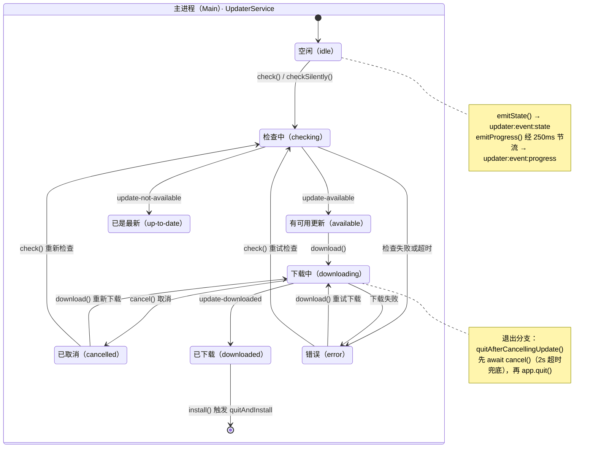

---

title: 应用更新（Electron-updater）
description: 采用 8 态显式快照状态机接管更新生命周期，禁用静默强装，支持中途取消（cancelled）与退出清理。
---

# 应用更新（Electron-updater）

> **TL;DR**：全面接管 `electron-updater`。显式关闭 `autoDownload` 与 `autoInstallOnAppQuit`，通过 8 态受控快照状态机向渲染层节流推送进度，支持中途取消下载（置为 `cancelled` 并保留版本信息供重试），并在应用退出时先取消下载再退出，杜绝文件锁与无界面进程残留。

> **本页职责边界**：本页负责主进程 `UpdaterService` 的 8 态快照状态机、`autoDownload = false` 受控下载、取消/退出协同与 `app-update.yml` 缺失兜底；不负责打包阶段 `afterPack` 补写 `app-update.yml` 与产物命名契约（见 [应用打包（Electron-builder）](/delivery/packaging)）、Release 资产与 `.blockmap` 上传（见 [发版流水线（Changelogen）](/delivery/release-pipeline)），以及 `verify:postbuild` 产物冒烟（见 [产物冒烟测试（Dist-smoke）](/testing/artifact-smoke)）。

## 1. 选型理由

- **规避静默强装与工作流中断**：官方默认会在后台静默下载并在退出时强制安装；禁用 `autoDownload` 与 `autoInstallOnAppQuit` 后，下载与重启安装全部交由用户显式确认。
- **状态透明与节流广播**：通过统一的 8 态快照与 `PROGRESS_EMIT_THROTTLE_MS`（250ms）节流推送，避免高频 `download-progress` 挤爆 IPC 与渲染层。
- **差分物料全通道就位**：打包阶段开启 `generateUpdatesFilesForAllChannels: true` 产出全通道元数据，Release 上传 `*.blockmap` 与 `latest*.yml` 后，`electron-updater` 自动执行块级差量下载。

## 2. 核心机制

`UpdaterService` 用一份 `UpdaterSnapshot` 承载全量状态，8 个状态由 `@app/shared` 的 `updaterStateSchema` 统一定义（`idle`、`checking`、`available`、`downloading`、`downloaded`、`cancelled`、`up-to-date`、`error`）；每次变更经 `emitState()` 推送给更新窗口，并在出口统一注入运行期 `currentVersion`。



→ 源码：[packages/shared/src/schemas/updater.ts](https://github.com/BanShan-Alec/electron-react-monorepo-template/blob/main/packages/shared/src/schemas/updater.ts) · [packages/main/src/services/updater.service.ts](https://github.com/BanShan-Alec/electron-react-monorepo-template/blob/main/packages/main/src/services/updater.service.ts)

`initElectronUpdater()` 在初始化时关闭 `autoDownload`、`autoInstallOnAppQuit` 并开启 `fullChangelog`。入口方法各自带状态守卫：`check()` 在 `checking` / `downloading` 态抛 `UPDATER_ALREADY_RUNNING`；`download()` 仅接受 `available` / `cancelled` / `error` 态；`install()` 仅接受 `downloaded` 态并调用 `updater.quitAndInstall(false, true)`。

### 关键实现：取消下载与退出协同

`UpdaterService.cancel()` 是取消分支的唯一入口：除了渲染层经 IPC 主动触发外，主窗口关闭且未开启托盘驻留时，`HomeWindowModule.quitAfterCancellingUpdate()` 会先 `await cancel()`（2 秒超时兜底）再执行 `app.quit()`。

→ 源码：[packages/main/src/services/updater.service.ts](https://github.com/BanShan-Alec/electron-react-monorepo-template/blob/main/packages/main/src/services/updater.service.ts)

```ts
public async cancel(): Promise<UpdaterSnapshot> {
  this.clearDevSimulationTimer();

  if (this.snapshot.state === 'downloading') {
    if (this.cancellationToken) {
      try {
        this.cancellationToken.cancel();
      } catch (err) {
        this.logger.warn('Failed to cancel token:', err);
      }
      this.cancellationToken = null;
    }
    // 取消后不再回退 available：保留 version/releaseNotes 供 cancelled 态展示与重新下载
    this.snapshot.state = 'cancelled';
    this.snapshot.progress = null;
    this.snapshot.error = null;
    this.snapshot.code = null;
    this.emitState();

    // 主窗口已不存在且未开启托盘常驻时，取消下载后退出，避免无界面进程残留
    const homeWin = getWindow(WINDOW_IDS.HOME);
    const shouldMinimizeToTray = getAppConfigStore().get('minimizeToTray');
    if (!shouldMinimizeToTray && (!homeWin || homeWin.isDestroyed())) {
      this.logger.info('Download cancelled with no window and tray disabled, quitting app');
      app.quit();
    }
  }
  return this.getSnapshot();
}
```

取消后状态置为 `cancelled`（保留版本与更新日志），渲染层可重新调用 `download()` 恢复下载；`download()` 内部用局部变量 `token` 持有 `CancellationToken`，避免 `cancel()` 将实例字段置空后 `catch` 分支把「已取消」误判成「下载失败」。

下载完成后的通知入口统一收敛：在 `update-downloaded` 监听与 `mockEmit('downloaded')` 分支中，若 `userDismissedWindow` 为真，调用 `showDownloadedNotification()` 发系统通知（点击通知再经 `windowDelegate.show()` 拉起更新窗口），否则直接展示更新窗口。OTA 各阶段（`OTA_STAGES`）异常由 `reportSentryOtaError` / `reportSentryOtaEvent` 上报 Sentry。

未打包调试时，`check()` 与 `download()` 会按 `isDev` 自动进入模拟更新计时器流程，便于在本地完整走通 8 态转换与取消分支而不依赖真实 GitHub Release 产物。

- **官方文档**：[electron-builder Auto Update](https://www.electron.build/auto-update) — 读它能解决什么：了解 `autoUpdater` 事件模型、`CancellationToken`、`app-update.yml` 解析路径与 `.blockmap` 差量更新机制。

## 3. 桌面端避坑注意事项

| 避坑要点                           | 事故表现与原因                                                                            | 本仓库对齐方案                                                                                                                                             |
| :--------------------------------- | :---------------------------------------------------------------------------------------- | :--------------------------------------------------------------------------------------------------------------------------------------------------------- |
| **退出应用被下载锁卡死**           | 下载进行中直接关闭主窗口，未取消的流持有临时文件句柄或残留无界面进程。                    | 主窗口关闭且未开启托盘常驻时进入 `quitAfterCancellingUpdate()`，先 `await cancel()`（2 秒超时兜底）再 `app.quit()`；`cancel()` 内无主窗也会主动退出。      |
| **发布配置 `app-update.yml` 缺失** | 目录构建（`build:unpack`）不含 `nsis` 等目标，导致打包态启动后点击检查更新直报 `ENOENT`。 | 打包期 `afterPack` 补写 `resources/app-update.yml`，`verify:postbuild` 校存在；运行期 `initElectronUpdater()` 对缺失场景回退到编译期 `bundledRepository`。 |
| **高频 Progress 冲垮渲染层**       | 高速下载每秒触发上百次 `download-progress`，频繁 IPC 序列化导致更新窗口卡顿。             | `emitProgress()` 结合 `PROGRESS_EMIT_THROTTLE_MS`（250ms）节流（100% 时立即放行）。                                                                        |
| **底层错误堆栈直接透出**           | 网络超时或原始异常堆栈（`net::ERR_*`）直接显示给用户，缺少语义指引。                      | `classifyError()` 将 `AppError` 已有码与 `net::ERR_*` 映射为 `UPDATER_NETWORK_ERROR` 等语义码，其余落回阶段兜底码。                                        |

- **严禁绕过 `UpdaterService` 直调 `autoUpdater`**：通道切换、feed URL 兜底、取消令牌、错误分类与进度节流均挂载在服务实例上，旁路调用会导致状态机与窗口失步。
