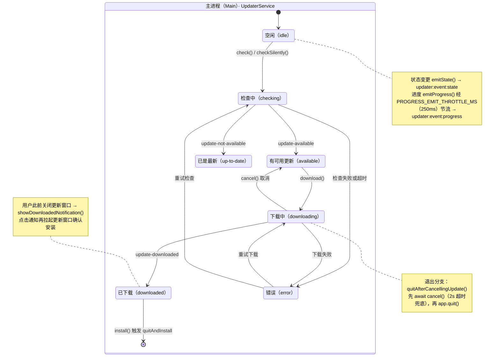

---

title: 应用更新（Electron-updater）
description: 采用显式快照状态机接管更新生命周期，禁用静默强装，退出时安全取消下载与节流推送。
---

# 应用更新（Electron-updater）

> **TL;DR**：全面接管 `electron-updater`。刻意关闭 `autoDownload` 与 `autoInstallOnAppQuit`，通过 7 态受控快照状态机向渲染层节流推送进度，支持中途取消下载，并在应用退出时清理未完成临时包，杜绝后台僵尸进程与文件锁冲突。

## 1. 选型理由

- **规避静默强装与卡顿**：官方默认行为是在后台静默全量下载并在应用退出时强制重启安装，若用户正处于未保存的关键工作流中将造成严重灾难。
- **状态透明与节流推送**：通过统一的受控状态机（7 态），配合高频下载进度的节流（Throttle）广播，更新进度窗口始终保持 60fps 平滑流畅而不挤爆 IPC。
- **全通道与差分更新支持**：物料由打包阶段一键产出 `.blockmap` 索引，`electron-updater` 客户端按需实现分块差量下载，节约带宽与等待耗时。

## 2. 核心机制

`UpdaterService` 用一份 `UpdaterSnapshot` 快照承载全部更新状态，7 个状态由 `@app/shared` 的 `updaterStateSchema` 统一定义（即 `UpdaterState` 的 7 个取值）；每次状态变更都经 `emitState()` 推送到更新窗口，渲染层只负责展示。



→ 源码：[packages/shared/src/schemas/updater.ts](https://github.com/BanShan-Alec/electron-react-monorepo-template/blob/main/packages/shared/src/schemas/updater.ts) · [packages/main/src/services/updater.service.ts](https://github.com/BanShan-Alec/electron-react-monorepo-template/blob/main/packages/main/src/services/updater.service.ts)

初始化阶段显式关闭官方默认行为：`autoDownload = false`、`autoInstallOnAppQuit = false`，并开启 `fullChangelog`（`updater.service.ts:190`）。入口方法各自带状态守卫：`check()` 在 `checking` / `downloading` 态直接抛 `UPDATER_ALREADY_RUNNING`（:319-322），`download()` 只接受 `available` 或 `error` 态（:460），`install()` 只接受 `downloaded` 态（:554-555）。因此安装永远需要用户显式确认：更新窗口存活时在窗口内确认；用户此前关闭过更新窗口时，`update-downloaded` 会降级为系统通知，点击通知再拉起更新窗口确认，不存在静默强装。

### 关键实现：取消下载

`cancel()` 是取消分支的唯一入口：渲染层经 IPC `updater:cancel` 调用；主窗口关闭并触发退出时，`quitAfterCancellingUpdate()` 会先 `await` 它（2 秒超时兜底），销毁更新窗口后再 `app.quit()`。

**节选**：`UpdaterService.cancel()`（`packages/main/src/services/updater.service.ts:524`）

```ts
public async cancel(): Promise<UpdaterSnapshot> {
  this.clearDevSimulationTimer();

  if (this.snapshot.state === 'downloading') {
    if (this.cancellationToken) {
      try {
        this.cancellationToken.cancel();
      } catch (err) {
        this.logger.warn('Failed to cancel token:', err);
      }
      this.cancellationToken = null;
    }
    this.snapshot.state = 'available';
    this.snapshot.progress = null;
    this.snapshot.error = null;
    this.snapshot.code = null;
    this.emitState();

    // 主窗口已不存在且未开启托盘常驻时，取消下载后退出，避免无界面进程残留
    const homeWin = getWindow(WINDOW_IDS.HOME);
    const shouldMinimizeToTray = getAppConfigStore().get('minimizeToTray');
    if (!shouldMinimizeToTray && (!homeWin || homeWin.isDestroyed())) {
      this.logger.info('Download cancelled with no window and tray disabled, quitting app');
      app.quit();
    }
  }
  return this.getSnapshot();
}
```

→ 源码：[packages/main/src/services/updater.service.ts](https://github.com/BanShan-Alec/electron-react-monorepo-template/blob/main/packages/main/src/services/updater.service.ts)

取消后状态退回 `available` 而不是 `idle`，用户可以重新发起下载；退出流程最多等待取消 2 秒，随后继续关闭进程。若取消时主窗口已销毁且未开启托盘常驻，`cancel()` 内部会直接 `app.quit()`，避免留下无界面进程（`updater.service.ts:547`）。

下载完成后的入口分两路：`update-downloaded` 在 `userDismissedWindow` 为真时调用 `showDownloadedNotification()` 发系统通知，点击通知经 `windowDelegate.show()` 重新拉起更新窗口；否则直接拉起更新窗口。dev 模拟下载路径复用同一套判定（`updater.service.ts:278-286`、`:659-671`），通知文案与点击行为统一封装在 `showDownloadedNotification()`（`:590-604`）。已下载完成的安装包由 electron-updater 保留在缓存中（`pending/update-info.json`），下次启动重新检查到同一版本时可复用缓存、无需重新下载即可进入安装。

安装环节同理：用户在更新窗口确认后，`install()` 校验 `downloaded` 态并调用 `updater.quitAndInstall(false, true)`（`updater.service.ts:570`），进程退出后由安装器接管，全程没有静默强装。

差分物料由打包阶段备齐：`build/electron-builder.ts:33` 开启 `generateUpdatesFilesForAllChannels: true` 生成全通道更新元数据；Release 流水线把 `*.blockmap` 与 `latest*.yml` 连同安装包一起上传（见 [发版流水线（Changelogen）](/delivery/release-pipeline)）。客户端按 blockmap 只下载差异块是 electron-updater 的内置行为，本仓库保证的是物料就位。OTA 各阶段（checking / downloading / downloaded / installing / electron-updater）由 `reportSentryOtaError` / `reportSentryOtaEvent` 打点 Sentry（`updater.service.ts:36-44`、`:274`、`:303`、`:401`、`:518`、`:574`）。

## 3. 桌面端避坑注意事项

| 避坑要点                     | 事故表现与原因                                                                                                    | 本仓库对齐方案                                                                                                                                                                                                                                                    |
| :--------------------------- | :---------------------------------------------------------------------------------------------------------------- | :---------------------------------------------------------------------------------------------------------------------------------------------------------------------------------------------------------------------------------------------------------------- |
| **退出应用被文件锁卡死**     | 用户正在下载 200MB 安装包时突然关闭应用，未关闭的下载任务持有本地临时文件句柄，导致下次启动安装包损坏或进程挂起。 | 主窗口关闭且未开启托盘常驻时，进入 `quitAfterCancellingUpdate()`，先 `await cancel()` 取消未完成的流（2 秒超时兜底），再 `app.quit()`。                                                                                                                           |
| **源码/开发模式更新报错**    | 在 `pnpm dev` 下执行检查更新，由于未打包状态下缺少 `resources/app-update.yml`，导致程序直接抛出未捕获异常。       | 在开发态自动拦截并使用本地 Mock 逻辑，生产态基于 `package.json` 的 `repository.url` 自动合成更新源。                                                                                                                                                              |
| **高频 Progress 冲垮渲染层** | 宽带极速下载时，`download-progress` 事件每秒触发数百次，频繁触发 IPC 序列化与 React 重新渲染致使界面卡死。        | 在主进程内部引入 `PROGRESS_EMIT_THROTTLE_MS`（节流阀，值为 250ms），将推送频率严格限制在每 250ms 一次。                                                                                                                                                           |
| **错误分类与语义提示缺失**   | 报错仅显示 `Error: net::ERR_CONNECTION_TIMED_OUT` 等底层原始堆栈，用户无法理解。                                  | `classifyUpdaterError` 只把 `AppError` 的既有 code 与 `net::ERR_*` 映射为语义码；哈希校验失败、文件占用等其余异常落到调用阶段的兜底码（检查失败 / 下载失败）。渲染层仅对 `UPDATER_NETWORK_ERROR`、`UPDATER_NOT_CONFIGURED` 给友好中文文案，原始错误保留为次要行。 |

- **不要绕过 `UpdaterService` 直调 `autoUpdater`**：channel、feedURL、取消下载、错误分类与快照推送都挂在 service 上，旁路调用会让状态机与窗口失步。
