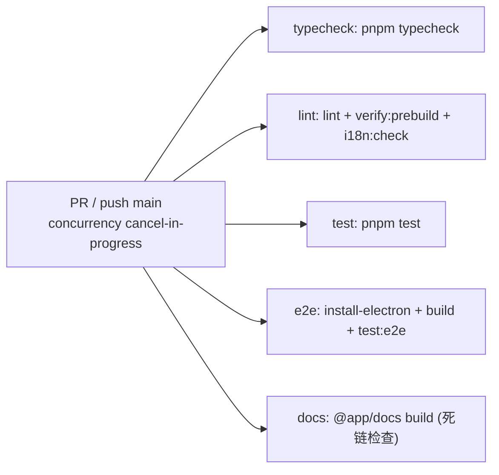

---

title: CI 并行门禁（GitHub-Actions）
description: 5 大工作流并行校验，结合前置命名与样式静态扫描及 i18n 缺译拦截，全绿方可合并。
---

# CI 并行门禁（GitHub-Actions）

> **TL;DR**：GitHub Actions 在每次 PR 与 `main` 推送时并行触发 `typecheck`、`lint`、`test`、`e2e`、`docs` 5 个 Required Checks；其中 `lint` 串联 `verify:prebuild`（根配置与渲染层设计系统扫描）与 `i18n:check`，`e2e` 预装二进制并先构建再跑 Electron 测试，全绿方可合入主干。

> **本页职责边界**：本页负责 GitHub Actions 5 路并行门禁编排、`ci.yml` 关键前置步骤与 `verify:prebuild` 静态拦截链路；不负责根目录 `dependencies` 白名单规则细节（见 [依赖管理（Monorepo）](/engineering/dependency-management)）、本地打包与后置产物冒烟（见 [应用打包（Electron-builder）](/delivery/packaging)），以及 `v*` tag 发版矩阵（见 [发版流水线（Changelogen）](/delivery/release-pipeline)）。

## 1. 选型理由

- **5 路解耦并行压低反馈耗时**：类型检查、规范扫描、纯 Node 单测、真实 Electron E2E 与 Vocs 文档构建互不阻塞并行执行，总耗时收敛在最慢的 `e2e` 任务内。
- **分支保护强门禁（Required Checks）**：5 个 Job 均在仓库规则中列为必过检查项，工作流显式声明最小只读权限 `permissions: contents: read`，任一门禁失败即阻断合并。
- **0ms 静态拦截前置暴露问题**：在进入耗时的全仓编译和 Electron 测试前，`lint` Job 即通过 `verify:prebuild` 与 `i18n:check` 拦截包名违规、非法根依赖、离阶样式与英文缺译。

## 2. 核心机制

PR 提交或更新后，GitHub Actions 立即基于 `.github/workflows/ci.yml` 启动 5 条互不阻塞的检查流水线；任一检查失败或处于挂起态时，分支保护规则都会阻止合入 `main`。



### GitHub Actions 5 路并行工作流

工作流启用 `concurrency.cancel-in-progress: true` 自动取消同一 PR 旧提交的排队运行；其中 `typecheck`（`pnpm run typecheck`）、`test`（`pnpm run test`）与 `docs`（`pnpm --filter @app/docs run build`）各自独立执行单条命令，而 `lint` 与 `e2e` 分别承担组合前置检查与构建后 Electron 测试：

→ 源码：[.github/workflows/ci.yml](https://github.com/BanShan-Alec/electron-react-monorepo-template/blob/main/.github/workflows/ci.yml)

```yaml
# 节选：并发取消、只读权限与关键组合门禁（typecheck / test / docs 为单步运行）
concurrency:
  group: ${{ github.workflow }}-${{ github.ref }}
  cancel-in-progress: true

permissions:
  contents: read

jobs:
  lint:
    runs-on: ubuntu-latest
    steps:
      - uses: ./.github/actions/setup-env
      - run: pnpm run lint
      - run: pnpm run verify:prebuild
      - run: pnpm run i18n:check
  e2e:
    runs-on: ubuntu-latest
    steps:
      - uses: ./.github/actions/setup-env
      - run: pnpm exec install-electron
      - run: pnpm run build
      - run: pnpm run test:e2e
```

### 打包前静态门禁（verify:prebuild）

`verifyPrebuild()` 负责三项静态校验：① 根 `package.json` `name` 正则校验（防发布文件名含空格或大写导致 OTA 寻址 404）；② 根 `dependencies` 白名单校验（规则详情与原理见 [依赖管理（Monorepo）](/engineering/dependency-management)）；③ 调用 `verifyDesignSystem(rootDir)` 扫描 `packages/renderer/src` 下离阶字号 `text-[Npx]`、`var(--ant-*)` 越界与种子外硬编码 hex 颜色（令牌定义见 [设计规范与令牌（Design Tokens）](/ui/design-tokens)）。

此外，本地开发可通过 `pnpm typecheck && pnpm lint && pnpm test && pnpm verify:prebuild` 在提交前完整复现核心静态门禁，避免 push 后在 CI 阶段反复排错。

→ 源码：[scripts/verify-prebuild.ts](https://github.com/BanShan-Alec/electron-react-monorepo-template/blob/main/scripts/verify-prebuild.ts)

```ts
// 节选：根 package.json name 规范校验与设计系统静态扫描
if (typeof rootPkg.name !== 'string' || !/^[a-z0-9-_]+$/.test(rootPkg.name)) {
  errors.push(`[根目录 name 违规] 根 package.json 的 "name" 字段 ("${rootPkg.name}") 不符合规范。`);
}

// 2. 根目录 dependencies 边界校验（仅限 @app/main，详见 /engineering/dependency-management）
// 3. renderer 样式门禁（扫描 text-[Npx]、var(--ant-*) 与非 design-tokens.ts 的 hex 颜色）
const designProblems = verifyDesignSystem(rootDir);
if (designProblems.length > 0) {
  errors.push(...designProblems);
}
```

- **官方文档**：[GitHub Actions Workflow Syntax](https://docs.github.com/en/actions/writing-workflows/workflow-syntax-for-github-actions) — 读它能解决什么：理解 `concurrency` 并发分组、`permissions` 最小权限与 Job 独立运行语义。

只有 5 个 Required Checks 全部返回绿灯，PR 才具备合并资格；本地改完代码后应先跑通核心门禁命令再推送评审。

## 3. 桌面端避坑注意事项

| 避坑要点                      | 事故表现与原因                                                                           | 本仓库对齐方案                                                                                    |
| :---------------------------- | :--------------------------------------------------------------------------------------- | :------------------------------------------------------------------------------------------------ |
| **Linux E2E 缺二进制失败**    | Electron 42+ 不再自带安装时二进制下载，CI 无缓存时直接拉起测试报错找不到可执行文件。     | 在 `e2e` Job 前显式执行 `pnpm exec install-electron`，确保无头环境二进制在位。                    |
| **未构建即跑 E2E 报入口缺失** | `electron.launch` 依赖 `packages/main/dist/index.cjs` 等产物，漏跑构建导致测试启动失败。 | `e2e` Job 强制先运行 `pnpm run build`，再执行 `pnpm run test:e2e`。                               |
| **Docs 死链仅在静态构建暴露** | 文档站跨页路径写错或缺少页面在本地 dev 热更新时不易察觉，合入后线上出现 404。            | 将 `pnpm --filter @app/docs run build` 设为独立 `docs` Required Check，静态编译发现死链立即阻断。 |
| **CI 队列被旧提交占满**       | 短时间内连续 push 同一 PR 分支，旧 Runner 继续占用配额且结果覆盖新状态。                 | 启用 `concurrency: cancel-in-progress: true`，同一 PR 新提交自动取消旧工作流。                    |

- **环境一致性基线**：所有工作流统一通过复合 Action `.github/actions/setup-env` 安装 Node 与 pnpm 依赖，确保 Runner 与本地工具链版本对齐。
