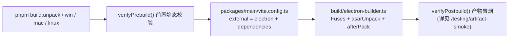

---

title: 应用打包（Electron-builder）
description: electron-builder 采用 TypeScript 类型化配置，应用身份全仓收敛，自动外置主进程依赖并固化 Fuses 熔丝。
---

# 应用打包（Electron-builder）

> **TL;DR**：全面采用 TypeScript 编写 `build/electron-builder.ts` 打包配置。应用身份从根 `package.json` 单一真源推导，主进程运行时依赖从 `packages/main/package.json` 自动提取外置，通过 `afterPack` 补写 `resources/app-update.yml` 并固化 `electronFuses` 熔丝位，实现三平台标准自动化出包。

> **本页职责边界**：本页负责 `build/electron-builder.ts` 打包配置、主进程依赖自动外置、`electronFuses` 熔丝及 NSIS 卸载数据清理选项；不负责 `.map` 源码映射的三道隔离防线（见 [源码映射隔离（Source-map）](/delivery/sourcemap)）、根目录 `dependencies` 白名单规则（见 [依赖管理（Monorepo）](/engineering/dependency-management)）、CI 并行门禁（见 [CI 并行门禁（GitHub-Actions）](/delivery/ci-gates)）或 tag 发版流程（见 [发版流水线（Changelogen）](/delivery/release-pipeline)）。

## 1. 选型理由

- **类型安全与共享逻辑**：`build/electron-builder.ts` 直接导入 `APP_IDENTITY`、计算工作区 `files` 规则并执行 `afterPack` 钩子，避免脆弱的手写 JSON 配置漂移。
- **应用身份与命名契约**：`appId`、`productName` 与 GitHub 发布坐标全部派生自根 `package.json`；`artifactName` 强制使用 `${name}-${version}-${os}-${arch}.${ext}`，防止带空格的产品名被 GitHub Releases 转成点号导致 `latest.yml` 寻址 404。
- **二进制熔丝与全形态更新配置**：构建期写入 `electronFuses` 封死提权与 ASAR 旁路加载，并在 `afterPack` 对目录构建（`build:unpack`）补齐 `resources/app-update.yml`。

## 2. 核心机制



### TypeScript 打包配置与熔丝/钩子

`config` 统一配置三平台目标（Win NSIS x64、Mac dmg/zip、Linux deb）、`asarUnpack: ['**/*.node']`、全通道更新元数据、`afterPack` 补写 `app-update.yml` 及 `electronFuses`；`files` 字段通过 `getListOfFilesFromEachWorkspace` 聚合各包声明，并排除 `.map`（源码映射防线见 [源码映射隔离（Source-map）](/delivery/sourcemap)）。

→ 源码：[build/electron-builder.ts](https://github.com/BanShan-Alec/electron-react-monorepo-template/blob/main/build/electron-builder.ts)

```ts
// 节选：产物命名契约、原生模块解包、afterPack 钩子与二进制熔丝配置
const config: Configuration = {
  appId: APP_IDENTITY.appId,
  productName: APP_IDENTITY.productName,
  generateUpdatesFilesForAllChannels: true,
  // biome-ignore lint/suspicious/noTemplateCurlyInString: electron-builder placeholder template
  artifactName: '${name}-${version}-${os}-${arch}.${ext}',
  asarUnpack: ['**/*.node'],
  afterPack: (context: AfterPackContext) => {
    ensureAppUpdateConfig(context);
  },
  electronFuses: {
    runAsNode: false,
    enableNodeOptionsEnvironmentVariable: false,
    onlyLoadAppFromAsar: true,
    enableEmbeddedAsarIntegrityValidation: true,
    resetAdHocDarwinSignature: true,
  },
  files: [
    'LICENSE*',
    '!node_modules/@app/**',
    ...getListOfFilesFromEachWorkspace(['main', 'preload', 'renderer']),
    '!**/*.map',
  ],
};
```

### 主进程构建依赖自动外部化

主进程打包由 Vite 自动读取 `packages/main/package.json` 的 `dependencies` 注入 `external`；纯 JS 工具库装入 `devDependencies` 由 Vite 内联进 `index.cjs`，原生或需动态加载的依赖装入 `dependencies` 随包外置：

→ 源码：[packages/main/vite.config.ts](https://github.com/BanShan-Alec/electron-react-monorepo-template/blob/main/packages/main/vite.config.ts)

```ts
// 节选：自动提取 packages/main/package.json 的 dependencies 设为 external
const pkgPath = path.resolve(__dirname, 'package.json');
const pkg = JSON.parse(fs.readFileSync(pkgPath, 'utf8'));
const runtimeDependencies = Object.keys(pkg.dependencies ?? {});
// ...
    rolldownOptions: {
      external: ['electron', ...runtimeDependencies],
      output: { entryFileNames: '[name].cjs', format: 'cjs' },
    },
  },
  ssr: { noExternal: true },
```

### 跨平台打包命令矩阵

```bash
pnpm build:unpack    # 本地解包目录构建与验证（生成 dist/win-unpacked 等）
pnpm build:win       # 打包 Windows NSIS 安装包
pnpm build:mac       # 打包 macOS dmg / zip
pnpm build:linux     # 打包 Linux deb 安装包
```

### Electron Fuses 与 Windows 卸载清理选项

`electronFuses` 禁用了 `runAsNode` 与 `enableNodeOptionsEnvironmentVariable`（封堵环境变量与通用 Node 执行绕过），开启 `onlyLoadAppFromAsar`、`enableEmbeddedAsarIntegrityValidation`（Win/Mac 生效）与 `resetAdHocDarwinSignature`（无正式 Apple 证书时允许 `arm64` 重签启动）。刻意保留 `enableNodeCliInspectArguments`（支撑 `verify-postbuild` 的 Playwright 启动探针）与默认 `enableCookieEncryption`（规避无签名 macOS Keychain 弹窗）。

Windows NSIS 卸载向导通过 [build/installer.nsh](https://github.com/BanShan-Alec/electron-react-monorepo-template/blob/main/build/installer.nsh) 提供「同时清除本地应用数据、配置与缓存（AppData）」复选框（默认不勾选，且在 `${Silent}` 静默卸载与 `${isUpdated}` 自动更新时跳过），仅当用户主动勾选时清理 Roaming `AppData` 与 `LocalAppData` 下的更新缓存。

- **官方文档**：[electron-builder Configuration](https://www.electron.build/configuration) — 读它能解决什么：查阅 `artifactName` 占位符、`asarUnpack`、`afterPack` 生命周期钩子与 `electronFuses` 的完整平台语义。

## 3. 桌面端避坑注意事项

| 避坑要点                          | 事故表现与原因                                                                                          | 本仓库对齐方案                                                                            |
| :-------------------------------- | :------------------------------------------------------------------------------------------------------ | :---------------------------------------------------------------------------------------- |
| **`artifactName` 含空格 404**     | 使用 `${productName}` 命名产物，GitHub Releases 自动将空格替换为点号，导致 `latest.yml` 校验 404。      | 强制使用小写无空格的 `${name}`（派生自根 `package.json`）。                               |
| **C++ 原生模块放进 ASAR 崩溃**    | `.node` 动态库被压缩进 `app.asar` 后无法被操作系统 `dlopen` 加载。                                      | 显式配置 `asarUnpack: ['**/*.node']` 自动解包至 `app.asar.unpacked/`。                    |
| **目录构建缺失 `app-update.yml`** | `build:unpack` 不走 `nsis` 等更新器目标，`electron-builder` 跳过写入更新配置文件导致检查更新报 ENOENT。 | `afterPack` 钩子调用 `ensureAppUpdateConfig` 为全形态补齐（已存在则保留完整安装器配置）。 |

- **关联门禁指针**：根目录 `dependencies` 白名单防线（仅允许 `@app/main`）见 [依赖管理（Monorepo）](/engineering/dependency-management)；`.map` 与 `.d.ts` 随包泄露防线见 [源码映射隔离（Source-map）](/delivery/sourcemap)。
