---

title: 发版流水线（Changelogen）
description: 本地 changelogen 按约定式提交推导版本并推送 v* tag，CI 三平台矩阵纯构建后由单一 publish Job 汇聚发布。
---

# 发版流水线（Changelogen）

> **TL;DR**：版本号决策权严格留在本地。开发者执行 `pnpm release`（由 `changelogen` 依据 `.config/changelog.config.ts` 推导 semver、更新 `package.json` 与 `CHANGELOG.md` 并推送 `v*` tag），随后 GitHub Actions 三平台并行执行 `-p never` 纯构建，最终由单一 `publish` Job 汇总全部产物创建 GitHub Release。

> **本页职责边界**：本页负责本地 `changelogen` 提版与 semver 映射规则、GitHub Actions 三平台矩阵构建与 `publish` 聚合发布流水线；不负责本地 Commit 格式校验与 Husky 钩子拦截（见 [提交信息规范（Commitlint）](/engineering/commit-convention)）、`electron-builder` 打包配置（见 [应用打包（Electron-builder）](/delivery/packaging)），以及 PR 阶段 5 路校验门禁（见 [CI 并行门禁（GitHub-Actions）](/delivery/ci-gates)）。

## 1. 选型理由

- **单版本事实源避免 CI 回写冲突**：若让 CI 自动修改 `package.json` 并 push back，多人并发合入或重试任务极易引起分支冲突与历史分叉。本仓库规定版本提升与 CHANGELOG 生成只在本地经 `changelogen` 完成，CI 保持无状态纯执行。
- **矩阵构建与发布解耦（`-p never` → 单一 `publish`）**：Windows、macOS、Linux 构建耗时差异极大，若各矩阵自行发布会导致 Release 产物残缺或相互覆盖；统一先传 `-p never` 暂存 Artifact，全部成功后再聚合发布。
- **可控的 semver 映射规则**：通过 `.config/changelog.config.ts` 显式收敛各提交类型对应的版本号增量与变更日志小节。

## 2. 核心机制

```mermaid
flowchart LR
    Local["本地 pnpm release / release:patch|minor|major"] --> Tag["changelogen 更新版本、CHANGELOG 并推 v* tag"]
    Tag --> Matrix["CI 三平台矩阵 Build (windows / macos / ubuntu)"]
    Matrix -->|"build:* -- -p never + if-no-files-found: error"| Artifacts["upload-artifact (exe/dmg/deb/zip/yml/blockmap)"]
    Artifacts -->|"needs: build · 仅 refs/tags/v*"| Publish["publish Job (permissions: contents: write)"]
    Publish --> Release["softprops/action-gh-release 统一发版"]
```



### 本地发版脚本与 semver 规则真源

根目录 `package.json` 暴露统一 `changelogen` 命令；当需要强制升级主版本时，使用 `pnpm release:major`：

→ 源码：[package.json](https://github.com/BanShan-Alec/electron-react-monorepo-template/blob/main/package.json)

```json
"changelog": "changelogen",
"release": "changelogen --release",
"release:patch": "changelogen --release --patch",
"release:minor": "changelogen --release --minor",
"release:major": "changelogen --release --major"
```

提交类型到 semver 的真实映射定义在 `.config/changelog.config.ts`：`feat` 映射为 `minor`，其余 `fix`、`perf`、`refactor`、`docs`、`build`、`chore`、`test`、`style`、`ci` 均映射为 `patch`（**没有任何 commit type 自动映射为 `major`**，且全部 10 类变更均在 `CHANGELOG.md` 生成对应小节而非折叠）：

→ 源码：[.config/changelog.config.ts](https://github.com/BanShan-Alec/electron-react-monorepo-template/blob/main/.config/changelog.config.ts)

```ts
export default {
  types: {
    feat: { title: '🚀 新增特性 (Features)', semver: 'minor' },
    fix: { title: '🩹 缺陷修复 (Bug Fixes)', semver: 'patch' },
    perf: { title: '⚡ 性能优化 (Performance)', semver: 'patch' },
    refactor: { title: '💅 代码重构 (Refactoring)', semver: 'patch' },
    docs: { title: '📖 文档更新 (Documentation)', semver: 'patch' },
    build: { title: '📦 构建与依赖 (Build & Deps)', semver: 'patch' },
    chore: { title: '🏡 工程维护 (Chores)', semver: 'patch' },
    test: { title: '✅ 测试相关 (Testing)', semver: 'patch' },
    style: { title: '🎨 代码风格 (Styles)', semver: 'patch' },
    ci: { title: '🤖 持续集成 (CI/CD)', semver: 'patch' },
  },
};
```

### GitHub Actions 三平台矩阵与聚合发布

工作流在推送 `v*` tag 或手动 `workflow_dispatch` 时触发（手动触发仅走完 `build` 验证管线，不执行 `publish`）。`build` 矩阵在三平台均显式传入 `-- -p never` 禁止直接上传，并收集 `.exe`、`.dmg`、`.deb`、`.zip`、`.yml`、`.blockmap`；`publish` 阶段申请 `contents: write` 权限，读取根 `package.json` 的 `productName` 拼接 Release 标题（`${{ steps.identity.outputs.product_name }} ${{ github.ref_name }}`），并通过 `softprops/action-gh-release` 统一发版。

需要注意，Linux 构建步骤会提前安装 `libarchive-tools` 以支持 `.deb` / `fpm` 归档打包；`build` 阶段同时注入 `SENTRY_AUTH_TOKEN` 供打包插件上传 SourceMap（见 [源码映射隔离（Source-map）](/delivery/sourcemap)）。

→ 源码：[.github/workflows/release.yml](https://github.com/BanShan-Alec/electron-react-monorepo-template/blob/main/.github/workflows/release.yml)

```yaml
# 节选：三平台 -p never 纯构建暂存产物，单 publish Job 聚合发版
jobs:
  build:
    strategy:
      fail-fast: false
      matrix: { os: [windows-latest, macos-latest, ubuntu-latest] }
    steps:
      - if: runner.os == 'Windows'
        run: pnpm run build:win -- -p never
      - if: runner.os == 'macOS'
        run: pnpm run build:mac -- -p never
      - if: runner.os == 'Linux'
        run: pnpm run build:linux -- -p never
      - uses: actions/upload-artifact@v4
        with:
          name: artifacts-${{ matrix.os }}
          if-no-files-found: error
  publish:
    needs: build
    if: startsWith(github.ref, 'refs/tags/v')
    permissions: { contents: write }
    steps:
      - uses: actions/download-artifact@v4
        with: { path: release-artifacts, merge-multiple: true }
      - uses: softprops/action-gh-release@3bb12739c298aeb8a4eeaf626c5b8d85266b0e65 # v2
        with:
          name: ${{ steps.identity.outputs.product_name }} ${{ github.ref_name }}
          files: release-artifacts/*
          generate_release_notes: true
```

- **官方文档**：[UnJS Changelogen](https://github.com/unjs/changelogen) — 读它能解决什么：理解 `--release` 参数、Conventional Commits 到 semver 的自动推导与 Git tag 推送机制。

## 3. 桌面端避坑注意事项

| 避坑要点                    | 事故表现与原因                                                                                  | 本仓库对齐方案                                                                                 |
| :-------------------------- | :---------------------------------------------------------------------------------------------- | :--------------------------------------------------------------------------------------------- |
| **CI 自动提版造成历史分叉** | 在 Actions 中运行 `npm version` 并回推主分支，并发发版或重试极易导致分支保护拦截与历史冲突。    | 严禁 CI 修改 `package.json`；本地 `changelogen --release` 锁定版本号后通过 `v*` tag 触发构建。 |
| **矩阵各自发布导致残缺**    | Windows 先构建完即创建 Release，用户或自动更新客户端在 macOS/Linux 尚未上传前拉取报错 404。     | 构建命令统一传 `-- -p never`，待三平台全部成功后由 `needs: build` 的 `publish` 统一发布。      |
| **OTA 更新元数据漏传**      | Release 只附带安装包而漏掉 `latest*.yml` 与 `*.blockmap`，客户端检查更新失败或退化为全量下载。  | 上传规则显式覆盖 `*.yml` 与 `*.blockmap`，并配置 `if-no-files-found: error` 严防静默漏传。     |
| **默认只读权限无法发版**    | 工作流全局设 `permissions: contents: read`，`publish` 若未单独提权会导致创建 Release 返回 403。 | `publish` Job 显式声明 `permissions: contents: write`，最小权限粒度只授予发布阶段。            |

- **规范协作约定**：本地提交前需满足中文 Conventional Commits 规则（见 [提交信息规范（Commitlint）](/engineering/commit-convention)），才能被 `changelogen` 准确归类进发布日志。
