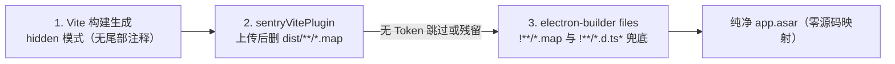

---

title: 源码映射隔离（Source-map）
description: 生产环境使用 hidden 模式生成 SourceMap，Sentry 上传后即刻物理删盘，electron-builder 打包兜底排除 .map 与 .d.ts。
---

# 源码映射隔离（Source-map）

> **TL;DR**：线上排障需要 SourceMap 还原压缩堆栈，但绝不能将 `.map` 与类型声明带入最终安装包。仓库通过「`hidden` 生成模式 + `sentryVitePlugin` 上传后物理销毁 + `electron-builder` 文件白名单兜底排除」三道独立防线，彻底阻断源码泄露。

> **本页职责边界**：本页负责生产 `.map` 与 `.d.ts` 文件的三层防泄露隔离策略；不负责 `electron-builder` 完整打包配置、产物命名与 Fuses 熔丝开关（见 [应用打包（Electron-builder）](/delivery/packaging)），也不负责 Sentry 运行时崩溃采集与 OTA 标签打点（见 [崩溃上报（Sentry）](/main/crash-reporting)）。

## 1. 选型理由

- **杜绝 `sourceMappingURL` 注释暴露**：若生产构建开启 `sourcemap: true`，产物末尾会自动追加 `//# sourceMappingURL=...` 并随包下发，用户解包 `app.asar` 即可还原完整 TypeScript 源码。
- **保障生产堆栈可反解**：若直接关闭 `sourcemap: false`，Sentry 收集到的崩溃堆栈只有混淆压缩后的行号列号，无法定位线上疑难故障。
- **三层冗余免疫失误**：即便本地打包未注入 `SENTRY_AUTH_TOKEN` 或 CI 上传失败，第三道打包过滤规则依然确保没有任何 `.map` 文件能混进 `app.asar`。

## 2. 核心机制

三道防线从构建期到打包期串联生效：Vite 只产映射不写注释，Sentry 插件上传后立即删盘，最后由 `electron-builder` 过滤规则兜底拦截任何残留 `.map` 与类型声明文件。



### 第一道防线：`hidden` 模式生成（无尾部注释暴露）

主进程与 Preload（[packages/preload/vite.config.ts](https://github.com/BanShan-Alec/electron-react-monorepo-template/blob/main/packages/preload/vite.config.ts)）在开发态使用 `inline` 便于调试断点，生产态切换为 `hidden`；渲染进程在 `packages/renderer/vite.config.ts` 中直接锁定 `sourcemap: 'hidden'`。Vite 会独立生成 `.map` 文件供插件上传，但**不在** JS/CJS 产物末尾追加 `sourceMappingURL` 注释。

→ 源码：[packages/main/vite.config.ts](https://github.com/BanShan-Alec/electron-react-monorepo-template/blob/main/packages/main/vite.config.ts) · [packages/renderer/vite.config.ts](https://github.com/BanShan-Alec/electron-react-monorepo-template/blob/main/packages/renderer/vite.config.ts)

```ts
// 节选：主进程与 Preload 区分 dev/prod 模式；Renderer 固定为 'hidden'
sourcemap: isDev ? 'inline' : 'hidden',
```

### 第二道防线：Sentry 上传后即刻删盘

主进程与渲染进程均挂载 `sentryVitePlugin`，当存在 `sentryAuthToken` 时自动上传符号表，并在 `filesToDeleteAfterUpload` 中即刻物理删除 `dist/**/*.map`；本地无 Token 时通过 `disable: !sentryOptions.sentryAuthToken` 安全跳过而不中断构建。

→ 源码：[packages/main/vite.config.ts](https://github.com/BanShan-Alec/electron-react-monorepo-template/blob/main/packages/main/vite.config.ts)

```ts
// 节选：上传成功后立即物理清理 dist 下的 .map 文件
sentryVitePlugin({
  org: sentryOptions.sentryOrg,
  project: sentryOptions.sentryProject,
  authToken: sentryOptions.sentryAuthToken,
  telemetry: false,
  disable: !sentryOptions.sentryAuthToken,
  release: {
    name: sentryOptions.releaseName,
  },
  sourcemaps: {
    filesToDeleteAfterUpload: ['dist/**/*.map'],
  },
}),
```

### 第三道防线：打包阶段绝对排除兜底

即使本地构建因无 Token 保留了 `.map`，`build/electron-builder.ts` 的 `files`（以及 `getListOfFilesFromEachWorkspace` 内部拼接的 `filter`）也会硬性排除 `**/*.map` 与各类 `.d.ts` 声明文件，确保不会进入 `app.asar`（完整打包配置见 [应用打包（Electron-builder）](/delivery/packaging)）。

→ 源码：[build/electron-builder.ts](https://github.com/BanShan-Alec/electron-react-monorepo-template/blob/main/build/electron-builder.ts)

```ts
// 节选：files 白名单末尾硬性排除 .map 与第三方 .d.ts* 声明文件
  files: [
    'LICENSE*',
    '!node_modules/@app/**',
    ...getListOfFilesFromEachWorkspace(['main', 'preload', 'renderer']),
    '!**/*.map', // 严禁将 SourceMap 源码映射文件打包进 asar，彻底防止源码泄露
    '!**/node_modules/*/{CHANGELOG.md,README.md,README,readme.md,changelog.md}',
    '!**/node_modules/*/{test,__tests__,tests,docs,example,examples}/**',
    '!**/node_modules/**/*.d.ts',
    '!**/node_modules/**/*.d.cts',
    '!**/node_modules/**/*.d.mts',
  ],
```

- **官方文档**：[Vite `build.sourcemap`](https://vite.dev/config/build-options.html#build-sourcemap) — 读它能解决什么：理解 `'hidden'`、`'inline'` 与 `true` 模式在产物尾部注释与调试关联上的核心差异。

## 3. 桌面端避坑注意事项

| 避坑要点                            | 事故表现与原因                                                                     | 本仓库对齐方案                                                                               |
| :---------------------------------- | :--------------------------------------------------------------------------------- | :------------------------------------------------------------------------------------------- |
| **`sourceMappingURL` 注释泄露**     | 生产配置误设为 `sourcemap: true`，产物尾部携带映射 URL 注释导致工具直接反解源码。  | 主进程/Preload 生产态与渲染层构建统一锁定 `'hidden'`。                                       |
| **本地未配 Token 残留 `.map` 入包** | 本地调试打包未配 `SENTRY_AUTH_TOKEN`，插件跳过上传与删盘导致 `.map` 留在 `dist/`。 | `build/electron-builder.ts` 在根 `files` 与子包 `filter` 两处均附加 `'!**/*.map'` 兜底排除。 |
| **缺少 AuthToken 阻断本地打包**     | 未配置 Sentry 环境变量时构建器直接报错退出，开发者无法本地出包验证。               | 显式设置 `disable: !sentryOptions.sentryAuthToken`，无凭证时安全降级跳过上传。               |
| **`.d.ts` 声明暴露内部接口结构**    | 第三方或内部类型定义文件大量进入 `app.asar`，既浪费体积又便于逆向推测接口结构。    | `files` 同步排除 `**/*.d.ts`、`**/*.d.cts` 与 `**/*.d.mts`。                                 |
