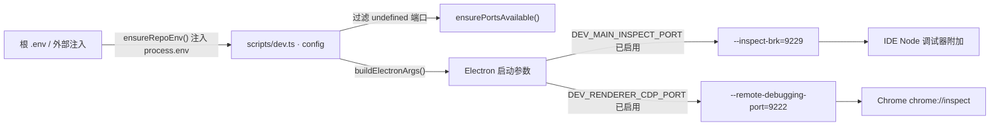

---

title: 远程调试端口（CDP）
description: 渲染层 CDP 端口与主进程断点端口集中配置在根 .env，由 scripts/dev.ts 读取并联动预检与启动参数。
---

# 远程调试端口（CDP）

> **TL;DR**：渲染进程 CDP 端口（`DEV_RENDERER_CDP_PORT`，默认 `9222`）与主进程断点端口（`DEV_MAIN_INSPECT_PORT`，默认注释关闭）集中声明在根 `.env`；在 `.env` 中注释或留空即同步关闭启动参数、日志与端口预检。

## 1. 选型理由

Electron 同时嵌入 Chromium 渲染引擎与 Node.js 主进程运行时，本地排查问题通常需要两条独立调试通道：
1. **渲染层 CDP 调试**：向 Electron 注入 `--remote-debugging-port`，供外部 Chrome DevTools（`chrome://inspect`）或自动化工具连接性能面板与内存快照。
2. **主进程 Node 断点**：向 Electron 注入 `--inspect-brk`，在启动第一时间暂停等待 VS Code 或 IDE 附加调试器。

本页负责开发与预览态调试端口的集中配置、开关控制与参数组装；端口冲突的交互释放逻辑见 [启动预检](/dx/startup-preflight)，三路构建拉起流程见 [开发编排](/dx/dev-orchestration)，生产安装包对调试能力的熔丝策略见 [应用打包](/delivery/packaging)。

如需了解 `--remote-debugging-port` 暴露的协议域与远程探针能力，可参考 [Chrome DevTools Protocol (CDP) 文档](https://chromedevtools.github.io/devtools-protocol/)。

## 2. 核心机制



### 集中式端口配置（`.env` 注释即开关）

`scripts/dev.ts` 先调用 `ensureRepoEnv(__dirname)` 将根 `.env` 空位幂等注入 `process.env`，再把未注入的 `process.env.MODE` 归一为 `'production'`，最后通过 `parseOptionalPort` 直接读取 `process.env` 中的三个端口变量；其中 `DEV_MAIN_INSPECT_PORT` 与 `DEV_RENDERER_CDP_PORT` 为可选开关，在 `.env` 中注释或留空即可让关联逻辑自动跳过：

→ 源码：[scripts/dev.ts](https://github.com/BanShan-Alec/electron-react-monorepo-template/blob/main/scripts/dev.ts)

```ts
// 节选：scripts/dev.ts 从 process.env 读取端口配置（由 ensureRepoEnv 幂等填充）
function parseOptionalPort(key: string): number | undefined {
  const raw = (process.env[key] ?? '').trim();
  return raw ? Number(raw) || undefined : undefined;
}

const config: {
  mode: string;
  rendererPort: number;
  mainInspectPort?: number;
  rendererCdpPort?: number;
} = {
  mode: process.env.MODE ?? 'production',
  rendererPort: parseOptionalPort('DEV_RENDERER_PORT') ?? 5173,
  mainInspectPort: parseOptionalPort('DEV_MAIN_INSPECT_PORT'),
  rendererCdpPort: parseOptionalPort('DEV_RENDERER_CDP_PORT'),
};
```

### 启动参数与端点日志组装

`buildElectronArgs()` 在 `pnpm dev` 的主进程热重启与 `pnpm preview` 启动时共同复用，确保两种会话形态下的调试端口行为一致：

→ 源码：[scripts/dev.ts](https://github.com/BanShan-Alec/electron-react-monorepo-template/blob/main/scripts/dev.ts)

```ts
function buildElectronArgs(): string[] {
  const args: string[] = [];

  if (config.mainInspectPort) {
    args.push(`--inspect-brk=${config.mainInspectPort}`);
    console.log(
      `${LOG_PREFIX} main break inspect endpoint: http://127.0.0.1:${config.mainInspectPort}`,
    );
  }

  if (config.rendererCdpPort) {
    args.push(`--remote-debugging-port=${config.rendererCdpPort}`);
    console.log(`${LOG_PREFIX} renderer CDP endpoint: http://127.0.0.1:${config.rendererCdpPort}`);
  }

  return args;
}
```

## 3. 桌面端避坑注意事项

- **未注入 `MODE` 时默认按生产行为启动**：`scripts/dev.ts` 会在解析 `config` 前把缺失的 `process.env.MODE` 归一为 `'production'`，保证直接运行脚本时不会出现「开发语义 + 加载 `dist`」的混合态。
- **注释即联动停用预检**：`ensurePortsAvailable` 会忽略 `port` 为 `undefined` 的条目；在根 `.env` 中注释掉 `DEV_MAIN_INSPECT_PORT` 后，启动阶段不会扫描 9229 端口，避免误杀其他本地 Node 调试进程。
- **Chrome 与 IDE 远程附加姿势**：启用 `DEV_RENDERER_CDP_PORT` 后在 Chrome 打开 `chrome://inspect` 点击目标页面的 `inspect` 即可接入独立 DevTools；取消注释 `DEV_MAIN_INSPECT_PORT` 后，进程会在首行暂停等待 VS Code 等 Node 调试器附加 `127.0.0.1:9229`。
- **生产安装包绝不能默认注入调试参数**：`--remote-debugging-port` 与 `--inspect-brk` 仅由 `scripts/dev.ts` 在本地 `dev` / `preview` 阶段注入，打包产物（`build/electron-builder.ts`）不会携带这些启动参数。
