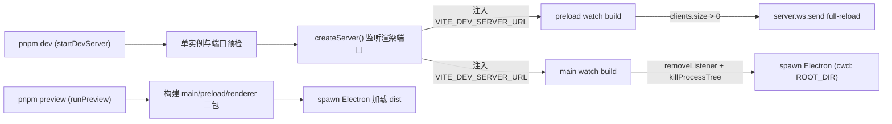

---

title: 开发编排（Vite + Electron）
description: 单命令串联渲染层 dev server、preload 与主进程 watch 构建；生产预览校验产物并按进程树彻底清场。
---

# 开发编排（Vite + Electron）

> **TL;DR**：`pnpm dev` 编程式拉起 Vite Dev Server，同时启动 Preload 与 Main 双路增量构建，实现「三路编排、分级重载」；`pnpm preview` 仅构建主/预加载/渲染三包后以生产行为启动，退出时按进程树彻底清场。

## 1. 选型理由

Electron 本地的开发回路远比普通 Web 应用复杂，核心面临两大难题：
- **三路并发与时序依赖**：渲染层需要 Vite Dev Server（HMR），Preload 需要增量构建并触发页面刷新，主进程需要在重新打包后重启 Electron 进程，三者启动顺序与地址透传存在强依赖。
- **孤儿僵尸进程**：直接杀死主进程 PID 往往会让 Chromium 渲染进程、GPU 进程或托盘实例残留在后台，继续霸占单实例锁与本地端口。

本页负责 `pnpm dev` 与 `pnpm preview` 的构建编排、分级重载与进程树退出清理机制；启动前单实例与端口占用探测见 [启动预检](/dx/startup-preflight)，调试端口开关与参数拼装见 [远程调试端口](/dx/debug-port)。

为什么使用 Vite 的编程式 API（`createServer` 与 `build`）而非串联多条 CLI 命令，可参考 [Vite JavaScript API 文档](https://vite.dev/guide/api-javascript.html)，它解释了如何直接获取 `resolvedUrls` 并通过 `server.ws.send` 广播刷新信号。

## 2. 核心机制



### 编程式三路编排与分级重载

`startDevServer` 先通过 `createServer()` 拉起渲染层并读取 `server.resolvedUrls.local[0]` 写入 `process.env.VITE_DEV_SERVER_URL`，再以 `build({ build: { watch: {} } })` 并行启动 Preload 与 Main 监听：

- **Preload 增量重建**：仅当已连接 WebSocket 客户端时才发送 `full-reload`，防止冷启动首轮构建早于窗口挂载时触发首屏二次重载：

→ 源码：[scripts/dev.ts](https://github.com/BanShan-Alec/electron-react-monorepo-template/blob/main/scripts/dev.ts)

```ts
// 节选：createPreloadReloaderPlugin 仅在存在活跃客户端时广播刷新
writeBundle() {
  if (server.ws.clients.size === 0) {
    return;
  }
  server.ws.send({
    type: 'full-reload',
  });
}
```

- **Main 增量重建**：重启前必须先移除旧进程上的 `exit` 监听器，避免强杀旧实例时误触发当前脚本退出；启动新实例时显式固定 `cwd: ROOT_DIR`，确保 `.` 入口按仓库根解析：

→ 源码：[scripts/dev.ts](https://github.com/BanShan-Alec/electron-react-monorepo-template/blob/main/scripts/dev.ts)

```ts
// 节选：createElectronLauncherPlugin 主进程重建后安全替换实例
if (electronApp !== null) {
  electronApp.removeListener('exit', process.exit);
  if (electronApp.pid) {
    await killProcessTree(electronApp.pid);
  } else {
    electronApp.kill('SIGINT');
  }
  electronApp = null;
}

const args = buildElectronArgs();
electronApp = spawn(String(electronPath), [...args, '.'], {
  stdio: 'inherit',
  cwd: ROOT_DIR,
});
electronApp?.addListener('exit', process.exit);
```

### 生产预览态（Preview）与跨平台进程树清场

`runPreview` 不启动渲染层 Dev Server，默认构建 `@app/main`、`@app/preload`、`@app/renderer` 三包（跳过 `@app/docs`）后加载本地 `dist` 产物；传入 `pnpm preview -- --skip-build` 时直接校验核心入口是否存在，缺失则立即报错退出。无论是主进程重载还是 `SIGINT` / `SIGTERM` 退出，均通过 `killProcessTree` 跨平台清场：

→ 源码：[scripts/port-guard.ts](https://github.com/BanShan-Alec/electron-react-monorepo-template/blob/main/scripts/port-guard.ts)

```ts
// 节选：killProcessTree 跨平台递归终止进程树
if (process.platform === 'win32') {
  execSync(`taskkill /pid ${pid} /T /F`, { stdio: 'ignore' });
} else {
  try {
    execSync(`pkill -TERM -P ${pid}`, { stdio: 'ignore' });
  } catch {}
  try {
    process.kill(-pid, 'SIGKILL');
  } catch {
    process.kill(pid, 'SIGKILL');
  }
}
```

## 3. 桌面端避坑注意事项

- **严禁在 `dev` 中用 CLI 串行代替编程式 `createServer`**：端口被占用或顺延后，只有从 `server.resolvedUrls` 读取真实地址注入 `VITE_DEV_SERVER_URL`，主进程窗口才不会连向错误端口导致白屏。
- **`--skip-build` 仅在产物完整时使用**：改动过主进程、Preload 或共享常量后若带 `--skip-build` 启动 `pnpm preview`，会直接跑在旧产物上甚至触发入口文件缺失拦截。
- **重启前必须先摘除 `exit` 监听**：`createElectronLauncherPlugin` 若漏掉 `removeListener('exit', process.exit)`，热重载杀掉旧 Electron 实例会连带把整个 watch 编排进程一起退出。
