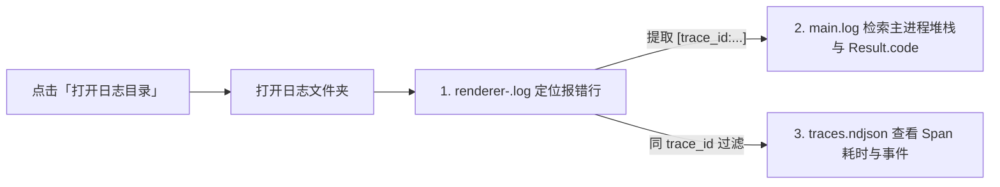

---

title: 日志与链路排查（Usage）
description: 通过诊断卡片唤起日志目录，利用 W3C trace_id 串联 renderer-<window>.log、main.log 与 traces.ndjson 进行跨进程排障。
---

# 日志与链路排查（Usage）

> **TL;DR**：通过应用内「打开日志目录」一键定位平台日志文件夹，先从 `renderer-<window>.log` 提取报错行的 `trace_id`，再到 `main.log` 与 `traces.ndjson` 检索同 ID，即可拼出完整跨端调用证据链。

## 1. 选型理由

桌面端排障存在两道天然屏障：
1. **控制台不留痕**：打包交付给用户后没有 DevTools 终端，原生 `console.log` 随进程关闭消失，且渲染端受沙箱隔离无法直接写盘。
2. **双端文件孤立**：前端只看到 IPC 调用失败，主进程日志按异步并发交错落盘，缺少共同索引就无法定位是哪一次请求触发了底层错误。

本页负责运行态日志定位与跨进程 `trace_id` 排查方法；日志分文件轮转、脱敏与滑窗限流原理见 [本地日志](/main/logging)，W3C `traceparent` 注入、`AsyncLocalStorage` 续接与 Span 采集机制见 [全链路追踪](/main/tracing)。

## 2. 核心机制



### 日志文件分工与目录定位

在 Dashboard 的「生产分级日志 (LogManager)」卡片点击「打开日志目录」，渲染层会调用 `diagnostics.openLogFolder`，由主进程 `LogManager.openLogFolder()` 通过 `shell.openPath` 打开日志文件所在目录：

| 文件名                    | 记录内容与排障重点                                                          |
| :------------------------ | :-------------------------------------------------------------------------- |
| **`main.log`**            | 主进程生命周期、未捕获异常、IPC 入口日志与业务报错                          |
| **`renderer-<窗口>.log`** | 按窗口名隔离的渲染端日志（如 `renderer-home.log`），记录 UI 错误与 IPC 失败 |
| **`traces.ndjson`**       | W3C Span 拓扑记录，每行一条 JSON，记录 `duration_ms`、`status` 与结构化事件 |

### 渲染端 IPC 失败日志与类型守卫

渲染层统一经 `callIpc` 发起请求；失败时由 `logIpc` 先用 `typeof logger.withTrace === 'function'` 守卫检测 Preload 日志桥能力，再区分开发态（附完整 `error` 对象与栈）和生产态（收敛为单行错误消息）写入磁盘：

→ 源码：[packages/renderer/src/lib/ipc.ts](https://github.com/BanShan-Alec/electron-react-monorepo-template/blob/main/packages/renderer/src/lib/ipc.ts)

```ts
// 节选：logIpc 失败分支的类型守卫与环境分流
const line = `${IPC_LOG_PREFIX} ${channel} failed ${cost}`;
const targetLogger =
  traceId && typeof logger.withTrace === 'function' ? logger.withTrace(traceId) : logger;
const traceMarker = traceId ? { __trace_id: traceId } : undefined;

if (isDev) {
  if (traceMarker) {
    targetLogger.error(line, error, traceMarker);
  } else {
    targetLogger.error(line, error);
  }
  return;
}
const reason = error instanceof Error ? error.message : String(error);
if (traceMarker) {
  targetLogger.error(`${line}: ${reason}`, traceMarker);
} else {
  targetLogger.error(`${line}: ${reason}`);
}
```

### 实战：四步串联同 `trace_id` 三端日志

按以下四步即可快速定位跨端异常：
1. 在 `renderer-<窗口>.log` 定位失败记录并复制 `[trace_id:xxxx]`；
2. 在 `main.log` 全文检索该 `trace_id`，对齐主进程处理入口与 `Result.code`；
3. 在 `traces.ndjson` 过滤同 ID 查看该 Span 的 `duration_ms` 与 `events` 结构化详情；
4. 命令行快速检索：Git Bash 用 `grep <trace_id> main.log`，PowerShell 用 `Select-String <trace_id> main.log`。

以「打开外链 `https://example.com` 被主进程安全白名单拦截」为例，一次失败在三份文件中的真实格式如下（主进程 `.862` 早于渲染端 `.865` 落盘，因渲染端需等待 IPC 返回）：

→ 源码：[packages/main/src/modules/log.module.ts](https://github.com/BanShan-Alec/electron-react-monorepo-template/blob/main/packages/main/src/modules/log.module.ts)

```text
# 1. renderer-home.log（渲染层等待 IPC 返回后落盘，附完整 Error 堆栈）
[2026-10-20 17:03:55.865] [error] [trace_id:2611dd45ea5ca5a37b97c91eb46e504a] [Renderer] [home] [ipc] diagnostics.performAction failed 2.7ms {
  name: 'Error',
  message: 'Disallowed external URL: https://example.com',
  stack: 'Error: Disallowed external URL: https://example.com\n' +
    '    at async Object.<anonymous> (http://localhost:5173/src/features/devtools/hooks/useDevTools.ts:18:16)'
}

# 2. main.log（主进程处理更早落盘，带 span_id 与 Result.code）
[2026-10-20 17:03:55.862] [debug] [trace_id:2611dd45ea5ca5a37b97c91eb46e504a span_id:2fd06c93e53731f5] [IPC] [home] Handling diagnostics:perform-action
[2026-10-20 17:03:55.864] [warn]  [trace_id:2611dd45ea5ca5a37b97c91eb46e504a span_id:2fd06c93e53731f5] [IPC] [home] diagnostics:perform-action failed (0.6ms): Disallowed external URL: https://example.com [code: INVALID_ARGUMENT]

# 3. traces.ndjson（单行 Span JSON，记录耗时、错误码与事件）
{"type":"span","name":"ipc.receive:diagnostics:perform-action","trace_id":"2611dd45ea5ca5a37b97c91eb46e504a","span_id":"2fd06c93e53731f5","parent_id":"5d50e42213267f2f","start_time":1792487035862,"duration_ms":1.83,"status":"ERROR","attributes":{"ipc.channel":"diagnostics:perform-action","rpc.system":"electron-ipc","window.id":1,"window.name":"home","app.result_success":false,"app.result_code":"INVALID_ARGUMENT"},"events":[{"name":"business_error","time_ms":1792487035864,"attributes":{"error.message":"Disallowed external URL: https://example.com","error.code":"INVALID_ARGUMENT"}}]}
```

## 3. 桌面端避坑注意事项

- **严禁裸写 `console.log` 替代 `window.logger`**：只有通过 Preload 暴露的 `logger.info` / `logger.error` 才会经 `DIAGNOSTICS_LOG` 通道落盘；开发态调试日志若未走 `logger`，生产排障时将完全丢失。
- **警惕 `Dropped N renderer log line(s)` 限流告警**：如果在 `main.log` 发现该 `warn`（来自 `DiagnosticsService` 滑窗节流器，详见 [本地日志](/main/logging)），说明渲染端存在每秒超过限流阈值的高频刷屏（常见于 `useEffect` 依赖死循环）。
- **勿在代码中写死日志路径**：不同系统日志目录位置各异，统一依赖 `LogManager.getLogDirectory()` 与 `shell.openPath(dir)` 定位与打开，并按 `trace_id` 而非毫秒时间戳对齐跨端日志。
