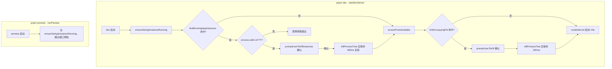

---

title: 启动预检（Single-instance + Port）
description: 启动开发或预览会话前先探测单实例锁与端口冲突，交互确认后定向终止，非 TTY 环境立即报错退出。
---

# 启动预检（Single-instance + Port）

> **TL;DR**：`pnpm dev` 按「先单实例、后端口」顺序探测后台残留应用与端口占用，`pnpm preview` 仅执行单实例预检；TTY 下交互确认并按进程树强杀释放，非 TTY（CI/无交互脚本）直接抛错阻断。

## 1. 选型理由

Electron 本地启动常出现两类隐蔽的「假死」问题：
1. **单实例锁静默退出**：上次开发会话未清理干净，或本地安装的打包版在系统托盘常驻时，新拉起的 Electron 抢锁失败会瞬间静默退出，看似闪退却毫无构建报错。
2. **端口占用导致连接错位**：若 5173 等端口被残留进程占用，未清理或顺延地址未透传都会让窗口连向错误服务或直接白屏超时。

本页负责启动开发/预览命令前的单实例锁冲突与端口占用预检；三路构建与热重载编排见 [开发编排](/dx/dev-orchestration)，调试端口开关见 [远程调试端口](/dx/debug-port)，运行态 Electron 单实例锁与托盘唤醒逻辑见 [托盘常驻与单实例](/main/tray-single-instance)。

## 2. 核心机制



`startDevServer` 固定先执行 `ensureNoAppInstanceRunning(ROOT_DIR)`、再执行 `ensurePortsAvailable`；`runPreview` 不起渲染层 Dev Server，仅复用单实例预检。脚本启动时先由 `ensureRepoEnv(__dirname)` 内部调用 [findRepoRoot](https://github.com/BanShan-Alec/electron-react-monorepo-template/blob/main/build/lib/repo-paths.ts) 从脚本目录向上定位仓库根（同时存在 `package.json` 与 `pnpm-workspace.yaml`），在 Windows 平台还会先执行 `chcp 65001` 切换控制台代码页避免中文乱码，两者均位于 [scripts/dev.ts](https://github.com/BanShan-Alec/electron-react-monorepo-template/blob/main/scripts/dev.ts)。

### 单实例探测（按仓库根路径隔离）

Windows 通过 PowerShell `Get-Process`、POSIX 通过 `pgrep -f` 同时匹配两类特征：按 `APP_IDENTITY.productName` 识别已安装打包版，按本仓根目录下的 Electron 二进制路径识别开发态实例（避免误杀其他项目或平行 worktree）：

→ 源码：[scripts/instance-guard.ts](https://github.com/BanShan-Alec/electron-react-monorepo-template/blob/main/scripts/instance-guard.ts)

```ts
// 节选：findPosixInstances() 内的双特征匹配模式
const patterns = [`${repoRoot}/node_modules/electron/dist/electron`, APP_IDENTITY.productName];
```

### 端口探测与交互释放

`ensurePortsAvailable` 依次校验根 `.env` 中的 `DEV_RENDERER_PORT`、`DEV_RENDERER_CDP_PORT` 与 `DEV_MAIN_INSPECT_PORT`（自动跳过未配置或留空端口）；Windows 解析 `netstat -ano` 的 `LISTENING` 行，POSIX 按 `lsof` → `ss` → `fuser` 逐级降级查询 PID：

→ 源码：[scripts/port-guard.ts](https://github.com/BanShan-Alec/electron-react-monorepo-template/blob/main/scripts/port-guard.ts)

```ts
// 节选：ensureSinglePortAvailable() 探测与交互释放决策边界
const pid = await findOccupyingPid(port);
if (pid === null || pid === process.pid) {
  return;
}

const procName = await getProcessName(pid);
const shouldKill = await promptUserToKill(port, desc, pid, procName);
if (shouldKill) {
  await killProcessTree(pid);
  // 等待 300ms 确保系统彻底释放套接字
  await new Promise((resolve) => setTimeout(resolve, 300));
} else {
  console.log('[dev] 用户取消了端口释放，服务启动终止。');
  process.exit(1);
}
```

## 3. 桌面端避坑注意事项

- **预检顺序必须是「先单实例，后端口」**：旧 dev 会话残留时，强杀对端 Electron 实例通常会连带终止其父级 dev 进程并顺带释放 5173/9222 端口，反过来会让用户重复确认两次。
- **非 TTY 环境严禁挂起等待输入**：在 CI 或无交互管道中，`promptUserToKill` 与 `promptUserToKillInstances` 会在创建 `readline` 前检查 `process.stdin.isTTY`，不满足立即抛错并提示先从托盘右键退出残留实例。
- **精准隔离其他工作区与项目**：Windows 按本仓路径前缀过滤 `electron` 进程，POSIX 匹配 `${repoRoot}/node_modules/electron/dist/electron`，避免误杀同时打开的其他仓库或平行 worktree 开发实例。
- **强杀后的复检差异**：`ensureNoAppInstanceRunning` 在等待 300ms 后会再次调用 `findRunningAppInstances` 复检，若遇到高权限进程残留会输出红色告警提示手动退出；`ensureSinglePortAvailable` 则直接等待 300ms 释放套接字。
