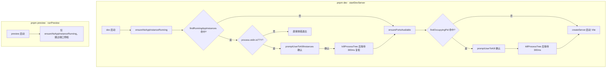

---

title: 启动预检（Single-instance + Port）
description: 启动服务前先探测单实例锁与端口冲突，交互确认后定向清理，非 TTY 环境快速报错。
---

# 启动预检（Single-instance + Port）

> **TL;DR**：执行 `pnpm dev` 时，先探测后台残留的 Electron 实例（打包版或旧 dev 会话），再检测 Vite 与调试端口占用；检测到冲突后交互式提示强杀释放，非 TTY 环境直接阻断报错。

## 1. 选型理由

Electron 开发者常遇到两种极为隐蔽的“假死”现象：
1. **单实例锁静默退出**：如果上一次的开发会话未退出干净，或者后台托盘常驻着已打包的应用，新拉起的实例因申请单实例锁失败会瞬间自行退出。终端无报错、窗口无弹出，开发者往往误以为是构建闪退。
2. **端口占用与顺延迷航**：Vite 默认会自动顺延端口（如 5173 被占则自动改用 5174），但如果未被主进程获知，主进程窗口仍然试图连接旧地址，导致白屏超时。

## 2. 核心机制



`startDevServer` 固定先 `ensureNoAppInstanceRunning`、后 `ensurePortsAvailable`；`runPreview` 只复用单实例预检，不启动 dev server，因此没有端口需要探测。非 TTY 时 `promptUserToKill` / `promptUserToKillInstances` 会在创建 readline 前直接抛错。两个入口都在 [scripts/dev.ts](https://github.com/BanShan-Alec/electron-react-monorepo-template/blob/main/scripts/dev.ts)。

脚本在 Win32 下先执行 `chcp 65001` 切换控制台代码页，避免 Git Bash 等终端的中文日志乱码（`scripts/dev.ts:32-37`）；仓库根由 `loadRepoEnv(__dirname)` 内部的 `findRepoRoot` 从脚本目录向上锁定，不依赖 `process.cwd()`（`scripts/dev.ts:11-15`、`build/lib/repo-paths.ts`）。

### 单实例探测

Windows 分支用 PowerShell `Get-Process`：按 `APP_IDENTITY.productName` 匹配打包版，dev 实例则要求可执行文件路径落在本仓根目录下，避免误杀其他项目 / worktree。POSIX 分支用 `pgrep -f` 按同样的两个特征匹配：

→ 源码：[scripts/instance-guard.ts](https://github.com/BanShan-Alec/electron-react-monorepo-template/blob/main/scripts/instance-guard.ts)

节选：`findRunningAppInstances()` 内的匹配特征（省略函数体与平台分支）：

```ts
const patterns = [`${repoRoot}/node_modules/electron/dist/electron`, APP_IDENTITY.productName];
```

### 端口探测

`ensurePortsAvailable` 按 `rendererPort` → `rendererCdpPort` → `mainInspectPort` 的顺序逐个调用 `ensureSinglePortAvailable`，未配置（`undefined`）的端口自动跳过：

→ 源码：[scripts/port-guard.ts](https://github.com/BanShan-Alec/electron-react-monorepo-template/blob/main/scripts/port-guard.ts)

```ts
export async function ensureSinglePortAvailable(port: number, desc: string): Promise<void> {
  const pid = await findOccupyingPid(port);
  if (pid === null || pid === process.pid) {
    return;
  }

  const procName = await getProcessName(pid);
  const shouldKill = await promptUserToKill(port, desc, pid, procName);

  if (shouldKill) {
    console.log(`[dev] 正在终止进程 ${procName} (PID: ${pid}) 及其子进程树...`);
    await killProcessTree(pid);
    // 等待 300ms 确保系统彻底释放套接字
    await new Promise((resolve) => setTimeout(resolve, 300));
    console.log(`\x1b[32m[dev] 端口 ${port} (${desc}) 已成功释放。\x1b[0m`);
  } else {
    console.log('[dev] 用户取消了端口释放，服务启动终止。');
    process.exit(1);
  }
}
```

- Windows 下调用 `netstat -ano` 解析 `LISTENING` 行获取 PID；POSIX 下按 `lsof -i :<port> -t -sTCP:LISTEN` ➔ `ss -lptn "sport = :<port>"` ➔ `fuser <port>/tcp` 逐级降级探测。

## 3. 桌面端避坑注意事项

- **预检时序必须是「先单实例，后端口」**：
  - 如果上次的 dev 会话残留在后台，强杀对端 Electron 实例通常会连带导致其父级 dev 进程自动退出，从而顺带释放 5173 等端口。颠倒顺序会导致用户经历两次不必要的二次确认。
- **Preview 模式下无需预检端口**：
  - `pnpm preview` 不需要启动 Vite Dev Server，直接加载本地 `file://`，因此预览模式只运行单实例探测，不浪费时间做端口预检。
- **清理后二次复检**：
  - 单实例路径在进程树强杀后会再次执行 `findRunningAppInstances`；若残留进程拥有高权限无法强杀，会给出醒目的红色手动终止警告，不假装清理成功。端口路径没有二次探测，只等待 300ms 让系统释放套接字。
