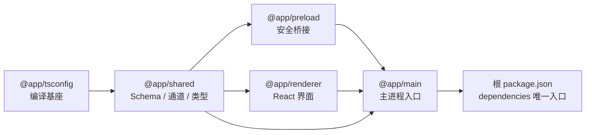

---

title: 依赖管理（Monorepo）
description: 明确根目录、主进程、渲染层、其他子包、包间拓扑及第三方/自建 .node 原生模块的依赖归属与接入规则。
---

# 依赖管理（Monorepo）

> **TL;DR**：根目录 `dependencies` 硬性仅允许 `@app/main`（`pnpm verify:prebuild` 唯一真源）；`@app/main` 按运行时是否从 `node_modules` 解析分流 `dependencies`（外部/原生包）与 `devDependencies`（Vite 内联纯 JS 库）；`@app/renderer` 静态打包；第三方 `.node` 需 `publicHoistPattern` + `allowBuilds`，自建 `.node` 需独立建包并加入打包白名单。

## 1. 各包依赖归属规则

本页负责 Monorepo 各包依赖归属、`workspace:*` 包间拓扑、第三方/自建 `.node` 原生包接入规范，以及根目录依赖白名单门禁的唯一真源。本页不负责环境变量管理（见 [环境变量管理](/engineering/env-vars)）、ASAR 体积预算与产物扫描（见 [分包与体积门禁](/security/bundle-budget)）、打包参数与 Electron Fuses（见 [应用打包](/delivery/packaging)），也不负责 CI 多路调度（见 [CI 并行门禁](/delivery/ci-gates)）。

| 包 / 位置                  | `dependencies` 放什么                                                        | `devDependencies` 放什么                                                | 打包 / 构建归宿                                                             |
| :------------------------- | :--------------------------------------------------------------------------- | :---------------------------------------------------------------------- | :-------------------------------------------------------------------------- |
| **根目录 `package.json`**  | 仅限 `@app/main`（`verify:prebuild` 硬门禁）                                 | 跨包工程工具与构建脚本（Biome、Vitest、Playwright、Electron）           | 防止 `electron-builder` 递归把工具/前端包卷入 `app.asar`                    |
| **主进程 `@app/main`**     | 运行时需从 `node_modules` 加载的外部/原生包（`electron-updater`、`usb`）     | 故意内联进 bundle 的纯 JS 库（`electron-log`、`electron-store`、`zod`） | `dependencies` 自动进入 Vite `external`；其余由 `ssr.noExternal: true` 内联 |
| **渲染层 `@app/renderer`** | 前端运行库（`antd`、`wouter`、`zustand`、`@lingui/*`、`react`）              | Vite/Tailwind/Lingui 构建插件与类型定义                                 | 全量静态编译进 `dist/`，运行时不读取 `node_modules`                         |
| **预加载 `@app/preload`**  | 禁止放运行时依赖                                                             | 极简桥接与契约（`@app/shared`、`@sentry/electron`）                     | 经 `ssr.noExternal: true` 全部内联进 `dist/index.cjs`                       |
| **共享契约 `@app/shared`** | 无（纯类型与 Schema 契约，零平台运行时依赖）                                 | `zod`、`vitest`、`@app/tsconfig`                                        | 仅提供 TS 类型、Zod Schema 与纯函数常量                                     |
| **工具/文档独立子包**      | `@app/docs` 放站点运行依赖（`vocs`、`mermaid`）；`pr-review` / `tsconfig` 无 | 各包专属 CLI/编译工具（`tsx`、`vitest` 等）                             | 独立构建或脚本执行，不参与桌面端 `app.asar` 打包                            |

- **安装命令归属**：始终通过 `pnpm --filter <pkg> add [-D] <dep>` 装进目标包，禁止在根目录直接执行 `pnpm add <业务库>`。
- **版本集中策略**：多包共用或必须保持同版本的框架族（`react`、`typescript`、`vite`、`vitest`、`zod`、`tailwindcss`）在 [pnpm-workspace.yaml](https://github.com/BanShan-Alec/electron-react-monorepo-template/blob/main/pnpm-workspace.yaml) 的 `catalog:` 统一定版（子包写 `"catalog:"`）；单包独用依赖在包内自行定版。想系统理解 `catalog:` 协议如何在安装期锁版并在发布期还原版本区间，可参考 [pnpm Catalogs 官方文档](https://pnpm.io/catalogs)。

→ 源码：[packages/main/vite.config.ts](https://github.com/BanShan-Alec/electron-react-monorepo-template/blob/main/packages/main/vite.config.ts)

```ts
// 节选：主进程 external 由 packages/main/package.json dependencies 自动派生，无需手改配置
const pkgPath = path.resolve(__dirname, 'package.json');
const pkg = JSON.parse(fs.readFileSync(pkgPath, 'utf8'));
const runtimeDependencies = Object.keys(pkg.dependencies ?? {});
// ...
rolldownOptions: {
  external: ['electron', ...runtimeDependencies],
```

## 2. 包间依赖规则（workspace:* 单向拓扑）

包间引用统一使用 `"workspace:*"`，严格维持单向无环层级（Biome `noImportCycles` 为 error）：



- **允许方向**：`@app/shared` 与 `@app/tsconfig` 居最底层供各端引用；`@app/main` 可在 `devDependencies` 引用 `@app/preload`、`@app/renderer`、`@app/shared` 完成构建产物装配与进程启动。
- **严禁越界**：`@app/renderer` 禁止依赖 `@app/main` 或 `@app/preload`（渲染层与主进程仅通过 `@app/shared` 契约 + `window.api` 通信）；`@app/shared` 禁止引入任何 Electron、Node 或 DOM 运行时依赖；`@app/docs` 与 `@app/pr-review` 仅可依赖 `@app/tsconfig`，不反向耦合业务包。

## 3. 原生模块（.node）依赖与新增子包规范

### 第三方 `.node` 原生包（以仓库内置 `usb` 为例）

含原生二进制 `.node` 的第三方包无法被 Vite 内联，必须同时完成四项配置：

1. **装入主进程 `dependencies`**：执行 `pnpm --filter @app/main add <pkg>`，使 Vite 自动将其标为 `external` 并在打包期保留至 `node_modules`。
2. **放行 `publicHoistPattern`**：仓库采用 `nodeLinker: isolated` 严格隔离，必须在 [pnpm-workspace.yaml](https://github.com/BanShan-Alec/electron-react-monorepo-template/blob/main/pnpm-workspace.yaml) 的 `publicHoistPattern` 添加匹配模式（如 `@node-usb/*`、`*usb*`），否则 `electron-builder` 无法解包拷贝。
3. **审批构建脚本**：若命中 `ERR_PNPM_IGNORED_BUILDS`，先运行 `pnpm ignored-builds` 审查，再执行 `pnpm approve-builds <pkg>` 写入 `allowBuilds`。
4. **ASAR 自动解包**：[build/electron-builder.ts](https://github.com/BanShan-Alec/electron-react-monorepo-template/blob/main/build/electron-builder.ts) 已全局配置 `asarUnpack: ['**/*.node']`；若原生包附带 `.dll` / `.dylib` / `.so` 等动态库，需在该数组补充对应后缀（打包细节见 [应用打包](/delivery/packaging)）。

### 自建 `.node` 原生模块（扩展约定：新增独立 workspace package）

仓库当前无内置自建 `.node` 子包示例；若需自行编写 C++ N-API 或 Rust `napi-rs` 原生插件，**严禁直接把源码或二进制塞进 `packages/main` 目录**，统一按独立子包接入（4 步）：

1. **新建独立子包 `packages/<native-pkg>`**：将原生编译工具链与构建脚本收敛进该包的 `scripts.build`，并在 `package.json` 显式声明 `main`、`exports` 与包含 `.node` 产物的 `files` 白名单。
2. **主进程通过 `workspace:*` 引用**：在 `packages/main/package.json` 的 `dependencies` 添加 `"@app/<native-pkg>": "workspace:*"`，使其自动进入主进程 `external`。
3. **登记打包白名单（关键）**：`build/electron-builder.ts` 默认配置了 `'!node_modules/@app/**'` 排除了全部 workspace 软链，必须将该子包名加入 `getListOfFilesFromEachWorkspace([...])`（当前仅列出 `['main', 'preload', 'renderer']`），否则打包会被静默过滤。
4. **解包与多平台验证**：`.node` 产物自动命中 `asarUnpack: ['**/*.node']`；若含伴随动态库需同步补充 `asarUnpack`，并执行 `pnpm verify:postbuild` 验证打包产物可用。

→ 源码：[build/electron-builder.ts](https://github.com/BanShan-Alec/electron-react-monorepo-template/blob/main/build/electron-builder.ts)

```ts
// 节选：先全局排除 @app/* 软链，再按白名单收集子包 files 产物打入 app.asar
files: [
  'LICENSE*',
  '!node_modules/@app/**',
  ...getListOfFilesFromEachWorkspace(['main', 'preload', 'renderer']),
```

## 4. 校验判据与避坑清单

- **根目录门禁唯一真源**：[scripts/verify-prebuild.ts](https://github.com/BanShan-Alec/electron-react-monorepo-template/blob/main/scripts/verify-prebuild.ts) 内的 `verifyPrebuild()` 硬性校验根 `package.json` 的 `dependencies` 仅含 `['@app/main']`；在根目录执行 `pnpm verify:prebuild` 退出码为 `0` 且输出 `根目录 dependencies 边界校验通过` 即达标。
- **供应链冷静期与脚本审批**：[pnpm-workspace.yaml](https://github.com/BanShan-Alec/electron-react-monorepo-template/blob/main/pnpm-workspace.yaml) 启用 `minimumReleaseAge: 1440`（禁止安装发布未满 24 小时的包）与 `allowBuilds` 白名单；遇阻断禁止直接改配置跳过，先审后批。
- **切勿将 `ELECTRON_MIRROR` 写入 `.npmrc` 或全局环境变量**：`@electron/get` 会优先读取该变量，在打包 macOS DMG 时连带劫持 `dmgbuild` 等辅助工具下载地址导致 404 失败；镜像前缀仅限保留在根目录 [package.json](https://github.com/BanShan-Alec/electron-react-monorepo-template/blob/main/package.json) 的 `postinstall` 单行注入（Electron 42+ 二进制惰性拉取）。
