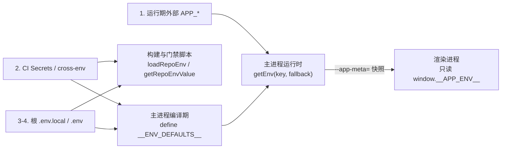

---

title: 环境变量管理（Env-vars）
description: 梳理环境变量从哪里生成、在哪里消费、免重打包覆盖规则及按消费面新增变量的完整清单。
---

# 环境变量管理（Env-vars）

> **TL;DR**：全仓只在仓库根维护 `.env`（共享默认）与 `.env.local`（本地覆盖），外部 Shell/CI 始终最高优先；构建脚本读 `build/lib/env.ts`，主进程运行时读 `getEnv()`（支持 `APP_<KEY>` 免重打包覆写），渲染层只读冻结的 `window.__APP_ENV__`。

## 1. 哪里生成：文件分层与优先级

本页负责环境变量的文件分层与覆盖优先级、生成源到 4 类消费面的流向、按消费面新增变量清单与安全红线。本页不负责全仓六层配置归属总览（见 [配置项归属](/dx/configuration-map)）、`additionalArguments` / `--app-meta=` 传参与 Preload 解包实现（见 [窗口初始传参](/architecture/window-params)），也不负责 CI 发布矩阵编排（见 [发版流水线](/delivery/release-pipeline)）。

环境变量只允许来自以下 4 层生成源，优先级**自上而下严格递减**（高优先级永远不被低优先级反向覆盖）：

| 优先级 | 生成源（位置）                                   | 入库状态          | 典型变量与用途                                                            |
| :----- | :----------------------------------------------- | :---------------- | :------------------------------------------------------------------------ |
| **1**  | 运行期外部注入（启动客户端前的 Shell / OS）      | 不入库            | `APP_API_BASE_URL` 等带 `ENV_PREFIX` 的覆盖值，支持打包后免重打包切环境   |
| **2**  | 构建 / CI 外部注入（Secrets 与 `cross-env`）     | 仅登记于模板注释  | `MODE`、`VITE_DEV_SERVER_URL`、`SENTRY_AUTH_TOKEN`、`OCR_LLM_*`、签名证书 |
| **3**  | 本地覆写文件（根 `.env.local` / `.env.*.local`） | `.gitignore` 忽略 | 开发者个人本地覆盖，不污染团队配置                                        |
| **4**  | 共享默认值（根 `.env` 与 `.env.example`）        | 入库唯一默认真源  | `ENV_PREFIX`、`API_BASE_URL`、`MAX_ASAR_SIZE_MB`、`DISTRIBUTION_CHANNEL`  |

- **严禁子包私建 `.env`**：[packages/renderer/vite.config.ts](https://github.com/BanShan-Alec/electron-react-monorepo-template/blob/main/packages/renderer/vite.config.ts) 与构建脚本统一向上锁定仓库根目录；[build/lib/env.ts](https://github.com/BanShan-Alec/electron-react-monorepo-template/blob/main/build/lib/env.ts) 的 `applyRepoEnv` 仅在 `process.env[key] === undefined` 时回填，禁止 `Object.assign(process.env, loadEnv(...))` 覆盖外部注入。
- **分层解析参考**：关于 Vite `loadEnv` 对 `.env`、`.env.[mode]` 与 `.local` 文件的合并规则，详见 [Vite 环境变量与模式文档](https://vite.dev/guide/env-and-mode)。

## 2. 哪里消费：四类消费面与流向图



环境变量在仓库中落到 4 个明确消费面，各自走独立入口、互不越界：

| 消费面             | 真实消费方                                                                                                                              | 读取入口与优先级                                                                                                                                           | 消费哪些变量                                                                            |
| :----------------- | :-------------------------------------------------------------------------------------------------------------------------------------- | :--------------------------------------------------------------------------------------------------------------------------------------------------------- | :-------------------------------------------------------------------------------------- |
| **构建与门禁脚本** | `scripts/dev.ts`、`scripts/build.ts`、`verify-postbuild.ts`、`sentry-options.ts`                                                        | [build/lib/env.ts](https://github.com/BanShan-Alec/electron-react-monorepo-template/blob/main/build/lib/env.ts)（`loadRepoEnv` / `getRepoEnvValue`）       | `MODE`、`MAX_ASAR_SIZE_MB`、`SENTRY_ORG`/`PROJECT`/`AUTH_TOKEN` 等（不进安装包）        |
| **主进程编译期**   | [packages/main/vite.config.ts](https://github.com/BanShan-Alec/electron-react-monorepo-template/blob/main/packages/main/vite.config.ts) | `loadRepoEnv` 过滤 `ALLOWED_ENV_KEYS` 注入 `__ENV_DEFAULTS__` 与 `__ENV_PREFIX__`                                                                          | 仅白名单 4 键：`API_BASE_URL`、`SYSTEM_CODE`、`DISTRIBUTION_CHANNEL`、`SENTRY_DSN`      |
| **主进程运行时**   | `csp.ts`、`sentry.module.ts`、`updater.service.ts`、`getRuntimeEnvSnapshot()`                                                           | [packages/main/src/env.ts](https://github.com/BanShan-Alec/electron-react-monorepo-template/blob/main/packages/main/src/env.ts) 的 `getEnv(key, fallback)` | 运行时实时读取，支持 `APP_<KEY>` 覆盖内置默认值                                         |
| **渲染进程**       | `Header`、`ErrorBoundary`、`ipc.ts`、`lib/sentry.ts`、`useNativeDialogs`                                                                | 只读冻结的 `window.__APP_ENV__`（经 `--app-meta=` 传入 Preload 冻结）                                                                                      | `mode`、`appVersion`、`appName`、`apiBaseUrl`、`systemCode`、`sentryDsn`、`releaseName` |

打包后的客户端磁盘上没有 `.env` 文件，因此主进程靠编译期内联的 `__ENV_DEFAULTS__` 兜底，再由 `getEnv()` 在运行期优先采纳 `APP_<KEY>`；渲染层**严禁直接读取 `import.meta.env.VITE_*`**，否则构建期写死后就丧失了免重打包切环境的能力（跨进程透传实现见 [窗口初始传参](/architecture/window-params)）。

→ 源码：[packages/main/src/env.ts](https://github.com/BanShan-Alec/electron-react-monorepo-template/blob/main/packages/main/src/env.ts)

```ts
export function getEnv(key: EnvKey, fallback?: string): string {
  const prefix = typeof __ENV_PREFIX__ !== 'undefined' ? __ENV_PREFIX__ : 'APP_';
  const prefixedKey = `${prefix}${key}`;
  const envVal = process.env[prefixedKey];
  if (envVal !== undefined && envVal !== '') {
    return envVal;
  }
  if (fallback !== undefined) {
    return fallback;
  }
  if (typeof __ENV_DEFAULTS__ !== 'undefined' && __ENV_DEFAULTS__[key] !== undefined) {
    return __ENV_DEFAULTS__[key];
  }
  return '';
}
```

## 3. 按消费面新增变量清单

- **仅构建 / 门禁脚本使用**（如新阈值或开关）：在 [.env.example](https://github.com/BanShan-Alec/electron-react-monorepo-template/blob/main/.env.example) 与 `.env` 登记键名 → 在脚本内通过 `loadRepoEnv` + `getRepoEnvValue` 读取即可，**不要加入 `ALLOWED_ENV_KEYS`**。
- **主进程与渲染层运行时共用**（支持 `APP_<KEY>` 免重打包覆写）：
  1. 在 [.env.example](https://github.com/BanShan-Alec/electron-react-monorepo-template/blob/main/.env.example) 与 `.env` 登记默认值；
  2. 在 [packages/main/vite.config.ts](https://github.com/BanShan-Alec/electron-react-monorepo-template/blob/main/packages/main/vite.config.ts) 的 `ALLOWED_ENV_KEYS` 与 [packages/main/src/env.d.ts](https://github.com/BanShan-Alec/electron-react-monorepo-template/blob/main/packages/main/src/env.d.ts) 的 `EnvKey` 同步加键；
  3. 在 [packages/shared/src/types/env.ts](https://github.com/BanShan-Alec/electron-react-monorepo-template/blob/main/packages/shared/src/types/env.ts) 的 `AppRuntimeEnv` 补充字段类型；
  4. 在 [packages/main/src/env.ts](https://github.com/BanShan-Alec/electron-react-monorepo-template/blob/main/packages/main/src/env.ts) 的 `getRuntimeEnvSnapshot()` 提取该值。
- **CI 机密凭证**：只登记进 `.env.example` 底部注释清单并在 GitHub Repository Secrets 配置，不写入 `.env`。

## 4. 验收与安全红线

- **免重打包验证判据**：`pnpm typecheck` 通过后，设置环境变量 `APP_API_BASE_URL=https://staging.example.com` 启动应用，在渲染层控制台核验 `Object.isFrozen(window.__APP_ENV__) === true` 且 `window.__APP_ENV__.apiBaseUrl === 'https://staging.example.com'`。
- **严禁将 Secret 放进 `.env` 或 `ALLOWED_ENV_KEYS`**：`--app-meta=` 位于 `additionalArguments`，在系统任务管理器与进程命令行中明文可见；签名证书、`SENTRY_AUTH_TOKEN`、`OCR_LLM_TOKEN` 与业务密钥严禁进入客户端打包或运行时快照。
- **不该放进 `.env` 的东西**：用户运行时可改偏好归 `userData/config.json`（见 [配置持久化](/main/config-persistence)），随代码库走的产品身份与发布源归根 `package.json`（见 [配置项归属](/dx/configuration-map)）。
