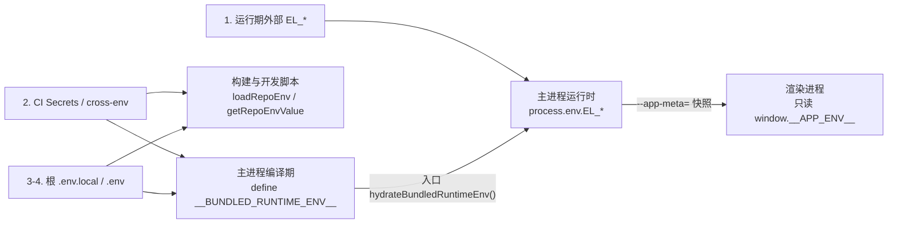

---

title: 环境变量管理（Env-vars）
description: 梳理环境变量从哪里生成、在哪里消费、固定 EL_ 前缀边界与入口内存回填 process.env 机制。
---

# 环境变量管理（Env-vars）

> **TL;DR**：全仓只在仓库根维护 `.env`（共享默认）与 `.env.local`（本地覆盖），外部 Shell/CI 始终最高优先；固定 `EL_` 前缀划定「防 OS 冲突 + 进客户端运行时」边界，打包态在主进程入口内存回填 `process.env` 空位，dev 与 packed 统一直接读 `process.env.EL_* ?? ''`。

## 1. 哪里生成：文件分层与优先级

本页负责环境变量的文件分层与覆盖优先级、生成源到 4 类消费面的流向、按消费面新增变量清单与安全红线。本页不负责全仓六层配置归属总览（见 [配置项归属](/dx/configuration-map)）、`additionalArguments` / `--app-meta=` 传参与 Preload 解包实现（见 [窗口初始传参](/architecture/window-params)），也不负责 CI 发布矩阵编排（见 [发版流水线](/delivery/release-pipeline)）。

环境变量只允许来自以下 4 层生成源，优先级**自上而下严格递减**（高优先级永远不被低优先级反向覆盖）：

| 优先级 | 生成源（位置）                                   | 入库状态          | 典型变量与用途                                                            |
| :----- | :----------------------------------------------- | :---------------- | :------------------------------------------------------------------------ |
| **1**  | 运行期外部注入（启动客户端前的 Shell / OS）      | 不入库            | `EL_API_BASE_URL` 等同名变量，支持打包后免重打包切环境                    |
| **2**  | 构建 / CI 外部注入（Secrets 与 `cross-env`）     | 仅登记于模板注释  | `MODE`、`VITE_DEV_SERVER_URL`、`SENTRY_AUTH_TOKEN`、`OCR_LLM_*`、签名证书 |
| **3**  | 本地覆写文件（根 `.env.local` / `.env.*.local`） | `.gitignore` 忽略 | 开发者个人本地覆盖，不污染团队配置                                        |
| **4**  | 共享默认值（根 `.env` 与 `.env.example`）        | 入库唯一默认真源  | `EL_*`（进运行时）、`DEV_*_PORT` / `MAX_ASAR_SIZE_MB`（仅脚本）           |

- **固定前缀即安全边界**：采用全局固定前缀 `EL_`（定义于 [packages/shared/src/constants/env.ts](https://github.com/BanShan-Alec/electron-react-monorepo-template/blob/main/packages/shared/src/constants/env.ts)）同时防 OS 环境变量撞名与划定入包边界——带 `EL_` 前缀才进客户端运行时，不带前缀只留给构建、开发与 CI 脚本，不在 `.env` 设动态前缀开关（避免「改了前缀但代码键名未变」的假可配陷阱）。
- **严禁子包私建 `.env`**：[packages/renderer/vite.config.ts](https://github.com/BanShan-Alec/electron-react-monorepo-template/blob/main/packages/renderer/vite.config.ts) 与构建脚本统一向上锁定仓库根；[build/lib/env.ts](https://github.com/BanShan-Alec/electron-react-monorepo-template/blob/main/build/lib/env.ts) 的 `applyRepoEnv` 仅在 `process.env[key] === undefined` 时回填，禁止覆盖外部注入。
- **分层解析参考**：关于 Vite `loadEnv` 对 `.env`、`.env.[mode]` 与 `.local` 文件的合并规则，详见 [Vite 环境变量与模式文档](https://vite.dev/guide/env-and-mode)。

## 2. 哪里消费：四类消费面与流向图



环境变量在仓库中落到 4 个明确消费面，各自走独立入口、互不越界：

| 消费面             | 真实消费方                                                                                                                              | 读取入口                                                                                                                                             | 消费哪些变量                                                                                    |
| :----------------- | :-------------------------------------------------------------------------------------------------------------------------------------- | :--------------------------------------------------------------------------------------------------------------------------------------------------- | :---------------------------------------------------------------------------------------------- |
| **构建与开发脚本** | `scripts/dev.ts`、`scripts/build.ts`、`verify-postbuild.ts`、`sentry-options.ts`                                                        | [build/lib/env.ts](https://github.com/BanShan-Alec/electron-react-monorepo-template/blob/main/build/lib/env.ts)（`loadRepoEnv` / `getRepoEnvValue`） | 无前缀脚本变量（`MODE`、`DEV_*_PORT`、`MAX_ASAR_SIZE_MB`、`SENTRY_ORG`/`PROJECT`/`AUTH_TOKEN`） |
| **主进程编译期**   | [packages/main/vite.config.ts](https://github.com/BanShan-Alec/electron-react-monorepo-template/blob/main/packages/main/vite.config.ts) | `loadRepoEnv` 过滤 `RUNTIME_ENV_KEYS` 注入 `__BUNDLED_RUNTIME_ENV__`                                                                                 | 仅 4 个 `EL_*` 白名单键（`API_BASE_URL`、`SYSTEM_CODE`、`DISTRIBUTION_CHANNEL`、`SENTRY_DSN`）  |
| **主进程运行时**   | `csp.ts`、`sentry.module.ts`、`updater.service.ts`、`getRuntimeEnvSnapshot()`                                                           | 直接读取 `process.env.EL_* ?? ''`（dev 与 packed 完全统一）                                                                                          | 入口先执行 `hydrateBundledRuntimeEnv()` 仅补 `undefined` 空位，外部注入始终优先                 |
| **渲染进程**       | `Header`、`ErrorBoundary`、`ipc.ts`、`lib/sentry.ts`、`useNativeDialogs`                                                                | 只读冻结的 `window.__APP_ENV__`（经 `--app-meta=` 传入 Preload 冻结）                                                                                | `mode`、`appVersion`、`appName`、`apiBaseUrl`、`systemCode`、`sentryDsn`、`releaseName`         |

为什么不把 `.env` 直接放进打包安装目录（`extraResources`）？因为安装在 macOS `.app/Contents/Resources` 或 Windows `Program Files` 下的独立文件脱离 `app.asar` 完整性校验，会同时破坏 Apple 签名、触发无管理员写权限问题并在 OTA 更新时被覆盖；而在主进程入口用内存回填 `process.env` 既受 ASAR 保护、零启动磁盘 I/O，又让业务代码在 dev 与 packed 下保持同一套 `process.env.EL_*` 读法。渲染层仍**严禁读取 `import.meta.env.VITE_*`**，否则打包写死后无法靠外部环境变量切环境（透传细节见 [窗口初始传参](/architecture/window-params)）。

→ 源码：[packages/main/src/env.ts](https://github.com/BanShan-Alec/electron-react-monorepo-template/blob/main/packages/main/src/env.ts)

```ts
// 节选：入口模块最早期内存回填 process.env，仅补 undefined 空位
export function hydrateBundledRuntimeEnv(
  defaults: Partial<Record<RuntimeEnvKey, string>> | undefined = typeof __BUNDLED_RUNTIME_ENV__ !==
  'undefined'
    ? __BUNDLED_RUNTIME_ENV__
    : undefined,
): void {
  if (!defaults) return;
  for (const key of RUNTIME_ENV_KEYS) {
    const value = defaults[key];
    if (process.env[key] === undefined && value !== undefined) {
      process.env[key] = value;
    }
  }
}
```

## 3. 按消费面新增变量清单

- **仅构建 / 开发脚本使用**（不带 `EL_` 前缀）：在 [.env.example](https://github.com/BanShan-Alec/electron-react-monorepo-template/blob/main/.env.example) 与 `.env` 登记键名 → 在脚本内通过 `loadRepoEnv` + `getRepoEnvValue` 读取即可，**不要加入 `RUNTIME_ENV_KEYS`**。
- **主进程与渲染层运行时共用**（统一 `EL_` 前缀，支持同名外部覆写）：
  1. 在 `.env.example` 与 `.env` 以 `EL_<KEY>` 登记默认值；
  2. 在 [packages/shared/src/constants/env.ts](https://github.com/BanShan-Alec/electron-react-monorepo-template/blob/main/packages/shared/src/constants/env.ts) 的 `RUNTIME_ENV_KEYS` 与 [packages/main/src/env.d.ts](https://github.com/BanShan-Alec/electron-react-monorepo-template/blob/main/packages/main/src/env.d.ts) 的 `NodeJS.ProcessEnv` 同步加键；
  3. 若需暴露给渲染层，在 [packages/shared/src/types/env.ts](https://github.com/BanShan-Alec/electron-react-monorepo-template/blob/main/packages/shared/src/types/env.ts) 的 `AppRuntimeEnv` 补字段，并在 `packages/main/src/env.ts` 的 `getRuntimeEnvSnapshot()` 从 `process.env` 提取该值。
- **CI 机密凭证**：只登记进 `.env.example` 底部注释清单并在 GitHub Repository Secrets 配置，不写入 `.env`。

## 4. 验收与安全红线

- **免重打包验证判据**：`pnpm typecheck` 通过后，设置环境变量 `EL_API_BASE_URL=https://staging.example.com` 启动应用，在渲染层控制台核验 `Object.isFrozen(window.__APP_ENV__) === true` 且 `window.__APP_ENV__.apiBaseUrl === 'https://staging.example.com'`。
- **严禁将 Secret 冠以 `EL_` 或写入 `.env`**：`--app-meta=` 位于 `additionalArguments`，在系统任务管理器与进程命令行中明文可见；签名证书、`SENTRY_AUTH_TOKEN`、`OCR_LLM_TOKEN` 与业务密钥严禁进入客户端打包或运行时快照。
- **不该放进 `.env` 的东西**：用户运行时可改偏好归 `userData/config.json`（见 [配置持久化](/main/config-persistence)），随代码库走的产品身份与发布源归根 `package.json`（见 [配置项归属](/dx/configuration-map)）。
