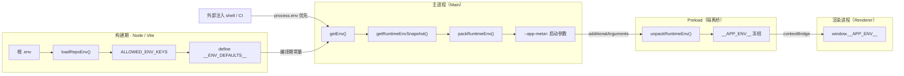

---

title: 环境变量管理（Dotenv）
description: 根 .env 单一加载入口，白名单快照经启动参数透传，渲染层安全获取冻结的 window.**APP_ENV**。
---

# 环境变量管理（Dotenv）

> **TL;DR**：根 `.env` 作为唯一的默认值源头，构建期由 Vite 白名单抽取快照，启动时通过 Base64URL JSON 编码挂载到窗口启动参数，Preload 在页面渲染前解包并深度冻结为全局 `window.__APP_ENV__`。

## 1. 选型理由

Electron 项目的环境变量经常面临以下痛点：
1. **多源覆盖时序混乱**：本地 `.env` 经常错误反向覆盖 CI 或命令行显式注入的 `MODE`。
2. **渲染进程孤岛**：渲染进程受沙箱隔离，无法直接读取 Node 的 `process.env`。
3. **安全泄露隐患**：若将包含证书凭证的构建期变量整体注入客户端，极易导致安全资产泄漏。

为此，工程建立了严格的单向管道链路（流程图见 §2）：构建期把根 `.env` 的白名单快照编译进主进程，主进程再把它序列化进窗口启动参数，Preload 解包后冻结注入渲染层。

## 2. 核心机制



### 关键实现

#### ① 构建期：加载根 `.env`，只补空位

`applyRepoEnv` 只补齐缺失键，已存在的外部注入（shell / CI）始终优先：

→ 源码：[build/lib/env.ts](https://github.com/BanShan-Alec/electron-react-monorepo-template/blob/main/build/lib/env.ts)

```ts
export function applyRepoEnv(env: RepoEnv): void {
  for (const [key, value] of Object.entries(env.values)) {
    if (process.env[key] === undefined) {
      process.env[key] = value;
    }
  }
}
```

#### ② 主进程：快照打包为 `--app-meta=` 启动参数

创建窗口时 `getPackedEnvArgument()` 拼上 `--app-meta=` 前缀塞进 `additionalArguments`；编解码本身用 `TextEncoder` + `btoa` 实现，Node 与 Preload 沙箱通用（`toBase64Url` / `fromBase64Url` 为同文件辅助函数）。

→ 源码：[packages/shared/src/utils/env-packer.ts](https://github.com/BanShan-Alec/electron-react-monorepo-template/blob/main/packages/shared/src/utils/env-packer.ts)

```ts
export function packRuntimeEnv(env: AppRuntimeEnv): string {
  const jsonStr = JSON.stringify(env);
  const bytes = new TextEncoder().encode(jsonStr);
  return toBase64Url(bytes);
}

export function unpackRuntimeEnv(encodedStr: string): AppRuntimeEnv {
  const bytes = fromBase64Url(encodedStr);
  const jsonStr = new TextDecoder().decode(bytes);
  return JSON.parse(jsonStr) as AppRuntimeEnv;
}
```

#### ③ Preload：解包、冻结、注入主世界

→ 源码：[packages/preload/src/index.ts](https://github.com/BanShan-Alec/electron-react-monorepo-template/blob/main/packages/preload/src/index.ts)

节选：运行时环境解包与注入（省略 import 与常量定义）：

```ts
const metaArg = process.argv.find((arg) => arg.startsWith(APP_ENV_ARG_PREFIX));
let runtimeEnv: AppRuntimeEnv | null = null;
if (metaArg) {
  try {
    runtimeEnv = unpackRuntimeEnv(metaArg.slice(APP_ENV_ARG_PREFIX.length));
  } catch (err) {
    console.error('[preload] Failed to unpack runtime env from additionalArguments:', err);
  }
}
contextBridge.exposeInMainWorld('__APP_ENV__', Object.freeze(runtimeEnv ?? {}));
```

## 3. 桌面端避坑注意事项

- **启动参数序列化契约保持纯粹直传**：
  - `packRuntimeEnv` 与 `unpackRuntimeEnv` 保持纯粹的 Base64URL 直传序列化契约，不介入多余的 trim 或隐式类型转换。空字符串或缺失字段的兜底与有效性校验统一交由消费业务端自行规范判定（如 `apiBaseUrl || '/'`）。
- **严禁向启动参数注入 Secret 机密凭据**：
  - 窗口启动参数（`additionalArguments`）可通过操作系统任务管理器、Process Explorer 或进程命令行探针直接明文/Base64查看。因此，代码签名私钥、OAuth Client Secret、CI Auth Token 等机密信息严禁放入 `AppRuntimeEnv`。
  - **机密凭证的正规出处**：打包证书与发布 Token 统一走 GitHub Actions Secrets / CI 环境变量并在 `build/` 打包脚本中消费；业务敏感调用推荐由后端鉴权代理或主进程安全内存中按需拉取，不入客户端启动参数。
- **渲染层读取规范**：
  - 渲染进程业务代码禁止依赖 Web 习惯的 `import.meta.env.VITE_xxx`，统一使用类型强约束的 `window.__APP_ENV__.apiBaseUrl`、`window.__APP_ENV__.mode`。
- **新增一个环境变量的标准流水线**：
  1. `.env.example` 登记键名与示例值；
  2. `packages/main/vite.config.ts` 中的 `ALLOWED_ENV_KEYS` 白名单追加该键；
  3. `packages/shared/src/types/env.ts` 在 `AppRuntimeEnv` 补充 TypeScript 字段定义；
  4. `packages/main/src/env.ts` 的 `getRuntimeEnvSnapshot()` 中完成值抽取。
