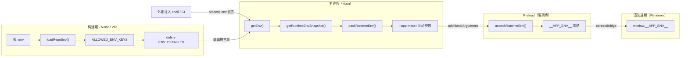

---

title: 环境变量管理（Dotenv）
description: 根 .env 作为唯一默认值真源，白名单快照经启动参数透传，渲染层安全获取冻结的 window.**APP_ENV**。
---

# 环境变量管理（Dotenv）

> **TL;DR**：根 `.env` 是唯一环境变量文件，构建期由 Vite `loadEnv` 按外部注入优先加载并内联白名单默认值；启动窗口时通过 `--app-meta=` Base64URL 参数透传给 Preload，解包并深度冻结为只读的 `window.__APP_ENV__`。

## 1. 优先级与边界原则

本页负责根 `.env` 的构建期加载优先级、白名单快照透传契约以及新增环境变量的标准流水线。本页不负责 `BrowserWindow` 通用初始传参方案对比（见 [窗口初始传参](/architecture/window-params)）、端口与开发编排配置归属（见 [配置项归属](/dx/configuration-map)），也不负责 GitHub Repository Secrets 在 CI 发布流水线中的注入配置（见 [发版流水线](/delivery/release-pipeline)）。

- **优先级固定为「外部注入 > 根 `.env` > 调用方默认值」**：禁止使用 `Object.assign(process.env, loadEnv(...))`，防止本地 `.env` 反向覆盖 CI 或 `cross-env` 注入的 `MODE` 与发布变量。
- **禁止在子包设独立 `.env`**：`packages/renderer/vite.config.ts` 与各构建脚本统一向上锁定仓库根目录。
- **构建期加载语义参考**：关于 Vite `loadEnv` 对 `.env` 与 `.env.[mode]` 的分层解析规则，详见 [Vite 环境变量与模式文档](https://vite.dev/guide/env-and-mode)。

## 2. 单向传递链路与契约



### ① 构建期：只补空位的根 `.env` 加载

`loadRepoEnv` 通过 Vite `loadEnv(mode, rootDir, '')` 读取根 `.env`，`applyRepoEnv` 仅在 `process.env[key] === undefined` 时回填，确保外部 Shell 或 CI Secrets 始终胜出：

→ 源码：[build/lib/env.ts](https://github.com/BanShan-Alec/electron-react-monorepo-template/blob/main/build/lib/env.ts)

```ts
export function applyRepoEnv(env: RepoEnv): void {
  for (const [key, value] of Object.entries(env.values)) {
    if (process.env[key] === undefined) {
      process.env[key] = value;
    }
  }
}
```

### ② 主进程与共享编解码：`--app-meta=` 启动参数

主进程创建窗口时调用 [getPackedEnvArgument](https://github.com/BanShan-Alec/electron-react-monorepo-template/blob/main/packages/main/src/env.ts) 将快照编码为 `--app-meta=<base64url>` 写入 `additionalArguments`；编解码使用纯 Web 标准 `TextEncoder` + `btoa`/`atob`，Node 与沙箱 Preload 通用：

→ 源码：[packages/shared/src/utils/env-packer.ts](https://github.com/BanShan-Alec/electron-react-monorepo-template/blob/main/packages/shared/src/utils/env-packer.ts)

```ts
export function packRuntimeEnv(env: AppRuntimeEnv): string {
  const jsonStr = JSON.stringify(env);
  const bytes = new TextEncoder().encode(jsonStr);
  return toBase64Url(bytes);
}

export function unpackRuntimeEnv(encodedStr: string): AppRuntimeEnv {
  const bytes = fromBase64Url(encodedStr);
  const jsonStr = new TextDecoder().decode(bytes);
  return JSON.parse(jsonStr) as AppRuntimeEnv;
}
```

### ③ Preload：解包、容错与冻结注入

Preload 在页面脚本执行前同步读取 `process.argv` 并通过 `contextBridge` 冻结挂载，保证 `window.__APP_ENV__` 不可篡改：

→ 源码：[packages/preload/src/index.ts](https://github.com/BanShan-Alec/electron-react-monorepo-template/blob/main/packages/preload/src/index.ts)

```ts
// 节选：运行时环境解包与冻结注入
const metaArg = process.argv.find((arg) => arg.startsWith(APP_ENV_ARG_PREFIX));
let runtimeEnv: AppRuntimeEnv | null = null;
if (metaArg) {
  try {
    runtimeEnv = unpackRuntimeEnv(metaArg.slice(APP_ENV_ARG_PREFIX.length));
  } catch (err) {
    console.error('[preload] Failed to unpack runtime env from additionalArguments:', err);
  }
}
contextBridge.exposeInMainWorld('__APP_ENV__', Object.freeze(runtimeEnv ?? {}));
```

## 3. 新增环境变量与安全清单

- **新增变量四步清单**：
  1. 在 [.env.example](https://github.com/BanShan-Alec/electron-react-monorepo-template/blob/main/.env.example) 登记键名与示例默认值；
  2. 在 [packages/main/vite.config.ts](https://github.com/BanShan-Alec/electron-react-monorepo-template/blob/main/packages/main/vite.config.ts) 的 `ALLOWED_ENV_KEYS` 与 [packages/main/src/env.d.ts](https://github.com/BanShan-Alec/electron-react-monorepo-template/blob/main/packages/main/src/env.d.ts) 的 `EnvKey` 联合类型同步追加该键；
  3. 在 [packages/shared/src/types/env.ts](https://github.com/BanShan-Alec/electron-react-monorepo-template/blob/main/packages/shared/src/types/env.ts) 的 `AppRuntimeEnv` 补充字段类型；
  4. 在 [packages/main/src/env.ts](https://github.com/BanShan-Alec/electron-react-monorepo-template/blob/main/packages/main/src/env.ts) 的 `getRuntimeEnvSnapshot()` 提取该值（支持运行期通过 `APP_<KEY>` 覆盖）。
- **验收判据**：运行 `pnpm typecheck` 通过后，启动 `pnpm dev` 在渲染层控制台验证 `Object.isFrozen(window.__APP_ENV__) === true` 且目标字段非 `undefined`。
- **严禁将 Secret 注入启动参数**：`additionalArguments` 可通过系统任务管理器或进程命令行查看，证书私钥、Sentry Auth Token 与 API 密钥只允许留在 CI Secrets / 主进程安全内存，严禁进入 `AppRuntimeEnv`。
- **序列化契约不隐式清洗**：`packRuntimeEnv` / `unpackRuntimeEnv` 保持原样透传，空值兜底由消费端自行处理；渲染层统一读取 `window.__APP_ENV__`，禁止使用 `import.meta.env.VITE_*`。
