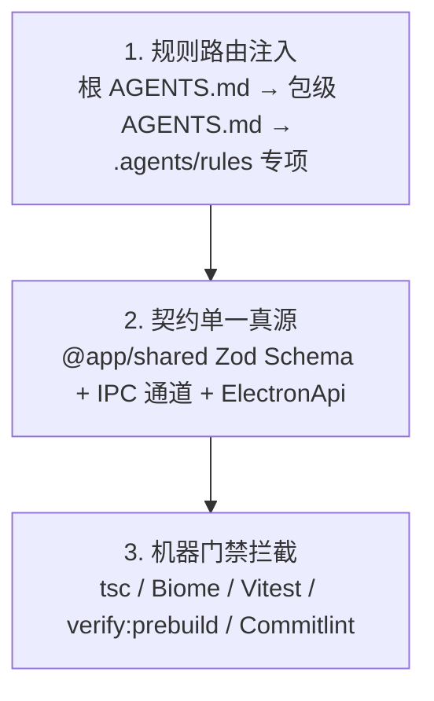

---

title: 与 AI 协作（Agent-ready）
description: 基于三层规则路由、@app/shared 单一契约与静态门禁体系的人机协作指南。
---

# 与 AI 协作（Agent-ready）

> **TL;DR**：AI 协作者按「根 `AGENTS.md` 任务路由 → 包级 `AGENTS.md` → `.agents/rules/` 专项细则」逐级读取规则，跨端接口以 `@app/shared` 为唯一事实源，交付前必须通过对应机器门禁。

**边界声明**：本页负责说明人机协作的三层规则组织原则与接手步骤；不负责代码逐项验收标准（见 [AI 产出验收清单](/ai/friendly-conventions)）、四步编码流水线（见 [全栈端到端功能开发](/ai/fullstack-sop)）或 PR 自动化评审工具链（见 [AI 评审闭环](/ai/review-loop)）。

## 1. 选型理由与规则设计准则

大型 Monorepo 若把所有架构细则堆在单一提示词或分散在 README 中，会导致上下文膨胀与规则漂移。本仓库结合注意力经济与单一真源原则建立分层治理体系：

- **控制入口篇幅，按路由按需加载**：根 [AGENTS.md](https://github.com/BanShan-Alec/electron-react-monorepo-template/blob/main/AGENTS.md) 仅维护全局红线、机器门禁矩阵与任务路由表；各包 `AGENTS.md` 保持精炼篇幅（约 150 行左右，其中 [packages/renderer/AGENTS.md](https://github.com/BanShan-Alec/electron-react-monorepo-template/blob/main/packages/renderer/AGENTS.md) 为 153 行），长篇专项流程由入口指针链接到 `.agents/rules/`（如 [main-domain-sop.md](https://github.com/BanShan-Alec/electron-react-monorepo-template/blob/main/.agents/rules/main-domain-sop.md)），而非依赖外部工具的 `globs` 配置。
- **契约先行与单向依赖**：跨端入参模型与通道常量统一在 [packages/shared/AGENTS.md](https://github.com/BanShan-Alec/electron-react-monorepo-template/blob/main/packages/shared/AGENTS.md) 约束下定义，主进程与渲染层保持单向流动、严禁逆向依赖或互引。
- **机器可判定优先于口头叮嘱**：可静态校验的约束（禁止桶文件、React Compiler 纯度、根依赖白名单、中文 commit）全部绑定至编译器、Biome、Commitlint 与 CI；提醒类约束必须配套合法代码骨架、豁免说明与孤岛单测入口（如 `@app/pr-review` 独立执行 `pnpm test:pr-review`）。

### 复制即用的 AI 初始化 Prompt

可将以下引导语写入项目级规则文件（或对话首条指令），使协作者沿仓库路由工作：

```text
你正在一个严格分层的 Electron Monorepo 项目中协作。请按仓库规则执行：
1. 先读根目录 AGENTS.md，根据任务路由读取对应包的 AGENTS.md 与链接的专项规则。
2. 所有约束与接口以规则文件及仓库真实源码为准，不得凭记忆猜测或自建桶文件。
3. 修改完成后按根目录 AGENTS.md §5 门禁矩阵运行对应校验命令，并如实报告结果。
```

## 2. 核心机制与执行步骤

### 三层 AI 协作防御体系



### AI 接手任务四步可执行流程

1. **定范围与查路由**：读取根 [AGENTS.md](https://github.com/BanShan-Alec/electron-react-monorepo-template/blob/main/AGENTS.md) §2 与 §4.2，确认任务触及哪些工作区包，并定位对应的专项细则入口。
2. **读包级真源**：进入任何 `packages/*` 修改代码前，先读取该包的 `AGENTS.md`（例如 [packages/main/AGENTS.md](https://github.com/BanShan-Alec/electron-react-monorepo-template/blob/main/packages/main/AGENTS.md) 或 [packages/preload/AGENTS.md](https://github.com/BanShan-Alec/electron-react-monorepo-template/blob/main/packages/preload/AGENTS.md)），明确允许导入边界与豁免项。
3. **落代码并守契约**：新增跨端通信时必须先改 `@app/shared`，再依次修改 `preload`、`main`、`renderer`；新增目录、导出或脚本时在同一 PR 内同步更新对应包的 `AGENTS.md`。
4. **跑通对应门禁**：日常改动执行 `pnpm typecheck && pnpm lint && pnpm test`；触及 `@app/pr-review` 须追加 `pnpm test:pr-review`；文案改动须执行 `pnpm i18n:extract` 补译后跑 `pnpm i18n:check`；提交前确保通过 `pnpm verify:prebuild`。

## 3. 桌面端避坑注意事项

- **勿将提示词当成硬门禁**：`AGENTS.md` 与 `.agents/rules/` 负责对齐语义与上下文，真正阻断非法导入、循环依赖或沙箱越权仍依赖 TypeScript、`Biome`、`verify:prebuild` 与 CI 门禁。
- **勿遗漏孤岛测试入口**：根 `pnpm test` 刻意排除了 `packages/pr-review` 与性能基准测试（见 [.config/vitest.config.ts](https://github.com/BanShan-Alec/electron-react-monorepo-template/blob/main/.config/vitest.config.ts)），改动该包后不可仅凭根测试绿灯就判定通过。
- **严守进程隔离边界**：在渲染层不得引入 `node:fs`、`__dirname` 或 `process`（`tsconfig` 仅靠白名单约定未做硬报错，见根 `AGENTS.md` §7），原生系统能力必须经由 `preload` 安全桥接暴露。
