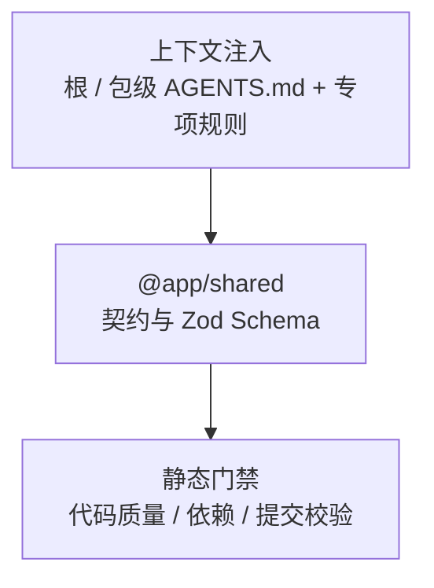

---

title: 与 AI 协作（Agent-ready）
description: 说明 AI 如何通过分层规则路由、共享契约与工程门禁协作
---

# 与 AI 协作（Agent-ready）

> **TL;DR**：先读根与包级 `AGENTS.md`，再按文件或任务路由读取专项规则；契约由 `@app/shared` 统一定义，硬性约束由工程门禁验证。

## 1. 选型理由

本工程采用「人机同席」的开发方式：根规则负责全仓导航，包级规则说明局部架构，专项文档承载只在特定文件或任务中需要的细节。这样既减少无关上下文，也避免同一规则在多处复制后逐渐漂移。

### 复制即用的 AI 初始化 Prompt

将以下内容放入 Cursor Rules (`.cursorrules`)、Claude 记忆或直接在对话开头投喂给 AI 助手：

```text
你正在一个严格分层的生产级 Electron Monorepo 项目中协作。请按仓库规则执行：
1. 从根目录 AGENTS.md 开始，按任务路由读取适用的包级规则和专项规则 / 流程。
2. 具体约束以这些规则与真实源码为准，不复制或猜测不存在的规范。
3. 修改后按对应规则文件中的门禁验证，并如实报告检查结果。
```

## 2. 核心机制

### 三层 AI 协作防御体系



### 分层规约定位

- **全局总则**（[根目录 AGENTS.md](https://github.com/BanShan-Alec/electron-react-monorepo-template/blob/main/AGENTS.md)）：定义全局边界与任务路由；具体规则以根文件为准，本页不重复列举。
- **包级规则与专项细则**：各包 `AGENTS.md` 提供规则入口与日常边界；仅适用于特定文件或任务的细则由入口明确链接到专项规则 / 流程文档。

### 规则按需加载

按文件路径适用的规则可用窄 `globs` 注入；只在特定任务需要的长流程，则由 `AGENTS.md` 的任务路由指向独立文档。完整的七维度设计准则见 [AI 协作者约定](/ai/collaboration-convention)。

### 任务路由

具体任务入口与专项文档的最新映射见根目录 [AGENTS.md](https://github.com/BanShan-Alec/electron-react-monorepo-template/blob/main/AGENTS.md) §4.2；本页不重复维护路由表。

## 3. 桌面端避坑注意事项

### 提示与机器门禁各司其职

代理规则用于提供与当前文件或任务相关的上下文，不等于运行时或 CI 硬校验。`.agents/rules` 中的路径规则仅由支持该机制的代理按 glob 加载；根目录任务路由是稳定入口。需要机械判定的约束仍由项目配置和 CI 门禁负责。

处理 Electron 多进程代码时，按对应包规则确认 IPC 契约、原生能力与窗口生命周期边界；本页不复制这些实现细则。

### AI 评审闭环

PR 评审与修复流程由专用工具链承载；适用入口和操作步骤见 [AI 评审闭环（Open-code-review）](/ai/review-loop)。
