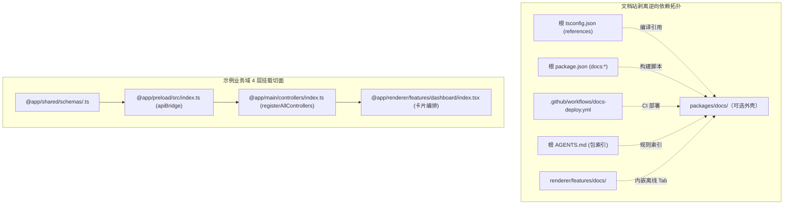

---

title: 模板解耦与模块裁剪（Template-Ejection）
description: 梳理文档站与演示域的跨包依赖拓扑，供 AI 协作者精准执行零破损裁剪与去模板化。
---

# 模板解耦与模块裁剪（Template-Ejection）

> **TL;DR**：建立基于「依赖反向拓扑与 4 层挂载切面」的裁剪清单。AI 协作者进场即可按图索骥，安全剥离可选的 `packages/docs` 站点或业务演示卡片，杜绝编译器断链与 IPC 悬空调用。

## 1. 选型理由

- **脚手架与业务应用边界解耦**：模板开箱附带了完整的解决方案文档站（`packages/docs`）与多组演示功能（如计算器、计数器、系统信息）。当 Fork 模板开发独立商业或开源产品时，此类模块通常需要安全退场。
- **消灭平铺脚本与指令幻觉**：散装的 Shell 命令（如 `rm -rf`）无法感知 Monorepo 内部复杂的引用拓扑。向 AI 协作者提供显式依赖拓扑与挂载点清单，能让 Agent 自主闭环执行无损裁剪并修复关联配置。
- **全仓 AI 规则自闭环（Zero-Docs Leak）**：各包 `AGENTS.md` 已全面剔除对文档站内部页面的强引用，删除文档站对 AI 编码规则与核心架构零破损。

## 2. 核心机制



### 文档站逆向依赖拓扑

文档站作为独立静态包，仅被工程根节点与渲染层内嵌 Tab 弱引用。指挥 Agent 执行文档站剥离时，需同步清理以下 5 处关联挂载点：

→ 源码：[tsconfig.json](https://github.com/BanShan-Alec/electron-react-monorepo-template/blob/main/tsconfig.json)
```json
{
  "references": [
    { "path": "./packages/main" },
    { "path": "./packages/preload" },
    { "path": "./packages/renderer" },
    { "path": "./packages/shared" },
    { "path": "./packages/pr-review" },
    { "path": "./packages/docs" }, // [!code --]
    { "path": "./scripts" }
  ]
}
```

- **构建与 CI 挂载**：清理根 `package.json` 中的 `docs:dev` / `docs:build` 脚本，以及 `.github/workflows/docs-deploy.yml`。
- **规则与客户端挂载**：清理根 `AGENTS.md` 包索引表格；若不需要客户端内部的离线文档 Tab，可同步卸载 `packages/renderer/src/features/docs` 与 `src/entries/home/App.tsx` 中的路由入口。

### 示例业务域 4 层挂载切面

以演示模块（如 `calculator`、`counter`）为例，业务逻辑严格穿透 4 层架构。裁剪示例域需按以下挂载点依次回退：

→ 源码：[packages/main/src/controllers/index.ts](https://github.com/BanShan-Alec/electron-react-monorepo-template/blob/main/packages/main/src/controllers/index.ts)
```ts
// 主进程集中挂载点：移除对应领域的 registerXxxControllers()
export function registerAllControllers(): void {
  registerSystemControllers();
  registerUsbControllers();
  registerCounterControllers(); // [!code --]
  registerCalculatorControllers(); // [!code --]
  registerConfigControllers();
}
```

→ 源码：[packages/renderer/src/features/dashboard/index.tsx](https://github.com/BanShan-Alec/electron-react-monorepo-template/blob/main/packages/renderer/src/features/dashboard/index.tsx)
```tsx
// 渲染层看板装配点：从仪表盘网格中移除展示卡片
function DashboardFeature() {
  return (
    <div className="grid grid-cols-1 lg:grid-cols-2 gap-6">
      <PingFeature />
      <SystemInfoFeature />
      <CounterFeature /> // [!code --]
      <CalculatorFeature /> // [!code --]
      <SettingsFeature />
    </div>
  );
}
```

- **契约与桥接清理**：同步清理 `packages/shared/src/constants/ipc-channels.ts`（枚举值）、`types/api.ts`（`ElectronApi` 接口）及 `packages/preload/src/index.ts`（`apiBridge` 转发字段）。

> **通用配置指引**：关于应用身份（`name`, `appId`, `productName`）、品牌图标与打包签名的重命名，请直接参见单一真源文档：[全局配置速查字典](/dx/configuration-map)。

## 3. 桌面端避坑注意事项

| 避坑要点                          | 事故表现与原因                                                                                                       | 本仓库对齐方案                                                                                 |
| :-------------------------------- | :------------------------------------------------------------------------------------------------------------------- | :--------------------------------------------------------------------------------------------- |
| **遗漏 tsconfig 引用清理**        | 删除了 `packages/docs` 目录但未改根配置，`pnpm typecheck` 抛出 `error TS6053: File not found` 导致 CI 门禁直接阻断。 | 必须同步从根 `tsconfig.json` 的 `references` 列表中移除对应工程节点。                          |
| **主进程 Controller 悬挂引用**    | 删除了业务 controller 文件但遗漏 `controllers/index.ts` 导入，构建期抛出模块未找到或运行时 IPC 无法监听。            | 必须在 `registerAllControllers()` 集中挂载处成对清理，杜绝散装残留。                           |
| **契约悬空引发类型断裂**          | 仅清理前端卡片却未清理 `@app/shared`，导致无用类型混入打包产物且维护认知漂移。                                       | 按照 `shared ➔ preload ➔ main ➔ renderer` 单向链路成对剔除。                                   |
| **误改 productName 引发数据孤岛** | 随意修改 `productName` 导致桌面客户端在操作系统的默认 `userData` 数据存储目录发生物理偏移，旧版本持久化数据丢失。    | 见 `/dx/configuration-map` 说明；若必须变更，主进程需显式配置 `app.setPath('userData', ...)`。 |
