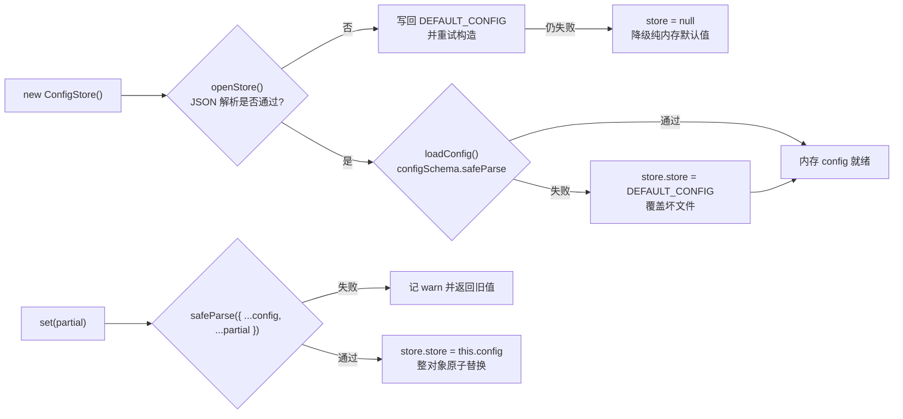

---

title: 配置持久化（Electron-store）
description: 用户偏好落在 userData/config.json，Zod schema 唯一真源、写坏即重置；新增配置项需同步六处。
---

# 配置持久化（Electron-store）

> **TL;DR**：用户偏好存于 `userData/config.json`，由 `@app/shared` 的 schema 单一真源驱动——写坏即回默认、字段漂移不崩；新增一个配置项要同时改契约、副作用、消费、测试与词条，漏一层就是「能写进去但不生效」。

## 1. 选型理由

三条硬需求决定了选型：

1. **只有主进程碰磁盘**：渲染层经 IPC 读写，偏好值不必再过一趟进程边界。
2. **启动早期就要同步读**：主题、语言、托盘文案在模块初始化阶段用到，异步读者会引入启动时序竞争。
3. **坏文件要能自愈**：文件在 `userData` 下，用户可手工编辑、外部工具也可能改动。

| 备选                | 否决理由                                                   |
| :------------------ | :--------------------------------------------------------- |
| `localStorage`      | 渲染层私有，主进程启动早期读不到；多窗口各存一份，无法统一 |
| 自己 `fs.writeFile` | 校验、原子写、损坏兜底全要自造，最容易写出的就是「写一半」 |
| 直接读 `.env`       | 属于构建期资产，改一次要重新打包，也不进 `userData`        |

`electron-store` 仅承担同步读写、原子落盘与 `userData` 路径管理（[config.module.ts](https://github.com/BanShan-Alec/electron-react-monorepo-template/blob/main/packages/main/src/modules/config.module.ts) 中 `new Store<AppConfig>({ cwd: customDir })` 刻意不传 `schema` 与 `defaults`），契约校验与默认值全部交给 `@app/shared` 的 Zod：

- **跨端单一真源**：一份 Zod schema 同时推导 TS 类型（`z.infer`）、派生 `DEFAULT_CONFIG`（`.default()`）、校验 IPC 入参（`updateConfigInputSchema`）与磁盘读写；若改用 `electron-store` 内置 JSON Schema（Ajv），必须在 `@app/shared` 外再维护第二份定义，必然漂移。
- **可控自愈与无痛升级**：`safeParse()` 在读路径自动按 `.default()` 补全新增字段并剥离旧版废弃键，在写路径拒绝非法输入并输出结构化 `error.issues` 而不断链；`electron-store` 内置校验遇非法数据会直接抛异常。
- **收敛校验引擎**：不向 `new Store()` 传 `schema` 就不会触发底层 Ajv 编译校验，全仓 IPC 与配置持久化统一收敛到同一套 Zod 引擎。

→ 官方文档：[electron-store（GitHub）](https://github.com/sindresorhus/electron-store)（读它能了解底层 `conf` 的 `cwd` 路径解析、原子写入退化行为与默认存储位置约定）。

## 2. 核心机制



### schema 是唯一真源

→ 源码：[packages/shared/src/schemas/config.ts](https://github.com/BanShan-Alec/electron-react-monorepo-template/blob/main/packages/shared/src/schemas/config.ts)

```ts
// 节选：AppConfig 类型、可更新字段契约与默认值单一来源
export type AppConfig = z.infer<typeof configSchema>;

export const updateConfigInputSchema = configBaseSchema.partial();
export type UpdateConfigInput = z.infer<typeof updateConfigInputSchema>;

// 默认值单一来源：由 configSchema 各字段的 .default() 派生，勿在此手写字面量
export const DEFAULT_CONFIG: AppConfig = configSchema.parse({});
```

默认值只写在 `configSchema` 各字段的 `.default()` 里，`DEFAULT_CONFIG` 由它派生：重置、损坏兜底、纯内存降级三处消费同一个对象，仓库里不存在第二份默认值清单。`updateConfigInputSchema` 是 IPC 入参契约——可被前端更新的字段必须在 `configBaseSchema` 里也登记一次。

### 读路径：两道自愈

`ConfigStore` 启动时依次过两道兜底，宁可回到默认值，也不带着非法配置启动：

1. **语法层（`openStore`）**：底层 `conf` 在构造期读取整个文件，非法 JSON 直接抛错 → 用 `DEFAULT_CONFIG` 覆盖坏文件后重试一次；目录不可写则降级为 `store = null` 纯内存模式，不阻塞启动。
2. **契约层（`loadConfig`）**：读取后执行 `configSchema.safeParse`，失败即记 error 并立即将 `DEFAULT_CONFIG` 写回磁盘。

→ 源码：[packages/main/src/modules/config.module.ts](https://github.com/BanShan-Alec/electron-react-monorepo-template/blob/main/packages/main/src/modules/config.module.ts)

```ts
  // 节选：ConfigStore.loadConfig 契约层损坏自愈
  private loadConfig(): AppConfig {
    if (!this.store) {
      return { ...DEFAULT_CONFIG };
    }
    const parsed = configSchema.safeParse(this.store.store);
    if (parsed.success) {
      return parsed.data;
    }
    // 检验失败即重置：默认值立即写回，覆盖坏文件
    this.logError(
      'Config reset to defaults: on-disk config failed schema validation:',
      parsed.error.issues,
    );
    try {
      this.store.store = { ...DEFAULT_CONFIG };
    } catch (error) {
      this.logWarn('Config write failed:', error);
    }
    return { ...DEFAULT_CONFIG };
  }
```

### 写路径：整对象替换 + 原子落盘

→ 源码：[packages/main/src/modules/config.module.ts](https://github.com/BanShan-Alec/electron-react-monorepo-template/blob/main/packages/main/src/modules/config.module.ts)

```ts
  // 节选：ConfigStore.set 非法输入拒绝与同步持久化
  public set(partial: Partial<AppConfig>): AppConfig {
    // IPC 入口已校验，此处兜住非 IPC 直连调用方（如 counter.service）：
    // 非法输入拒绝并留痕，不抛错不断链路
    const parsed = configSchema.safeParse({ ...this.config, ...partial });
    if (!parsed.success) {
      this.logWarn('Invalid config update rejected:', parsed.error.issues);
      return { ...this.config };
    }
    this.config = parsed.data;
    this.persist();
    return { ...this.config };
  }
```

`persist()` 执行 `this.store.store = this.config` 整对象替换，顺带清掉旧版本残留键（删除配置项只需从 schema 移除）。`electron-store` 每次 `set` 即同步落盘（底层 `conf` 经 `atomically` 以临时文件 + rename 替换），无需在 `before-quit` 补写。

### 新增一个配置项的完整链路

| 步骤      | 改哪里                                                                                                  | 漏掉的症状                                        |
| :-------- | :------------------------------------------------------------------------------------------------------ | :------------------------------------------------ |
| 1. 契约   | `shared/schemas/config.ts`：`configSchema` 加字段（带 `.default()`）；可更新则同时进 `configBaseSchema` | 前端传了也被入参 schema 剥掉，永远写不进去        |
| 2. 副作用 | `services/config.service.ts`：需联动系统时（主题 / 语言 / 开机自启）在此同步                            | 值存了，界面与系统行为不变，重启才生效            |
| 3. 消费   | 渲染层 hook 与卡片组件，按需给兜底值                                                                    | 旧配置缺该键时 UI 渲染 `undefined`                |
| 4. 广播   | 主进程写后 `broadcast(CONFIG_EVENT_CHANGED, updated)`（已在 controller 统一处理）                       | 多窗口不同步（preload 已封装 `config.onChanged`） |
| 5. 测试   | `packages/main/tests/unit/config-store.test.ts`：默认值、非法值拒绝、重置                               | 契约回退无人守护                                  |
| 6. 词条   | 新增文案则 `pnpm i18n:extract` → 补英译 → `pnpm i18n:check`                                             | CI 直接失败                                       |

## 3. 桌面端避坑注意事项

- **切勿向 `new Store()` 传入 `schema` 或 `defaults`**：
  - 这会绕开 `openStore` + `loadConfig` 的两道自愈链路，并在 `@app/shared` 之外制造第二份默认值导致契约漂移。
- **不要在构造期读 store**：
  - 业务 Service 需要配置时必须在方法内懒加载 `getAppConfigStore()`，切勿在模块顶层 `new Service()` 的构造期读取，避免与主进程模块装配时序冲突。
- **不该放进 `config.json` 的东西**：
  - 密钥与令牌（属于系统钥匙串或环境变量注入）、大体积缓存（走 cache 目录）、构建期常量（`build/` 与 `.env`）、已有专门存储的状态（窗口几何由 Electron `windowStatePersistence` 存 Chromium `Local State`，见 [窗口位置与尺寸](/ui/window-state)）。
- **页面职责边界**：
  - **本页负责**：用户偏好配置（`userData/config.json`）的 schema 派生、同步读写、损坏自愈与新增配置项全链路。
  - **本页不负责**：配置项跨层归属判定见 [配置项归属](/dx/configuration-map)；窗口几何持久化见 [窗口位置与尺寸](/ui/window-state)；开机自启启动顺序与登录项写入资格见 [托盘常驻、单实例与开机自启](/main/tray-single-instance)。
