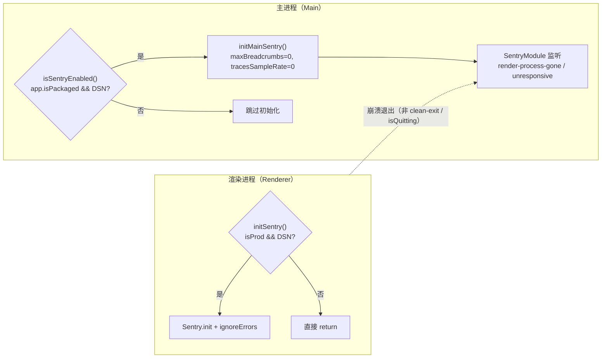

---

title: 崩溃上报（Sentry）
description: 主进程与渲染端双门禁收窄激活条件，渲染进程崩溃由主进程兜底代报，关闭噪音埋点。
---

# 崩溃上报（Sentry）

> **TL;DR**：仅在满足激活守卫（主进程打包态 / 渲染端生产态且配置有效 DSN）时激活 Sentry，开发态零网络开销与噪音；关闭面包屑轨迹与性能采样；渲染进程异常退出由主进程监听兜底上报。

## 1. 选型理由

桌面客户端运行在不可控的用户终端环境中，崩溃往往静默发生：
1. **渲染进程崩溃无法自报**：若 Chromium 渲染进程发生 OOM 或 Native 段错误闪退，页面 JS 引擎随之销毁，前端 Sentry 没有执行上报的机会。
2. **海量网络噪音与卡顿**：默认收集 DOM 交互轨迹（Breadcrumbs）、Console 日志与性能采样，不仅消耗带宽与 CPU，还容易录入敏感隐私。

工程采取主进程代报兜底策略，并将 Sentry 收窄为“极简致命崩溃捕获器”。

→ 官方文档：[Sentry for Electron](https://docs.sentry.io/platforms/javascript/guides/electron/)（读它能了解主进程、Preload 与渲染进程三端 SDK 协同及原生崩溃捕获边界）。

## 2. 核心机制



### 双端激活守卫与低噪音采样

主进程在启动最早期调用 `initMainSentry()`，通过 `isSentryEnabled()` 校验 `app.isPackaged && Boolean(getSentryDsn())`（未打包的 `preview` 模式不激活主进程上报）：

→ 源码：[packages/main/src/modules/sentry.module.ts](https://github.com/BanShan-Alec/electron-react-monorepo-template/blob/main/packages/main/src/modules/sentry.module.ts)

```ts
// 节选：主进程激活守卫与最小化采样配置
export function isSentryEnabled(): boolean {
  return app.isPackaged && Boolean(getSentryDsn());
}
// ...
Sentry.init({
  dsn,
  enabled: true,
  environment: app.isPackaged ? 'production' : process.env.MODE || 'development',
  release,
  maxBreadcrumbs: 0,
  beforeBreadcrumb: () => null,
  integrations: (defaults) => defaults.filter((i) => !i.name.includes('Breadcrumb')),
  tracesSampleRate: 0,
});
```

渲染端由 `initSentry()` 读取主进程通过 `additionalArguments` 注入的 `window.__APP_ENV__`，以 `window.__APP_ENV__?.mode === APP_ENV.PRODUCTION`（兜底 `import.meta.env.PROD`）与 DSN 共同构成 `isEnabled` 门禁，同时在 `ignoreErrors` 中过滤常见浏览器无害告警；Preload 侧则通过 `@sentry/electron/preload`（随 bundle 内联）建立双端桥接。

→ 源码：[packages/renderer/src/lib/sentry.ts](https://github.com/BanShan-Alec/electron-react-monorepo-template/blob/main/packages/renderer/src/lib/sentry.ts)

```ts
// 节选：渲染进程 initSentry() 的 isEnabled 门禁
export function initSentry(): void {
  const dsn = (typeof window !== 'undefined' && window.__APP_ENV__?.sentryDsn) || '';

  // 基于 window.__APP_ENV__?.mode 判断是否为生产模式 (兜底 import.meta.env.PROD)
  const isProd =
    typeof window !== 'undefined' && window.__APP_ENV__?.mode
      ? window.__APP_ENV__.mode === APP_ENV.PRODUCTION
      : import.meta.env.PROD;

  // 严格守卫：仅 prod 模式且有有效 DSN 时激活
  const isEnabled = isProd && Boolean(dsn);

  if (!isEnabled) {
    return;
  }
```

### 主进程代报渲染进程崩溃（render-process-gone）

`SentryModule` 仅在 `isSentryEnabled()` 为真时挂载监听：渲染进程意外退出时收集 `reason`、`exitCode` 与 URL 代报，页面假死（`unresponsive`）时同步上报告警。

→ 源码：[packages/main/src/modules/sentry.module.ts](https://github.com/BanShan-Alec/electron-react-monorepo-template/blob/main/packages/main/src/modules/sentry.module.ts)

```ts
// 节选：SentryModule.enable 监听渲染进程异常退出并代报
app.on('render-process-gone', (_event, webContents, details) => {
  logger.error('Renderer process gone unexpectedly:', details);

  if (appLifecycle.isQuitting || details.reason === 'clean-exit') {
    return;
  }
  // ... 获取 currentUrl 并构造 fatal 异常
  Sentry.captureException(
    new Error(
      `[Renderer Crash] process gone: reason=${details.reason}, exitCode=${details.exitCode}`,
    ),
    {
      level: 'fatal',
      tags: buildSentryTags(APP_FEATURES.WINDOW, {
        [SENTRY_TAGS.LOGGER]: SENTRY_LOGGER_SCOPE,
        [SENTRY_TAGS.PROCESS]: 'renderer',
        [SENTRY_TAGS.CRASH_REASON]: details.reason,
        [SENTRY_TAGS.EXIT_CODE]: details.exitCode,
      }),
      extra: { details, url: currentUrl },
    },
  );
});
```

## 3. 桌面端避坑注意事项

- **SourceMap 隔离不由运行时负责**：
  - `hidden` SourceMap 生成、Vite 构建期上传与上传后物理删除由构建打包链保障，见 [源码映射隔离](/delivery/sourcemap)。
- **开发态与未配 DSN 时全链路静默**：
  - 本地 `pnpm dev` 或未配置 `EL_SENTRY_DSN` 时双端均跳过初始化。排查“为何没收到报错”前先核实是否已打包且注入有效 DSN。
- **前端忽略无害噪声（`ignoreErrors`）**：
  - 渲染端 `initSentry` 已显式过滤 `ResizeObserver loop completed with undelivered notifications`、`ResizeObserver loop limit exceeded`、`Network Error`、`Failed to fetch`、`Load failed`，避免消耗事件配额。
- **打包态退出会被 Sentry 拖长（最长约 2 秒，最坏约 4 秒）**：
  - 打包态且配置有效 DSN 时，`@sentry/electron` 的 session 集成会接管 `will-quit`：`preventDefault()` 后异步结束会话并 flush（`node.flush(2000)`），最后调用 `app.exit()`。表现为窗口关闭后托盘或进程短暂残留数秒，属于正常收尾。
- **页面职责边界**：
  - **本页负责**：主进程与渲染进程 Sentry 激活守卫、低噪音采样与 `render-process-gone` / `unresponsive` 兜底上报。
  - **本页不负责**：SourceMap 构建上传与 ASAR 排除见 [源码映射隔离](/delivery/sourcemap)；本地文件日志与链路追踪见 [本地日志](/main/logging) 与 [全链路追踪](/main/tracing)。
