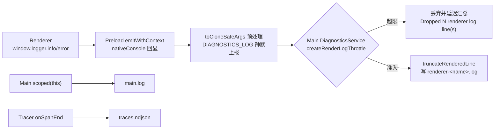

---

title: 本地日志（Electron-log）
description: 主进程与渲染窗口日志分文件落盘与独立归档，克隆安全预处理与滑窗限流保护。
---

# 本地日志（Electron-log）

> **TL;DR**：主进程日志（`main.log`）、渲染窗口日志（`renderer-<name>.log`）与遥测拓扑（`traces.ndjson`）分文件独立落盘与轮转；Preload 提供克隆安全的日志桥，主进程施加滑窗限流防止刷爆磁盘。

## 1. 选型理由

生产环境没有 Chrome DevTools，原生 `console.log` 随着进程销毁荡然无存：
1. **进程时序混淆**：若所有窗口和主进程的日志混在一个文件里，并发异步调用会让日志穿插错乱。
2. **失控死循环刷爆磁盘**：若渲染进程因状态死循环疯狂打印，短时间内即可写入数 GB 日志，挤爆用户磁盘。

工程依托 `electron-log` 构建分文件落盘与背压保护系统。

→ 官方文档：[electron-log（GitHub）](https://github.com/megahertz/electron-log)（读它能了解 `transports.file` 轮转、`log.create` 独立实例、`hooks` 与 `errorHandler` 机制）。

## 2. 核心机制



### 阈值真源与分文件独立轮转

轮转大小、单行长度、归档保留与渲染端限流阈值全部收敛在主进程单一真源常量文件，E2E 与单元测试直接引用这些常量：

→ 源码：[packages/main/src/constants/logging.ts](https://github.com/BanShan-Alec/electron-react-monorepo-template/blob/main/packages/main/src/constants/logging.ts)

```ts
export const LOG_FILE_MAX_SIZE_BYTES = 5 * 1024 * 1024;
export const TRACE_FILE_MAX_SIZE_BYTES = 10 * 1024 * 1024;
export const RENDERER_LINE_MAX_LENGTH = 2000;

export const LOG_ARCHIVE_MAX_DAYS = 7;
export const LOG_ARCHIVE_MAX_FILES = 5;
export const LOG_ARCHIVE_MAX_ATTEMPTS = 100;
export const LOG_ARCHIVE_CROP_BYTES = 256 * 1024;

export const RENDER_LOG_THROTTLE_LIMIT = 50;
export const RENDER_LOG_THROTTLE_WINDOW_MS = 1000;
```

`LogManager.setupLoggers()` 引用上述常量配置主日志、遥测日志与窗口日志，并通过 `createCustomArchiveLogFn()` 接管归档轮转（含 Windows 文件锁容错），同时启用全局未捕获异常捕获：

→ 源码：[packages/main/src/modules/log.module.ts](https://github.com/BanShan-Alec/electron-react-monorepo-template/blob/main/packages/main/src/modules/log.module.ts)

```ts
  // 节选：LogManager.setupLoggers 绑定常量阈值、自定义归档与未捕获异常落盘
  private setupLoggers(): void {
    // 主日志 5MB / 遥测日志 10MB 轮转上限
    const MAX_SIZE = LOG_FILE_MAX_SIZE_BYTES;
    const TRACE_MAX_SIZE = TRACE_FILE_MAX_SIZE_BYTES;

    // 主进程日志配置
    this.mainLogger.transports.file.fileName = 'main.log';
    this.mainLogger.transports.file.maxSize = MAX_SIZE;
    this.mainLogger.transports.file.archiveLogFn = createCustomArchiveLogFn();

    // 遥测拓扑日志配置 (NDJSON 独立文件)
    this.traceLogger.transports.file.fileName = 'traces.ndjson';
    this.traceLogger.transports.file.maxSize = TRACE_MAX_SIZE;
    this.traceLogger.transports.file.format = '{text}';
    this.traceLogger.transports.console.level = false;
    this.traceLogger.transports.file.archiveLogFn = createCustomArchiveLogFn();

    // 格式化输出
    const format = '[{y}-{m}-{d} {h}:{i}:{s}.{ms}] [{level}] {text}';
    this.mainLogger.transports.file.format = format;

    // 捕获未捕获异常并落盘
    this.mainLogger.errorHandler.startCatching({
      showDialog: false,
      onError: ({ error }) => {
        this.mainLogger.error('[Uncaught Exception]', error);
      },
    });
```

### 渲染端日志桥与滑窗限流保护

Preload 的 `emitWithContext` 在 `debug` 级别自动按 `!isDev` 门控丢弃；其余日志先走未包装的 `nativeConsole` 回显到 DevTools，再经 `toCloneSafeArgs` 剥离函数、循环引用与超深嵌套后，走 `IPC_CHANNELS.DIAGNOSTICS_LOG` 异步落盘：

→ 源码：[packages/preload/src/logger.ts](https://github.com/BanShan-Alec/electron-react-monorepo-template/blob/main/packages/preload/src/logger.ts) · [packages/main/src/services/diagnostics.service.ts](https://github.com/BanShan-Alec/electron-react-monorepo-template/blob/main/packages/main/src/services/diagnostics.service.ts)

```ts
// 节选：Preload 侧双写——DevTools 原生回显 + 静默异步落盘
nativeConsole[level](message, ...cleanArgs);

// 第二份：clone 安全预处理后经 diagnostics:log 落盘（静默管道，不生成独立 traceparent）
const payload: LogInput = {
  level,
  message,
  args: toCloneSafeArgs(cleanArgs),
  traceId: finalTraceId,
  spanId: finalSpanId,
};
void ipcRenderer.invoke(IPC_CHANNELS.DIAGNOSTICS_LOG, payload).catch(() => {
  // fire-and-forget：日志管道自身的故障不向业务调用方传播
});
```

主进程 `DiagnosticsService` 通过 `createRenderLogThrottle` 按调用方（`wc#<id>` 或 `win:<name>`）施加滑窗限流：每 `RENDER_LOG_THROTTLE_WINDOW_MS`（1s）最多准入 `RENDER_LOG_THROTTLE_LIMIT`（50）条，超限静默丢弃并在窗口结束时汇总告警（`Dropped <N> renderer log line(s) in 1s window`）；落盘前经 `truncateRenderedLine` 按 `RENDERER_LINE_MAX_LENGTH` 截断。

## 3. 桌面端避坑注意事项

- **业务代码禁止裸调 `log` 实例**：
  - 主进程打日志必须通过 `getLogManager().scoped(this)` 创建带 `[模块名]` 前缀的 Logger，开发态 `debug` 生效，生产态自动剔除 `debug` 细节。
- **渲染端严禁裸写 `console.log`**：
  - 生产打包后原生 `console` 不落盘。页面业务日志统一调用 `window.logger.info()` / `logger.error()`（或 `logger.withTrace(traceId)`）。
- **日志管道自身绝不抛出异常**：
  - 日志管道属于辅助可观测性基座，写入与 IPC 上报失败必须由内部吞掉，严禁向业务调用方抛错中断主流程。
- **页面职责边界**：
  - **本页负责**：主进程与渲染端日志的分文件存储、常量阈值真源、归档清理、脱敏克隆与滑窗限流机制。
  - **本页不负责**：W3C `traceparent` 传播与 `AsyncLocalStorage` 上下文追踪见 [全链路追踪](/main/tracing)；日常排障检索步骤与实战样本见 [日志与链路排查](/dx/log-troubleshooting)。
