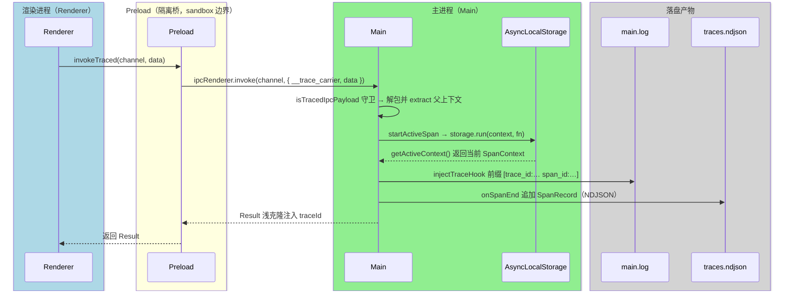

---

title: 全链路追踪（W3C-trace）
description: W3C traceparent 从 Preload 穿透主进程，AsyncLocalStorage 维持上下文。
---

# 全链路追踪（W3C-trace）

> **TL;DR**：业务 IPC 自动携带轻量 W3C `traceparent` 上下文；主进程借助 `AsyncLocalStorage` 维持调用链路，日志自动挂载 `[trace_id:...]`，返回结果回注 `traceId`，无需引入繁重的外部 APM SDK。

## 1. 选型理由

桌面跨进程调用排障经常陷入困境：
- 用户报告“点击按钮报错”，开发者在前端看到 UI 报错，却无法从主进程成千上万行日志中找到是哪一次 IPC 失败引发的。
- 传统的 OpenTelemetry / SkyWalking 等 SDK 体积极大，重度依赖 Node 原生动态 Hook，在打包进 Electron ASAR 时极易产生兼容性灾难。

工程采用纯函数实现的 W3C Trace Context 规范，零外部 SDK 实现跨端穿透。

## 2. 核心机制



链路只有一条主线：Preload 在 `invokeTraced` 里生成 `traceId` / `spanId` 并序列化成 W3C `traceparent`，塞进 `__trace_carrier`；主进程 `handleTraced` 先用 `isTracedIpcPayload` 守卫判定载荷，命中才解包并 `extract` 出父上下文，再交给 `Tracer.startActiveSpan` 在 `AsyncLocalStorage` 里 `run`；此后这条异步调用链上的日志前缀、Span 落盘、返回值注入都从同一份上下文取值。

### 关键实现：Preload 生成并注入 traceparent

所有业务 IPC 请求都由 `invokeTraced` 生成 W3C 标准上下文，作为不可见元数据随载荷下发；`callOptions` 一并透传，供主进程决定是否记录成功 Span：

→ 源码：[packages/preload/src/telemetry/ipc-tracer.ts](https://github.com/BanShan-Alec/electron-react-monorepo-template/blob/main/packages/preload/src/telemetry/ipc-tracer.ts)

```ts
export async function invokeTraced<R = unknown, T = unknown>(
  channel: string,
  data?: T,
  callOptions?: IpcCallOptions,
): Promise<R> {
  const traceId = generateTraceId();
  const spanId = generateSpanId();
  const traceparent = serializeTraceParent({
    traceId,
    spanId,
    traceFlags: '01',
  });

  const payload: TracedIpcPayload<T | undefined> = {
    __trace_carrier: {
      traceparent,
    },
    callOptions,
    data,
  };

  return ipcRenderer.invoke(channel, payload);
}
```

### 关键实现：主进程解包并在 AsyncLocalStorage 中续接

`handleTraced` 注册 `ipcMain.handle`：先用 `isTracedIpcPayload` 判断入参是否符合包装规范，命中后读取 `data` / `recordSuccess`，并在 `__trace_carrier` 存在时 `tracer.extract` 还原父上下文，再交给 `tracer.startActiveSpan` 建立 `ipc.receive:` 子 Span。续接的关键只有一句 `this.storage.run(manualSpan.context, ...)`——把 SpanContext 绑定到当前异步调用链，handler 内部任意深度的异步函数都能通过 `getActiveContext()` 取到。

→ 源码：[packages/main/src/telemetry/ipc-tracer.ts](https://github.com/BanShan-Alec/electron-react-monorepo-template/blob/main/packages/main/src/telemetry/ipc-tracer.ts)

节选：`Tracer` 类的 `startActiveSpan` 方法（`storage` 是同类中的 `private readonly` 字段）：

→ 源码：[packages/main/src/telemetry/tracer.ts](https://github.com/BanShan-Alec/electron-react-monorepo-template/blob/main/packages/main/src/telemetry/tracer.ts)

```ts
  public async startActiveSpan<T>(
    name: string,
    options: SpanOptions | undefined,
    fn: (span: ISpanScope) => Promise<T> | T,
  ): Promise<T> {
    const manualSpan = this.startManualSpan(name, options);

    return this.storage.run(manualSpan.context, async () => {
      const state: { status: 'OK' | 'ERROR' } = { status: 'OK' };
      const span: ISpanScope = {
        context: manualSpan.context,
        setStatus: (status) => {
          state.status = status;
          manualSpan.setStatus(status);
        },
        setAttributes: (attributes) => manualSpan.setAttributes(attributes),
        addEvent: (name, attributes) => manualSpan.addEvent(name, attributes),
        recordException: (error) => {
          state.status = 'ERROR';
          manualSpan.recordException(error);
        },
      };

      try {
        const result = await fn(span);
        if (options?.recordSuccess !== false || state.status === 'ERROR') {
          manualSpan.end(state.status);
        }
        return result;
      } catch (err) {
        manualSpan.recordException(err);
        manualSpan.end('ERROR');
        throw err;
      }
    });
  }
```

### 三个出口：日志前缀、NDJSON、Result.traceId

1. **主进程日志前缀**：活跃上下文存在时，electron-log hook `injectTraceHook` 从 `getActiveContext()` 取值，`main.log` 每行日志自动前缀 `[trace_id:xxxx span_id:yyyy]`。
2. **遥测落盘**：Span 结束时 `onSpanEnd` 监听器把 `SpanRecord` 以单行 JSON 写入 `traces.ndjson`，支持毫秒级拓扑还原。
3. **结果回注**：业务返回带 `success` 字段的 `Result` 时，`handleTraced` 浅克隆注入 `traceId`（不改原对象），渲染层报错时直接打印该 ID。

## 3. 桌面端避坑注意事项

- **日志管道本身严禁套用 traceparent**：
  - 日志传输通道 `IPC_CHANNELS.DIAGNOSTICS_LOG` 是唯一必须绕过 `handleTraced` 的特例。若日志管道自身也生成 Span 并打日志，将引发无休止的“日志生成遥测、遥测触发日志”的死循环自噪。
- **高频成功轮询可关闭成功 Span 写入**：
  - 对于心跳检测或秒级状态拉取，可在选项中配置 `recordSuccess: false`，仅在发生异常时才将 Span 写入 `traces.ndjson`，避免拓扑文件快速膨胀。机制在 `startActiveSpan`：仅当 `recordSuccess !== false` 或状态为 `ERROR` 时才调用 `manualSpan.end`。
- **跨进程排障黄金链路**：
  - 前端报错 ➔ 提取错误对象中的 `traceId` ➔ 在 `main.log` 全文检索该 ID ➔ 立即对齐主进程错误堆栈。
