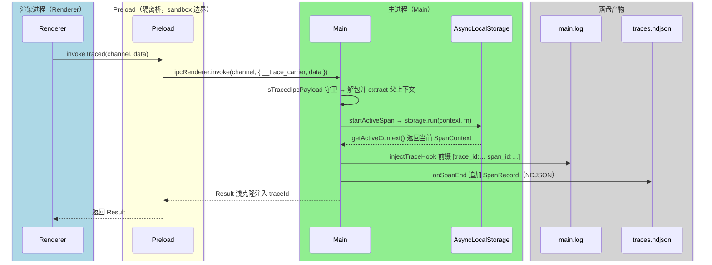

---

title: 全链路追踪（W3C-trace）
description: W3C traceparent 从 Preload 穿透主进程，AsyncLocalStorage 维持上下文。
---

# 全链路追踪（W3C-trace）

> **TL;DR**：业务 IPC 自动携带轻量 W3C `traceparent` 上下文；主进程借助 `AsyncLocalStorage` 维持调用链路，日志自动挂载 `[trace_id:...]`，返回结果回注 `traceId`，无需引入繁重的外部 APM SDK。

## 1. 选型理由

桌面跨进程调用排障经常陷入困境：
- 用户报告“点击按钮报错”，开发者在前端看到 UI 报错，却无法从主进程大量日志中找到是哪一次 IPC 失败引发的。
- 传统 OpenTelemetry / SkyWalking 等 SDK 体积极大且依赖 Node 原生动态 Hook，打包进 Electron ASAR 时极易产生兼容性与体积问题。

工程采用纯函数实现的 W3C Trace Context 规范，零外部 SDK 实现跨端穿透。

→ 官方文档：[W3C Trace Context](https://www.w3.org/TR/trace-context/)（读它能了解 `traceparent` 字段格式、`trace-id` / `parent-id` / `trace-flags` 规范与跨进程透传约定）。

## 2. 核心机制



链路只有一条主线：Preload 在 `invokeTraced` 里生成 `traceId` / `spanId` 并序列化成 W3C `traceparent`，塞进 `__trace_carrier`；主进程 `handleTraced` 先用 `isTracedIpcPayload` 守卫判定载荷，命中才解包并 `extract` 出父上下文，再交给 `Tracer.startActiveSpan` 在 `AsyncLocalStorage` 里 `run`；此后这条异步调用链上的日志前缀、Span 落盘、返回值注入都从同一份上下文取值。

### 关键实现：Preload 生成并注入 traceparent

所有业务 IPC 请求都由 `invokeTraced` 生成 W3C 上下文，作为元数据随载荷下发；`callOptions` 一并透传，供主进程决定是否记录成功 Span：

→ 源码：[packages/preload/src/telemetry/ipc-tracer.ts](https://github.com/BanShan-Alec/electron-react-monorepo-template/blob/main/packages/preload/src/telemetry/ipc-tracer.ts)

```ts
export async function invokeTraced<R = unknown, T = unknown>(
  channel: string,
  data?: T,
  callOptions?: IpcCallOptions,
): Promise<R> {
  const traceId = generateTraceId();
  const spanId = generateSpanId();
  const traceparent = serializeTraceParent({
    traceId,
    spanId,
    traceFlags: '01',
  });

  const payload: TracedIpcPayload<T | undefined> = {
    __trace_carrier: {
      traceparent,
    },
    callOptions,
    data,
  };

  return ipcRenderer.invoke(channel, payload);
}
```

### 关键实现：主进程解包并在 AsyncLocalStorage 中续接

`handleTraced`（[packages/main/src/telemetry/ipc-tracer.ts](https://github.com/BanShan-Alec/electron-react-monorepo-template/blob/main/packages/main/src/telemetry/ipc-tracer.ts)）注册 `ipcMain.handle`：先用 `isTracedIpcPayload` 判断入参，提取 `data`、`recordSuccess` 与 `__trace_carrier` 后调用 `tracer.startActiveSpan` 建立 `ipc.receive:` 子 Span。续接关键是 `this.storage.run(manualSpan.context, ...)`，使 handler 内任意深度的异步调用都能通过 `getActiveContext()` 取到当前上下文：

→ 源码：[packages/main/src/telemetry/tracer.ts](https://github.com/BanShan-Alec/electron-react-monorepo-template/blob/main/packages/main/src/telemetry/tracer.ts)

```ts
  // 节选：Tracer.startActiveSpan 绑定 AsyncLocalStorage 与成功采样开关
  public async startActiveSpan<T>(
    name: string,
    options: SpanOptions | undefined,
    fn: (span: ISpanScope) => Promise<T> | T,
  ): Promise<T> {
    const manualSpan = this.startManualSpan(name, options);

    return this.storage.run(manualSpan.context, async () => {
      const state: { status: 'OK' | 'ERROR' } = { status: 'OK' };
      // ... span: ISpanScope 方法代理省略
      try {
        const result = await fn(span);
        if (options?.recordSuccess !== false || state.status === 'ERROR') {
          manualSpan.end(state.status);
        }
        return result;
      } catch (err) {
        manualSpan.recordException(err);
        manualSpan.end('ERROR');
        throw err;
      }
    });
  }
```

### 三个出口：日志前缀、NDJSON、Result.traceId

1. **主进程日志前缀**：活跃上下文存在时，`LogManager` 的 `injectTraceHook` 从 `getActiveContext()` 取值，`main.log` 自动前缀 `[trace_id:xxxx span_id:yyyy]`。
2. **遥测落盘**：Span 结束时 `onSpanEnd` 监听器将 `SpanRecord` 以单行 JSON 写入 `traces.ndjson`。
3. **结果回注**：业务返回带 `success` 字段的 `Result` 时，`handleTraced` 浅克隆注入 `traceId`（不改原对象），渲染层请求层在报错时提取并写进日志。

### 启动耗时 span 速查

冷启动被切成两条独立 span，与 IPC span 同落 `traces.ndjson`：

| span 名                 | 覆盖区间                                         | 关键字段                                                     |
| :---------------------- | :----------------------------------------------- | :----------------------------------------------------------- |
| `app.initialization`    | 模块装配开始 → `await moduleRunner` 完成         | `initMs`（以进程启动为锚的总耗时）、事件 `app.modules_ready` |
| `window.initialization` | `window.created` → `dom_ready` → `ready_to_show` | `window.name` / `window.id`、`duration_ms`                   |

两者各起一条独立 trace，拼起来即「进程启动 → 窗口可显示」；启动阶段没有跨进程 trace 关联。

## 3. 桌面端避坑注意事项

- **日志管道本身严禁套用 traceparent**：
  - `IPC_CHANNELS.DIAGNOSTICS_LOG` 是唯一必须绕过 `handleTraced` 的特例。若日志管道自身生成 Span 并触发日志，将导致“日志触发遥测、遥测触发日志”的递归自噪。
- **高频成功轮询可关闭成功 Span 写入**：
  - 心跳或高频轮询可在 `IpcCallOptions` 传入 `recordSuccess: false`，仅在 `state.status === 'ERROR'` 或抛出异常时调用 `manualSpan.end` 写入 `traces.ndjson`。
- **页面职责边界**：
  - **本页负责**：W3C `traceparent` 跨进程传播、`AsyncLocalStorage` 上下文维持、Span 生命周期与启动耗时追踪。
  - **本页不负责**：日志文件轮转与限流机制见 [本地日志](/main/logging)；使用 `traceId` 进行三文件联查排障的实操步骤见 [日志与链路排查](/dx/log-troubleshooting)。
