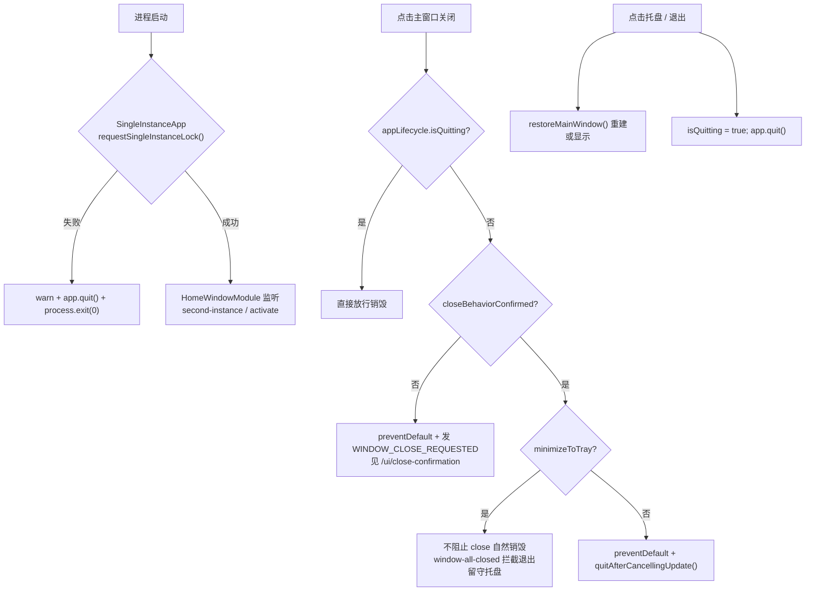

---

title: 托盘常驻与单实例（Tray + Single-instance）
description: 单实例锁防多开与二次唤起，关闭分流串联首次询问与自然销毁，原生托盘菜单与自启资格判定。
---

# 托盘常驻与单实例（Tray + Single-instance）

> **TL;DR**：主进程通过 `requestSingleInstanceLock()` 拦截重复启动，`HomeWindowModule` 监听 `second-instance` 唤醒现有窗口；点击关闭先判 `isQuitting` 与首次询问，确认后退守托盘自然销毁窗口释放内存；开机自启按 AUMID 归属，仅安装版副本可写登录项。

## 1. 选型理由

桌面客户端具有常驻与后台伴随特性：
1. **多实例冲突**：多次双击图标拉起独立进程，会争抢本地配置文件或调试端口。
2. **伪常驻内存膨胀**：关闭窗口时仅调用 `win.hide()`，Chromium DOM 树与渲染进程内存依然常驻后台。

工程通过「单实例抢锁 + `second-instance` 唤起 + 关闭自然销毁 + 托盘重建」实现轻量后台常驻。

→ 官方文档：[Electron app.requestSingleInstanceLock](https://www.electronjs.org/docs/latest/api/app#apprequestsingleinstancelockadditionaldata)（读它能了解单实例锁、`second-instance` 唤醒时序以及与 `Tray` 常驻协同的多平台差异）。

## 2. 核心机制



### 单实例互斥与对端唤醒

`SingleInstanceApp` 只负责抢锁，抢不到立即告警并退出；占有锁的实例由 `HomeWindowModule.enable()` 监听 `second-instance` 与 macOS `activate`，调用 `restoreOrCreateWindow(true)` 唤醒或重建主窗口（[home-window.module.ts](https://github.com/BanShan-Alec/electron-react-monorepo-template/blob/main/packages/main/src/modules/window/home-window.module.ts)）。

→ 源码：[packages/main/src/modules/single-instance.module.ts](https://github.com/BanShan-Alec/electron-react-monorepo-template/blob/main/packages/main/src/modules/single-instance.module.ts)

```ts
export class SingleInstanceApp implements AppModule {
  enable({ app }: { app: Electron.App }): void {
    const isSingleInstance = app.requestSingleInstanceLock();
    if (!isSingleInstance) {
      // 抢锁失败最常见成因：上一实例关闭主窗口后退守托盘、仍持有锁。
      // 一条 log.warn 同时落盘 main.log 并经控制台 transport 回显到终端
      const message =
        'Cannot acquire single instance lock: another instance is running (check the tray icon). Exiting.';
      getLogManager().scoped(this).warn(message);
      app.quit();
      process.exit(0);
    }
  }
}
```

### 关闭分流：首次询问、自然销毁与退出

点击主窗口关闭按钮按四级分支流转：处于退出流程直接放行；`closeGuardBypass` 为假且未完成首次确认时，阻止关闭并向渲染端发送 `WINDOW_CLOSE_REQUESTED`（渲染端弹窗与回传逻辑见 [首次关闭确认](/ui/close-confirmation)）；已确认且 `minimizeToTray` 为真时不调用 `preventDefault()`，让窗口自然销毁释放内存，由 [auto-terminate.module.ts](https://github.com/BanShan-Alec/electron-react-monorepo-template/blob/main/packages/main/src/modules/auto-terminate.module.ts) 在 `window-all-closed` 留守托盘；否则先取消在途更新再退出。

→ 源码：[packages/main/src/modules/window/home-window.module.ts](https://github.com/BanShan-Alec/electron-react-monorepo-template/blob/main/packages/main/src/modules/window/home-window.module.ts)

```ts
// 节选：HomeWindowModule 主窗口 close 事件四级分流
browserWindow.on('close', (event) => {
  if (appLifecycle.isQuitting) {
    this.closeRequestPending = false;
    return;
  }
  if (this.closeGuardBypass) {
    this.closeGuardBypass = false;
  } else if (!getAppConfigStore().get('closeBehaviorConfirmed')) {
    event.preventDefault();
    this.closeRequestPending = true;
    sendToWindow(WINDOW_IDS.HOME, IPC_CHANNELS.WINDOW_CLOSE_REQUESTED, null);
    return;
  }
  const shouldMinimizeToTray = getAppConfigStore().get('minimizeToTray');
  if (shouldMinimizeToTray) {
    logger.info('Home window closed and destroyed -> running in tray');
  } else {
    event.preventDefault();
    if (!this.quitAfterCancelPending) {
      this.quitAfterCancelPending = true;
      void this.quitAfterCancellingUpdate();
    }
  }
});
```

### 托盘菜单原生多语言与退出防护

托盘菜单文案由轻量函数 `mainMessage(lang, key)` 驱动，退出前必须先置位 `appLifecycle.isQuitting = true`：

→ 源码：[packages/main/src/modules/tray.module.ts](https://github.com/BanShan-Alec/electron-react-monorepo-template/blob/main/packages/main/src/modules/tray.module.ts)

```ts
// 节选：TrayManager.updateLanguage 托盘菜单模板与显式退出标记
this.contextMenu = Menu.buildFromTemplate([
  {
    label: mainMessage(lang, 'trayShowMainWindow'),
    click: () => this.restoreMainWindow(),
  },
  {
    label: mainMessage(lang, 'trayCheckUpdates'),
    click: () => {
      this.logger.info('User requested update check');
      updaterService.check().catch((err) => {
        this.logger.warn('Failed to check for updates from tray:', err);
      });
      getUpdaterWindowModule()
        .show()
        .catch((err) => {
          this.logger.error('Failed to show updater window from tray:', err);
        });
    },
  },
  { type: 'separator' },
  {
    label: mainMessage(lang, 'trayQuit'),
    click: () => {
      appLifecycle.isQuitting = true;
      app.quit();
    },
  },
]);
```

### 开机自启的系统登录项归属

Windows 登录项按 AppUserModelId（AUMID）写入注册表，同一应用身份仅占一条：免安装副本与安装版共用 `appId` 和 `userData`，若允许副本写登录项会直接覆盖安装版记录。因此 `AutoLaunchService` 依据编译期注入主进程 bundle 的 `__BUILD_REPO_ROOT__` 判定当前副本位置：

| 可执行文件位置                                   | 判定              | 结果                                |
| :----------------------------------------------- | :---------------- | :---------------------------------- |
| `pnpm build:unpack` 产物                         | 仓库内 → 就地副本 | 拒绝读写，开关置灰                  |
| `pnpm build:win` 遗留的 `dist/win-unpacked`      | 仓库内 → 就地副本 | 同样拒绝（`--skip-build` 不会串味） |
| 安装到 `Program Files` / `Applications` / `/opt` | 仓库外 → 安装版   | 正常管理开机自启                    |

→ 源码：[packages/main/src/services/auto-launch.service.ts](https://github.com/BanShan-Alec/electron-react-monorepo-template/blob/main/packages/main/src/services/auto-launch.service.ts)

## 3. 桌面端避坑注意事项

- **托盘常驻切勿滥用 `win.hide()`**：
  - 允许窗口自然销毁可释放 Chromium 渲染进程与 GPU 显存；再次点击托盘或二次启动时通过 `restoreOrCreateWindow(true)` 重建窗口即可。
- **退出应用必须先置位 `appLifecycle.isQuitting = true`**：
  - 托盘「退出应用」菜单项必须先设置该标记再 `app.quit()`，避免再次被 `close` 拦截或留在托盘。
- **Windows 托盘图标直传 `.ico` 文件路径**：
  - Windows 向 `new Tray(iconPath)` 传入含多尺寸 DPI 的 `.ico` 路径，由系统按缩放比选图；macOS 保留全彩图标（不设 template image）并 `resize` 至 16×16。
- **开机自启不要交给免安装副本**：
  - 在 `dist/win-unpacked` 联调时自启开关会提示就地副本不可管理；验证系统登录项需使用真实安装包。
- **页面职责边界**：
  - **本页负责**：主进程单实例抢锁与唤醒、窗口关闭分流、托盘菜单与自启副本资格判定。
  - **本页不负责**：首次关闭确认的渲染端弹窗与状态回传见 [首次关闭确认](/ui/close-confirmation)；开发态 CLI 单实例与端口预检见 [启动预检](/dx/startup-preflight)；配置持久化机制见 [配置持久化](/main/config-persistence)。
