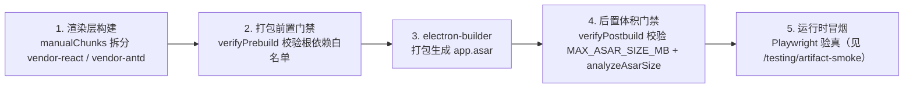

---

title: 分包与体积门禁（Chunk + Asar）
description: 渲染层按稳定性分块，构建前后分别守住根依赖边界与 app.asar 物理体积上限。
---

# 分包与体积门禁（Chunk + Asar）

> **TL;DR**：渲染端第三方依赖按稳定性拆分为 `vendor-react` 与 `vendor-antd`；打包前由静态门禁拦截根目录非法依赖（见依赖管理页），打包后实测 `app.asar` 体积（默认上限 10MB）并输出模块占比与 Top 5 文件。

## 1. 选型理由

桌面客户端体积极易悄悄膨胀失控：
1. **依赖链污染**：在根目录误装运行时库或引入重型调试包，打包工具会将大量无关 `node_modules` 卷入 `app.asar`。
2. **分包策略退化**：若不做路径级拆分，第三方运行时与业务代码揉进同一产物，影响缓存复用与首屏解析效率。

工程通过「渲染端精细分块 + 打包前置依赖拦截 + 打包后 ASAR 体积校验」控制交付体积。

→ 官方文档：[Vite 构建分块策略（manualChunks）](https://vite.dev/guide/build#chunking-strategy)（读它能了解 Rolldown / Rollup `manualChunks` 的分块原理与外围依赖隔离方式）。

## 2. 核心机制



### 渲染端精细路径分包（`manualChunks`）

以正则精确匹配 `node_modules` 子路径，避免 `@lingui/react` 等外围库误入核心运行时分块：

→ 源码：[packages/renderer/vite.config.ts](https://github.com/BanShan-Alec/electron-react-monorepo-template/blob/main/packages/renderer/vite.config.ts)

```ts
        manualChunks(id) {
          if (id.includes('node_modules')) {
            // 1. 最稳定核心运行时：React 核心包（精准路径匹配，避免 @lingui/react 等外围库污染）
            if (/[\\/]node_modules[\\/](react|react-dom|scheduler)[\\/]/.test(id)) {
              return 'vendor-react';
            }
            // 2. UI 框架：Ant Design 及其样式/图标/底层 RC 库
            if (/[\\/]node_modules[\\/](antd|@ant-design|rc-[a-z0-9-]+)[\\/]/.test(id)) {
              return 'vendor-antd';
            }
          }
        },
```

### 前置根依赖白名单门禁（指针）

`scripts/verify-prebuild.ts` 在打包前静态校验根目录 `package.json` 的 `dependencies` 仅限 `@app/main`（防止多余运行时库被扫描进 `app.asar`）。该门禁的完整源码摘录与依赖归属规则见 [依赖管理（Monorepo）](/engineering/dependency-management)。

### 后置 ASAR 物理体积门禁（`verify-postbuild`）

打包完成后，`verifyPostbuild` 先读取 `MAX_ASAR_SIZE_MB`（默认 `10`），调用 `analyzeAsarSize` 解析 ASAR 文件头打印模块占比与 Top 5 最大文件，超限立即抛错中断流水线：

→ 源码：[scripts/verify-postbuild.ts](https://github.com/BanShan-Alec/electron-react-monorepo-template/blob/main/scripts/verify-postbuild.ts)

```ts
// 节选：verifyPostbuild 读取体积上限、剖析组成并在超限时阻断
const maxAsarSizeMb =
  options.maxAsarSizeMb ?? Number(getRepoEnvValue(repoEnv, 'MAX_ASAR_SIZE_MB') || 10);
// ... 省略产物发现与 app-update.yml 校验
const asarStat = fs.statSync(artifact.asarPath);
const asarSizeMb = asarStat.size / (1024 * 1024);
console.log(
  `📊 [verify-postbuild] asar 总体积: ${asarSizeMb.toFixed(2)} MB (${asarStat.size.toLocaleString()} bytes) [阈值上限: ${maxAsarSizeMb.toFixed(2)} MB]`,
);

analyzeAsarSize(artifact.asarPath);

if (asarSizeMb > maxAsarSizeMb) {
  throw new Error(
    `❌ [verify-postbuild] asar 体积超过门禁上限 (${asarSizeMb.toFixed(2)} MB > ${maxAsarSizeMb.toFixed(2)} MB)，发生体积异常膨胀防劣化失败！`,
  );
}
```

校验通过后继续执行跨平台进程拉起与 `body.app-startup-ready` 冒烟验真，完整流程见 [产物冒烟测试](/testing/artifact-smoke)。

## 3. 桌面端避坑注意事项

- **`MAX_ASAR_SIZE_MB` 阈值配置**：
  - 默认上限为 `10` MB，可在根目录 `.env` 声明 `MAX_ASAR_SIZE_MB`（或在调用 `verifyPostbuild({ maxAsarSizeMb })` 时覆盖）。引入大体积本地数据时应同步评估阈值与分包，而非跳过校验。
- **`--skip-verify` 仅作紧急调试逃生门**：
  - `scripts/build.ts` 支持传入 `--skip-verify`（如 `pnpm build:win -- --skip-verify`）跳过后置体积门禁与冒烟测试，仅用于排查打包器自身问题，发版流水线严禁开启。
- **静态大文件与原生插件勿打入 ASAR**：
  - 原生 `.node` 依赖走 `asarUnpack`，独立静态大文件走 `extraResources`，避免 ASAR 归档膨胀拖慢读取性能。
- **页面职责边界**：
  - **本页负责**：渲染层 `manualChunks` 拆分策略与打包后 `app.asar` 体积门禁及构成剖析。
  - **本页不负责**：根依赖白名单门禁源码与说明见 [依赖管理（Monorepo）](/engineering/dependency-management)；`electron-builder` 文件排除清单见 [应用打包](/delivery/packaging)；打包产物启动与 Playwright 冒烟测试见 [产物冒烟测试](/testing/artifact-smoke)。
