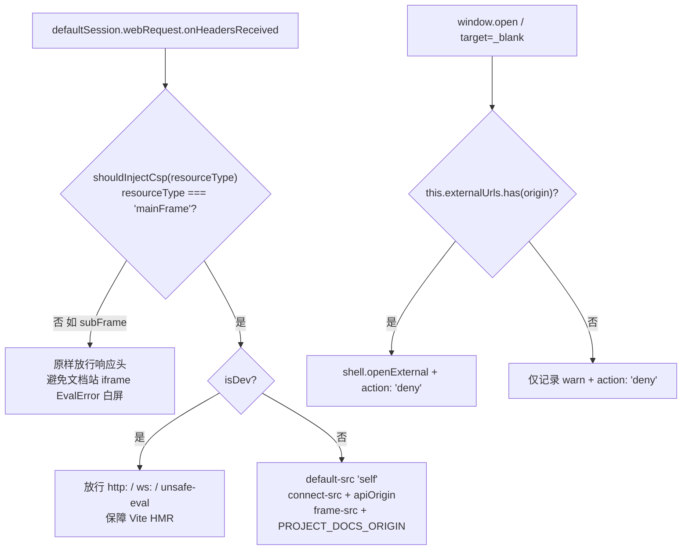

---

title: 内容安全策略（CSP）
description: 生产态收紧主框架 CSP 响应头并放行文档站 frame-src，外链与导航双白名单拦截全归主进程。
---

# 内容安全策略（CSP）

> **TL;DR**：生产环境剔除 `'unsafe-eval'` 与通配 `https:`，仅对 `mainFrame` 注入 CSP 并显式放行 `PROJECT_DOCS_ORIGIN` 的 `frame-src`；开发态按需放行 Vite HMR 的 `ws:`；窗口外链与页内导航均由主进程白名单裁决。

## 1. 选型理由

Electron 默认未开启严格安全策略时，渲染进程面临两类高危攻击面：
1. **XSS 穿透与动态代码执行**：一旦页面存在注入漏洞，恶意脚本可加载外部远程脚本或通过 `eval()` 执行任意逻辑。
2. **钓鱼导航劫持**：脚本可通过 `window.open` 或修改 `window.location` 将窗口导向恶意站点。

工程采取「主框架分环境 CSP + `setWindowOpenHandler` / `will-navigate` 双白名单」把安全裁决权收归主进程。

→ 官方文档：[MDN Content Security Policy (CSP)](https://developer.mozilla.org/en-US/docs/Web/HTTP/CSP)（读它能了解 `default-src` 回退链、`frame-src` 语义以及多个 CSP 响应头叠加取交集的行为）。

## 2. 核心机制



### 生产与开发双分流 CSP 注入（含 `mainFrame` 门控与 `frame-src`）

主进程只在 `details.resourceType === 'mainFrame'` 时追加 CSP 响应头；生产态显式放行 `frame-src ${docsOrigin}`（取自 `PROJECT_DOCS_ORIGIN`），避免被 `default-src 'self'` 拦截：

→ 源码：[packages/main/src/modules/security/csp.ts](https://github.com/BanShan-Alec/electron-react-monorepo-template/blob/main/packages/main/src/modules/security/csp.ts)

```ts
// 节选：分环境 CSP 构建与 mainFrame 单一注入门控
function buildCspPolicy({ isDev, apiOrigin, docsOrigin }: CspPolicyOptions): string {
  const connectSrc = apiOrigin ? `'self' ${apiOrigin}` : "'self'";

  if (isDev) {
    return "default-src 'self' 'unsafe-inline' 'unsafe-eval' data: blob: https: http: ws:;";
  }

  return `default-src 'self'; script-src 'self' 'unsafe-inline'; style-src 'self' 'unsafe-inline'; img-src 'self' data: blob:; connect-src ${connectSrc}; frame-src ${docsOrigin};`;
}

function shouldInjectCsp(resourceType: string | undefined): boolean {
  return resourceType === 'mainFrame';
}
// ... onHeadersReceived 回调内：
      if (!shouldInjectCsp(details.resourceType)) {
        callback({ responseHeaders });
        return;
      }
```

### 窗口外链与页内导航拦截

无论点击何种链接，`setWindowOpenHandler` 一律返回 `{ action: 'deny' }`，仅当协议为 `http:` / `https:` 且 `parsedUrl.origin` 命中 `this.externalUrls`（来自 `ALLOWED_EXTERNAL_URLS`）时委托系统默认浏览器打开：

→ 源码：[packages/main/src/modules/security/external-urls.ts](https://github.com/BanShan-Alec/electron-react-monorepo-template/blob/main/packages/main/src/modules/security/external-urls.ts)

```ts
// 节选：ExternalUrls.enable 恒拒绝应用内新开窗口，仅白名单域名转交系统浏览器
contents.setWindowOpenHandler(({ url }) => {
  try {
    const parsedUrl = new URL(url);
    if (parsedUrl.protocol !== 'http:' && parsedUrl.protocol !== 'https:') {
      this.logger.warn(`Blocked non-http(s) protocol navigation: ${url}`);
      return { action: 'deny' };
    }
    if (this.externalUrls.has(parsedUrl.origin)) {
      shell.openExternal(url).catch((err) => {
        this.logger.error('Failed to open external URL:', err);
      });
    } else {
      this.logger.warn(`Blocked opening of a disallowed external origin: ${parsedUrl.origin}`);
    }
  } catch (err) {
    this.logger.warn(`Malformed or invalid URL received: ${url}`, err);
  }
  return { action: 'deny' };
});
```

页内跳转由 `BlockNotAllowedOrigins`（[block-origins.ts](https://github.com/BanShan-Alec/electron-react-monorepo-template/blob/main/packages/main/src/modules/security/block-origins.ts)）监听 `will-navigate`，仅放行 `file:` 协议与 `allowedOrigins`（开发态为 dev server origin，生产态为 `file://` 与 `'null'`），其余直接 `event.preventDefault()`。

## 3. 桌面端避坑注意事项

- **顶层 `file://` 嵌入跨源文档站 iframe 的三重配合**：
  - 生产态主窗口运行在 `file://`，内置文档页通过 `<iframe sandbox="allow-scripts allow-same-origin allow-popups allow-forms">`（[DocsView](https://github.com/BanShan-Alec/electron-react-monorepo-template/blob/main/packages/renderer/src/features/docs/components/DocsView/index.tsx)）加载在线文档站。必须同时满足：**① 主框架 CSP 放行 `frame-src ${PROJECT_DOCS_ORIGIN}`**；**② `onHeadersReceived` 严格按 `mainFrame` 门控**（否则文档站子框架会被套上无 `'unsafe-eval'` 的 `script-src`，运行时抛 `EvalError` 白屏）；**③ iframe 保留 `allow-same-origin`** 使其自身 Service Worker 得以在文档站 origin 下注册（离线缓存机制见 [文档站离线缓存](/ui/docs-tab-offline)）。
- **首屏协调器内联脚本与 `script-src`**：
  - 首屏启动协调器内联在 `index.html` 中，若生产态移除 `script-src` 的 `'unsafe-inline'`，Chromium 会静默拦截内联脚本执行，导致 `body.app-startup-ready` 缺失并引发 E2E / 冒烟超时。
- **动态放行 `ELECTRON_APP_API_BASE_URL` 与追加叠加语义**：
  - 生产态通过 `getValidOrigin(process.env.ELECTRON_APP_API_BASE_URL ?? '')` 将网关 Origin 注入 `connect-src`，切勿恢复 `https:` 通配。`onHeadersReceived` 对已有 `Content-Security-Policy` 响应头做数组追加（叠加收紧而非覆盖）。
- **页面职责边界**：
  - **本页负责**：主进程分环境 CSP 注入、`mainFrame` 门控、`frame-src` 放行，以及 `setWindowOpenHandler` / `will-navigate` 外链与导航拦截。
  - **本页不负责**：文档站 iframe 的 Service Worker 缓存策略与 `offline.html` 回退见 [文档站离线缓存](/ui/docs-tab-offline)；`BrowserWindow` 沙箱参数见 [渲染进程沙箱](/security/sandbox)。
